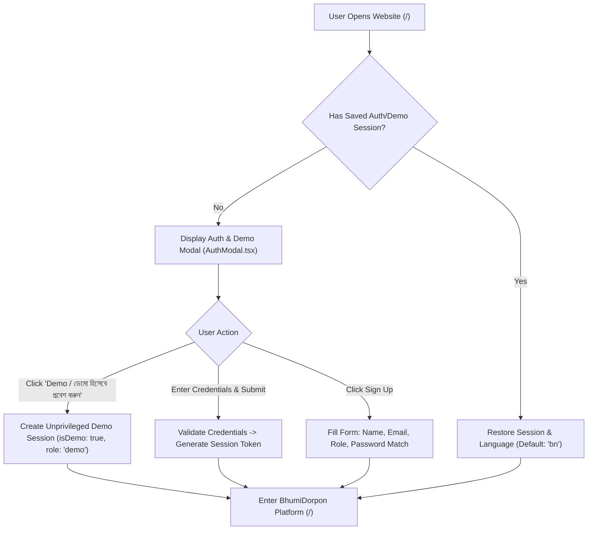
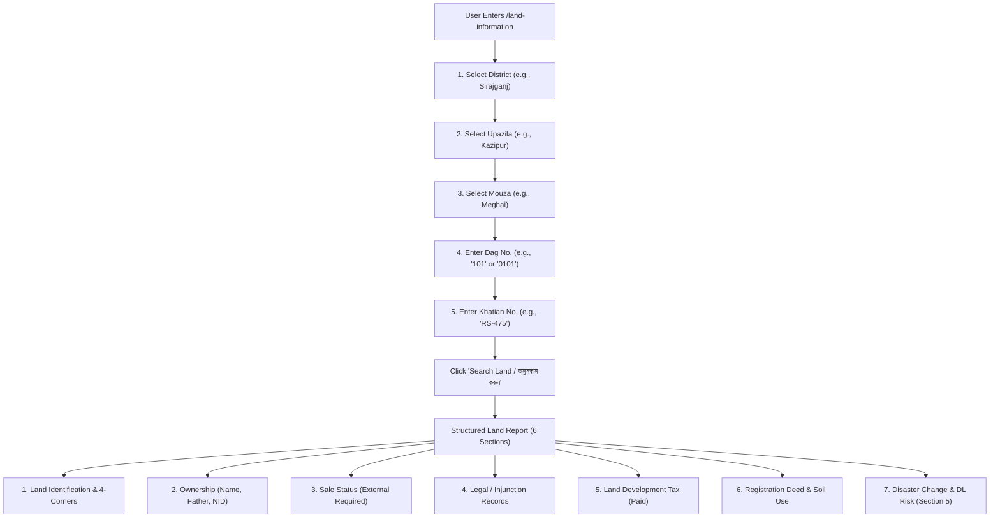
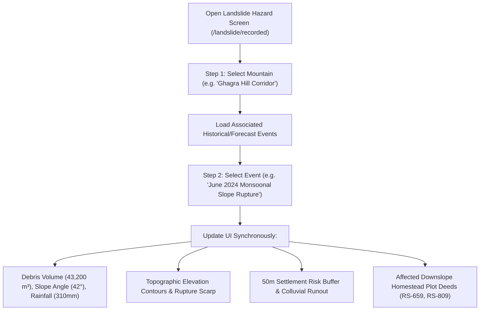
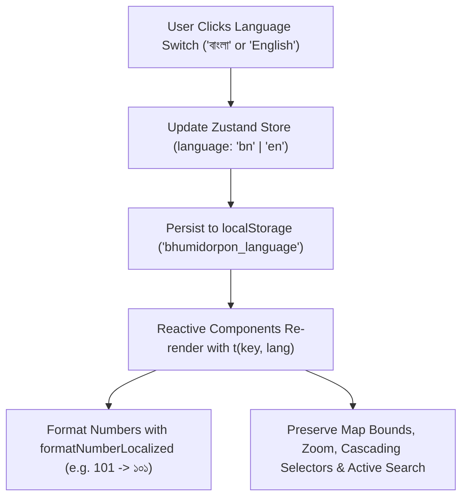

# Application Flow & User Flow — BhumiDorpon
**Bangladesh Cadastral Land-Change Records & Multi-Hazard Geospatial Dashboard**

---

> **Document Status:** Authoritative Navigation & Interaction Specification  
> **System Version:** 1.2 (Enhanced Demonstration Release)  
> **Team:** GeoNeural  
> **Last Updated:** October 2026  
> **Cross-References:** [Main Documentation](MAIN_PROJECT_DOCUMENTATION.md) | [PRD](PRD.md) | [TRD](TRD.md) | [System Architecture](ARCHITECTURE.md) | [Database Schema](DATABASE_SCHEMA.md) | [UI/UX Design System](UI_UX_DESIGN_SYSTEM.md) | [Authentication Specification](AUTH_SPECIFICATION.md) | [Testing & QA](TESTING_QA.md) | [Security Specification](SECURITY_SPECIFICATION.md)

---

## Table of Contents

- [1. Application Entry Point and Authentication Gate](#1-application-entry-point-and-authentication-gate)
- [2. Global Navigation, Header, & Layout Shell](#2-global-navigation-header--layout-shell)
- [3. Complete Application Sitemap & Route Hierarchy](#3-complete-application-sitemap--route-hierarchy)
- [4. Screen-by-Screen User Journeys](#4-screen-by-screen-user-journeys)
  - [4.1 Screen S0: Authentication & Demo Entry Modal (/login)](#41-screen-s0-authentication--demo-entry-modal-login)
  - [4.2 Screen S1: National Summary Dashboard (/)](#42-screen-s1-national-summary-dashboard-)
  - [4.3 Screen S2: Global "Land Information" Search (/land-information)](#43-screen-s2-global-land-information-search-land-information)
  - [4.4 Screen S3: Landslide Hazards with Mountain & Event Selector (/landslide)](#44-screen-s3-landslide-hazards-with-mountain--event-selector-landslide)
  - [4.5 Screen S4: River Erosion Side-by-Side Comparison (/river-erosion)](#45-screen-s4-river-erosion-side-by-side-comparison-river-erosion)
  - [4.6 Screen S5: Flood Event Map & Multi-Owner Registry (/flood)](#46-screen-s5-flood-event-map--multi-owner-registry-flood)
  - [4.7 Screen S6: Flood Owner Land Detail & 4-Corner GPS Readout](#47-screen-s6-flood-owner-land-detail--4-corner-gps-readout)
  - [4.8 Screen S7: Char Islands Accretion & State Khas Tracking (/char)](#48-screen-s7-char-islands-accretion--state-khas-tracking-char)
  - [4.9 Screen S8: Coastal Shifts & Tidal Shoreline Retreat (/coastal)](#49-screen-s8-coastal-shifts--tidal-shoreline-retreat-coastal)
  - [4.10 Screen S9: Platform Settings (About & Team)](#410-screen-s9-platform-settings-about--team)
- [5. Global Bilingual Language Switching Flow](#5-global-bilingual-language-switching-flow)
- [6. Top-Level "Explore Disasters" Scroll Navigation Flow](#6-top-level-explore-disasters-scroll-navigation-flow)
- [7. Google Earth 3D Parcel KML Interaction Flow](#7-google-earth-3d-parcel-kml-interaction-flow)
- [8. Empty-State, Validation, and Error Recovery Journeys](#8-empty-state-validation-and-error-recovery-journeys)

---

## 1. Application Entry Point and Authentication Gate

When a visitor opens BhumiDorpon (`/`), the application boots through the authentication and localization lifecycle:



1. **Session Check:** `useAppStore` inspects `localStorage` for `bhumidorpon_auth_session`.
2. **If No Active Session:** An interactive glassmorphic modal (`AuthModal.tsx`) appears.
3. **Demo Path (One Click):** Clicking **"Demo / ডেমো হিসেবে প্রবেশ করুন"** immediately grants unprivileged exploration access with zero friction.
4. **Login / Sign-Up Path:** Users can authenticate as Citizen, Surveyor, or Researcher.
5. **Language Initialization:** Defaults to Bangla (`'bn'`), formatting all interface tokens and numerals (`formatNumberLocalized`) in Bengali script.

---

## 2. Global Navigation, Header, & Layout Shell

Navigation is anchored by the **persistent 72px left-hand icon sidebar (`AppSidebar.tsx`)** and the **action toolbar in `AppHeader.tsx`**:

```mermaid
graph TD
    AppShell["BhumiDorpon Shell"] --> Header["AppHeader (Top Bar)"]
    AppShell --> Sidebar["AppSidebar (72px Left)"]
    AppShell --> MainContent["Main Viewport"]
    
    Header --> LandSearchBtn["'Land Information / ভূমির তথ্য' Button"]
    Header --> LangToggle["Language Switch (বাংলা | English)"]
    Header --> ScrollDisasterBtn["'Explore Disasters / দুর্যোগসমূহ দেখুন'"]
    Header --> UnitToggle["Area Unit (Decimal | Acre | Hectare)"]
    Header --> PeriodDropdown["Period Filter (1y | 3y | 5y | All)"]
    Header --> UserBadge["User Status (Demo / Authenticated / Logout)"]
    
    Sidebar --> NavHome["Home Dashboard (/)"]
    Sidebar --> NavLandInfo["Land Information (/land-information)"]
    Sidebar --> NavRiver["River Erosion (/river-erosion)"]
    Sidebar --> NavFlood["Flood Monitoring (/flood)"]
    Sidebar --> NavSlide["Landslide Hazards (/landslide)"]
    Sidebar --> NavChar["Char Islands (/char)"]
    Sidebar --> NavCoast["Coastal Shifts (/coastal)"]
    Sidebar --> NavDev["UI Components (/dev/components)"]
    Sidebar --> NavSettings["Settings (/settings)"]
```



---

## 3. Complete Application Sitemap & Route Hierarchy

```text
Home Dashboard                                          /
├── Initial Authentication & Demo Gateway              /login (or modal on /)
├── Land Information Search & Hazard Risk Report       /land-information
│   └── 6 Structured Sections + Section 5 DL Risk
├── River Erosion                                       /river-erosion
│   ├── Mode Dispatcher                                 /river-erosion
│   ├── A. Recorded Mode                                /river-erosion/recorded
│   └── B. Forecast Mode (ConvLSTM Projection)          /river-erosion/forecast
├── Flood Monitoring                                    /flood
│   └── Event Inundation Map & Owner Registry           /flood/[mouzaId]/[floodId]
│        └── Flood Owner Land Page (4 Corners GPS)      /flood/[mouzaId]/[floodId]/owner/[ownerId]
├── Landslide Hazards (with Mountain & Event Selector)  /landslide
│   ├── A. Recorded Mode (Slope Rupture & Debris)       /landslide/recorded
│   └── B. Forecast Mode (InSAR Slope Susceptibility)   /landslide/forecast
├── Char Islands                                        /char
│   ├── A. Recorded Mode                                /char/recorded
│   └── B. Forecast Mode                                /char/forecast
├── Coastal Shifts                                      /coastal
│   ├── A. Recorded Mode                                /coastal/recorded
│   └── B. Forecast Mode                                /coastal/forecast
├── UI Component Showcase                               /dev/components
└── Settings Hub                                        /settings
    ├── About Project Documentation                     /settings/about
    └── Team GeoNeural Roster                           /settings/team
```

---

## 4. Screen-by-Screen User Journeys

### 4.1 Screen S0: Authentication & Demo Entry Modal (`/login`)
- **Visuals:** Space Grotesk typography, lime accents, lock and mail icons, password visibility toggles.
- **Demo Access Banner:** Prominent lime button **"Demo / ডেমো হিসেবে প্রবেশ করুন"** with subtitle *"Explore dashboard without logging in"*.
- **User Tabs:** Login (Email/Username + Password), Sign-Up (Full Name, Email, Username, Role, Password, Confirm Password), Forgot Password notice.

### 4.2 Screen S1: National Summary Dashboard (`/`)
- **Header:** Title, subtitle, Explore Disasters button, Mode switch (Recorded Data | Forecast DL Model).
- **Row 1:** Hero Trend Card (8 cols) showing national land loss vs. accretion, alongside Compensation Budget Card (4 cols).
  - *Rule 5 Enforcement:* In Forecast mode, paid, approved, and pending progress bars are suppressed; only projected budget requirement is displayed.
- **Row 2:** Hazard Breakdown Bar Chart (5 cols) and Top Impacted Districts Ranked List (7 cols).
- **Right Column:** "Now" Live telemetry panel (active erosion points, monitored mouzas, critical alert pills) and Leaflet map preview.
- **Bottom Section (`#disaster-options`):** Five dedicated hazard cards with one-click "Explore" navigation.

### 4.3 Screen S2: Global "Land Information" Search (`/land-information`)
- **Search Form:**
  1. District dropdown (dependent parent)
  2. Upazila dropdown (filters by District)
  3. Mouza dropdown (filters by Upazila)
  4. Dag number input (text field preserving leading zeros e.g. `0101`, `101`)
  5. Khatian number input (e.g. `RS-475`)
  - Search and Reset buttons with instant validation alerts.
- **Structured Cadastral Report:**
  - **Section A (Land Identification):** Area, Land Classification, Coordinates, 4 Corners (NW, NE, SE, SW), Physical Status.
  - **Section B (Ownership):** Recorded Owner, Father's Name, 100% Share, Masked NID, Recording Date.
  - **Section C (Sale Status):** Listed for sale status, price details, verification source.
  - **Section D (Legal & Court Disputes):** Civil cases, Section 144/145 injunctions, court reference.
  - **Section E (Land Development Tax):** Payment up-to-date verification, receipt number, dues balance.
  - **Section F (Registration History & Land Use):** Deed number, mutation khatian, sub-registry office, soil condition.
  - **Section 5 (Disaster Change & Deep Learning Risk Analysis):**
    - 5.1 Historical land loss events (Erosion, flood inundation, sediment deposition).
    - 5.2 Multi-hazard DL risk projections (River erosion %, Flood %, Landslide %, Coastal % with model name and confidence scores).
    - 5.3 Completely submerged parcel handling (preserves cadastral identity and former deed area).



### 4.4 Screen S3: Landslide Hazards with Mountain & Event Selector (`/landslide`)
- **Two-Step Selector:**
  1. User selects Mountain from Chittagong Hill Tracts catalog (e.g., *Ghagra Hill Corridor*, *Furamon Peak Ridge*, *Chimbuk Hill Crest*).
  2. Event dropdown populates with corresponding historical events or forecast scenarios.
  3. User selects event (e.g., *June 2024 Monsoonal Slope Rupture*).
- **Dynamic Interface Update:**
  - Title and event date update instantly.
  - Displaced debris volume ($43,200\text{ m}^3$) and slope gradient ($42^\circ$) update.
  - Rainfall saturation threshold (mm/24h) and early warning casualties avoided count update.
  - Topographic contours, failure scar, debris runout zone, and downslope homestead table update synchronously.



### 4.5 Screen S4: River Erosion Side-by-Side Comparison (`/river-erosion`)
- Cascading selection: District &rarr; Upazila &rarr; River &rarr; Mouza.
- Side-by-side synchronized Leaflet maps (Before on left, After on right).
- Pan/zoom locks with re-entrancy prevention.
- Cadastral deed table listing lost decimals, estimated compensation, and payment status.

### 4.6 Screen S5: Flood Event Map & Multi-Owner Registry (`/flood`)
- Unified flow: District &rarr; Upazila &rarr; Mouza &rarr; Flood Event.
- Map displaying depth classes: Shallow ($< 0.5\text{m}$), Moderate ($0.5\text{m} - 1.5\text{m}$), Deep ($> 1.5\text{m}$).
- Owner search bar filtering by landowner name, Dag number, or Khatian number.

### 4.7 Screen S6: Flood Owner Land Detail & 4-Corner GPS Readout
- Dedicated landowner header with Name, Father's Name, Phone, and NID.
- Plot table displaying: Plot ID, Dag No., Khatian No., Land Class, Total Area, Flooded Area, and **Permanent 4-Corner GPS Readout (NW, NE, SE, SW to 6 decimal places)**.
- Actions: "Copy 4 Corners", "Copy All Coordinates", "Download GeoJSON", "Export CSV", and **"Open in Google Earth"** (client-side KML 2.2 export).

---

## 5. Global Bilingual Language Switching Flow



---

## 6. Top-Level "Explore Disasters" Scroll Navigation Flow

1. User views Home Dashboard (`/`).
2. Clicks button **"দুর্যোগসমূহ দেখুন" / "Explore Disasters"** in `AppHeader`.
3. Application queries `document.getElementById('disaster-options')`.
4. Checks `window.matchMedia('(prefers-reduced-motion: reduce)')`.
5. Executes smooth scroll animation (`behavior: 'smooth'`) to `#disaster-options`.
6. Element styling `scroll-mt-24` ensures sticky header and demo banner do not obscure the section title.

---

## 7. Google Earth 3D Parcel KML Interaction Flow

1. On Flood Owner Land Page, user clicks **"গুগল আর্থে দেখুন / Open in Google Earth"**.
2. Client-side serializer (`lib/googleEarth.ts`) builds KML 2.2 string containing parcel polygon, 4-corner GPS placemarks, style palettes, and LookAt camera altitude.
3. Automatically triggers `.kml` file download.
4. Generates direct Google Earth Web URL (`https://earth.google.com/web/@lat,lon,alt,0t,0r`).
5. Opens Google Earth in a new browser tab with camera focused on the selected parcel.

---

## 8. Empty-State, Validation, and Error Recovery Journeys

- **Land Search Miss:** Displays friendly empty card *"কোনো ভূমির রেকর্ড পাওয়া যায়নি / No Land Record Found"* with reset button.
- **Missing Required Search Fields:** Displays inline error alert *"অনুগ্রহ করে অন্তত জেলা ও উপজেলা নির্বাচন করুন"*.
- **Landslide Feature Out-of-Bounds:** Displays informative empty state *"No historical landslide recorded on this slope"* with reset to pilot cluster.
- **Data Network Error:** Displays error boundary with friendly message and "Try again" retry button.
