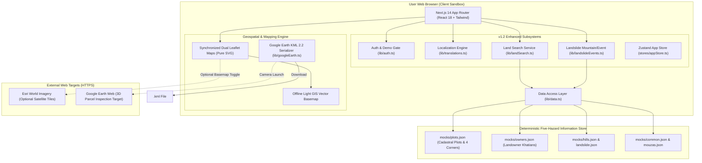
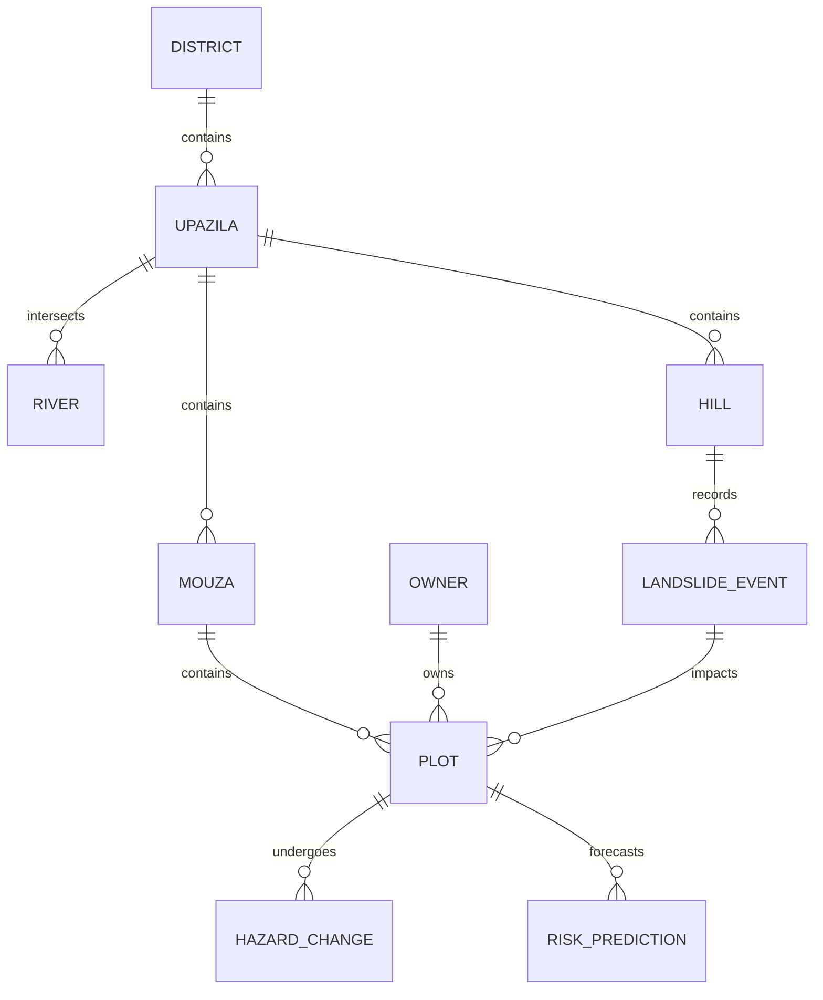

# System Architecture Documentation — BhumiDorpon
**Bangladesh Cadastral Land-Change Records & Multi-Hazard Geospatial Dashboard**

---

> **Document Status:** Authoritative Architectural Specification  
> **System Version:** 1.2 (Enhanced Demonstration Release)  
> **Team:** GeoNeural  
> **Last Updated:** October 2026  
> **Cross-References:** [Main Documentation](MAIN_PROJECT_DOCUMENTATION.md) | [PRD](PRD.md) | [TRD](TRD.md) | [App Flow & User Flow](APP_FLOW.md) | [Database Schema](DATABASE_SCHEMA.md) | [API Documentation](API_DOCUMENTATION.md) | [UI/UX Design System](UI_UX_DESIGN_SYSTEM.md) | [Authentication Specification](AUTH_SPECIFICATION.md) | [Testing & QA](TESTING_QA.md) | [Security Specification](SECURITY_SPECIFICATION.md)

---

## Table of Contents

- [1. Architectural Overview](#1-architectural-overview)
  - [1.1 Current Demonstration Architecture (v1.2)](#11-current-demonstration-architecture-v12)
  - [1.2 High-Level Architecture Diagram](#12-high-level-architecture-diagram)
- [2. Subsystem Layer Architecture](#2-subsystem-layer-architecture)
  - [2.1 Presentation & UI Layer](#21-presentation--ui-layer)
  - [2.2 Authentication & Demo Access Gate (lib/auth.ts)](#22-authentication--demo-access-gate-libauthts)
  - [2.3 Centralized Bilingual Localization Engine (lib/translations.ts)](#23-centralized-bilingual-localization-engine-libtranslationsts)
  - [2.4 Global "Land Information" Search Subsystem (lib/landSearch.ts)](#24-global-land-information-search-subsystem-liblandsearchts)
  - [2.5 Multi-Hazard Risk Prediction & Historical Quantification Engine](#25-multi-hazard-risk-prediction--historical-quantification-engine)
  - [2.6 Landslide Mountain & Historical Event Engine (lib/landslideEvents.ts)](#26-landslide-mountain--historical-event-engine-liblandslideeventsts)
  - [2.7 Geospatial Cartography & Dual-Map Synchronization Engine](#27-geospatial-cartography--dual-map-synchronization-engine)
  - [2.8 3D Google Earth Client-Side Serializer (lib/googleEarth.ts)](#28-3d-google-earth-client-side-serializer-libgoogleearthts)
  - [2.9 Deterministic Five-Hazard Information Store](#29-deterministic-five-hazard-information-store)
- [3. Google Earth vs. Google Earth Engine Architectural Placement](#3-google-earth-vs-google-earth-engine-architectural-placement)
- [4. Disaster Information Flow & Data Relationships](#4-disaster-information-flow--data-relationships)
- [5. Proposed Enterprise Production Cloud Architecture](#5-proposed-enterprise-production-cloud-architecture)
  - [5.1 Live Spatial Microservices](#51-live-spatial-microservices)
  - [5.2 Automated Cloud Remote-Sensing Pipeline](#52-automated-cloud-remote-sensing-pipeline)

---

## 1. Architectural Overview

### 1.1 Current Demonstration Architecture (v1.2)
BhumiDorpon v1.2 operates as a **high-performance, client-side geospatial web application** built with Next.js 14, TypeScript, Tailwind CSS, Zustand, and Leaflet. The system executes within the user's browser sandbox, querying a deterministic, relational mock JSON store through unified asynchronous services.

The v1.2 architecture features 6 dedicated subsystems:
1. **Authentication & Unprivileged Demo Access Subsystem:** Enforces initial session checks and isolates demo browsing.
2. **Centralized Bilingual Localization Subsystem:** Drives default Bangla rendering with zero layout shift and Bengali numerals (`০-৯`).
3. **5-Field Cadastral Land Search Subsystem:** Cascading search with leading zero preservation and 6-section structured reports.
4. **Historical Land Change & Deep-Learning Risk Prediction Pipeline:** Quantifies physical loss/accretion and returns multi-hazard ConvLSTM predictions.
5. **Two-Step Mountain and Historical Landslide Event Engine:** Connects mountains to discrete historical events and updates interface state dynamically.
6. **Smooth Scroll Navigation Engine:** Rapid access to hazard options via `#disaster-options`.

### 1.2 High-Level Architecture Diagram

---

## 2. Subsystem Layer Architecture

### 2.1 Presentation & UI Layer
- **Framework:** Next.js 14 App Router with React Server and Client Components.
- **Styling:** Tailwind CSS with a curated lime (`#D4F239`), ink (`#1A1A1A`), loss coral (`#EF4444`), and water blue (`#0284C7`) palette.
- **Typography:** Space Grotesk for headings and data readouts; Inter for UI prose.

### 2.2 Authentication & Demo Access Gate (`lib/auth.ts`)
- **Initialization:** Intercepts unauthenticated first-time visitors via `AuthModal.tsx`.
- **Demo Access Isolation:** Employs `createDemoSession()` to assign `isDemo: true` and `role: "demo"`. The session is saved to `localStorage` (`bhumidorpon_auth_session`).
- **Registration & Validation:** Enforces password confirmation, $\ge 6$ character length, and prevents duplicate accounts.

### 2.3 Centralized Bilingual Localization Engine (`lib/translations.ts`)
- **Dictionary:** Centralized `TRANSLATIONS` record mapping keys to `{ bn: string, en: string }`.
- **Bangla Default:** `useAppStore` initializes with `language: "bn"`.
- **Bengali Numerals:** `formatNumberLocalized(val, lang)` replaces ASCII digits $0-9$ with Bengali glyphs $০-৯$ when language is `'bn'`.
- **Zero Layout Shifts:** CSS flex and grid tiers prevent text expansion from disrupting card dimensions.

### 2.4 Global "Land Information" Search Subsystem (`lib/landSearch.ts`)
- **Cascading Resolution:** Resolves District &rarr; Upazila &rarr; Mouza &rarr; Dag No. &rarr; Khatian No.
- **Leading Zero Preservation:** Dag (`"0101"`) and Khatian (`"RS-475"`) are handled strictly as strings.
- **Structured 6-Section Report:** Assembles Identification, Ownership, Sale, Legal, Tax, Registration, and Disaster Risk data.
- **Standardized Badges:** Applies `verified`, `demo`, `unverified`, `unavailable`, and `external_required` badges.

### 2.5 Multi-Hazard Risk Prediction & Historical Quantification Engine
- **Historical Analysis:** Quantifies multi-temporal erosion, inundation, and sediment accretion.
- **Deep-Learning Risk Inference:** Provides genuine model risk scores across hazards (GeoAI-BD ConvLSTM, HydroSAR, InSAR SlopeNet).
- **Submerged Land Handling:** Physically submerged parcels are marked `historically_lost` while preserving deed area and former ownership.

### 2.6 Landslide Mountain & Historical Event Engine (`lib/landslideEvents.ts`)
- **Catalog:** Maps 12 Chittagong Hill Tracts mountains to historical events and forecast models.
- **Two-Step Selector:** `MountainEventSelector.tsx` handles Mountain selection &rarr; Event selection &rarr; Dynamic update of debris volume, slope angle, rainfall threshold, and downslope plots.

### 2.7 Geospatial Cartography & Dual-Map Synchronization Engine
- **Engine:** Pure Leaflet 1.9 with SVG vector rendering.
- **Basemaps:** Offline Light GIS vector basemap and optional Esri World Imagery.
- **Dual Map Sync:** Synchronizes pan and zoom between Before and After maps with re-entrancy protection.

### 2.8 3D Google Earth Client-Side Serializer (`lib/googleEarth.ts`)
- Pure client-side KML 2.2 serializer generating 3D extruded parcel polygons and launching Google Earth Web.

### 2.9 Deterministic Five-Hazard Information Store
- Local JSON mock files (`mocks/*.json`) loaded asynchronously by `lib/data.ts`.

---

## 3. Google Earth vs. Google Earth Engine Architectural Placement

| Dimension | Google Earth (Implemented in Prototype) | Google Earth Engine (GEE - Planned Pipeline) |
|---|---|---|
| **Architectural Role** | Client-Side 3D Viewer & KML Export | Cloud Planetary Geospatial Compute Engine |
| **Execution Environment** | User's Web Browser (`lib/googleEarth.ts`) | Google Cloud Infrastructure (Python/JavaScript API) |
| **Input Data** | Micro-cadastral 4-corner GPS coordinates | Petabytes of Sentinel-1/2 & Landsat rasters |
| **Output** | `.kml` file download and Earth Web launch | Cloud-Optimized GeoTIFFs (COGs) & Vector Polygons |
| **Status in Prototype** | **Fully Implemented & Verified (7 Unit Tests)** | **Proposed Cloud Pipeline (Non-Operational)** |

---

## 4. Disaster Information Flow & Data Relationships

---

## 5. Proposed Enterprise Production Cloud Architecture

In enterprise production:
- **Backend Service:** FastAPI (Python 3.11) with async endpoints.
- **Spatial Database:** PostgreSQL 16 + PostGIS 3.4 with GiST spatial indexing.
- **Tile Server:** Martin vector tile server streaming MVT tiles.
- **Earth Observation Ingestion:** Cloud Functions triggering automated GEE pipelines upon Sentinel-1 SAR orbit passes.
- **Deep Learning Workers:** Celery workers running ConvLSTM and U-Net models on GPU instances.
