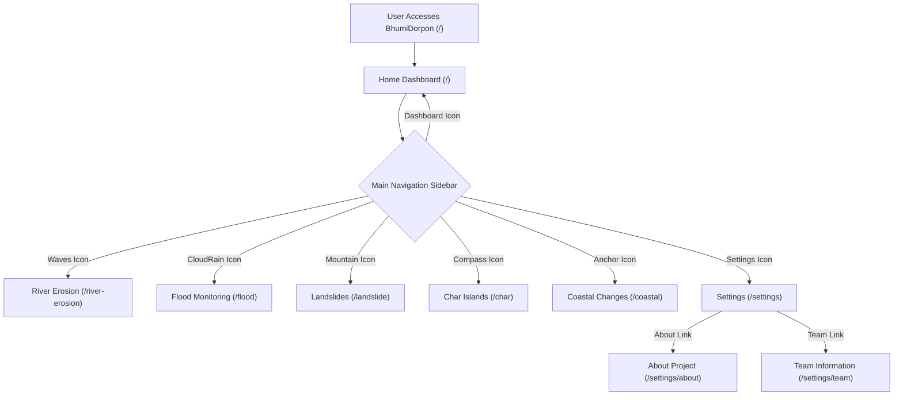
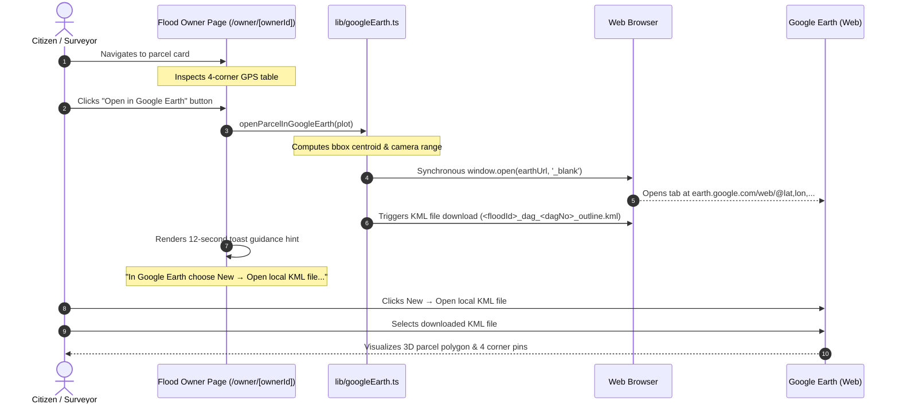
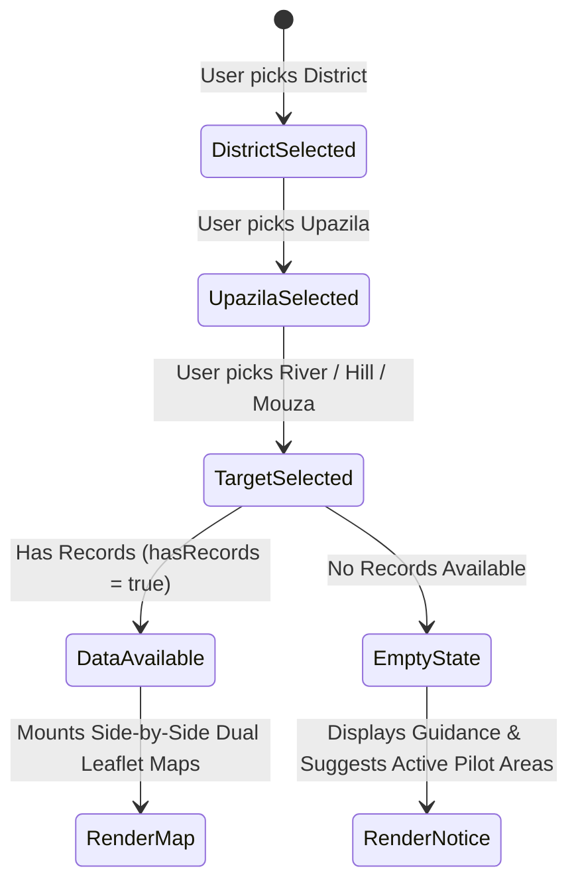
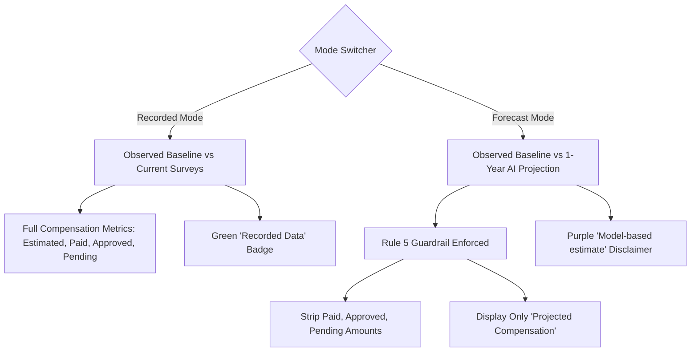

# Application Flow & User Flow — BhumiDorpon
**Bangladesh Cadastral Land-Change Records & Multi-Hazard Geospatial Dashboard**

---

> **Document Status:** Authoritative Navigation & Interaction Specification  
> **System Version:** 1.1 (Demonstration Release)  
> **Team:** GeoNeural  
> **Last Updated:** October 2026  
> **Cross-References:** [Main Documentation](MAIN_PROJECT_DOCUMENTATION.md) | [PRD](PRD.md) | [TRD](TRD.md) | [System Architecture](ARCHITECTURE.md) | [Database Schema](DATABASE_SCHEMA.md) | [UI/UX Design System](UI_UX_DESIGN_SYSTEM.md) | [Testing & QA](TESTING_QA.md)

---

## Table of Contents

- [1. Application Entry Point](#1-application-entry-point)
- [2. Global Navigation & Layout Shell](#2-global-navigation--layout-shell)
- [3. Complete Application Sitemap & Route Hierarchy](#3-complete-application-sitemap--route-hierarchy)
- [4. Screen-by-Screen User Journeys](#4-screen-by-screen-user-journeys)
  - [4.1 Screen S0: National Summary Dashboard (/)](#41-screen-s0-national-summary-dashboard-)
  - [4.2 Screen S1: Hazard Module Landing & Mode Dispatcher](#42-screen-s1-hazard-module-landing--mode-dispatcher)
  - [4.3 Screen S2: Cascading Selector & Result Navigation](#43-screen-s2-cascading-selector--result-navigation)
  - [4.4 Screen S3: Detailed Side-by-Side Map & Comparison View](#44-screen-s3-detailed-side-by-side-map--comparison-view)
  - [4.5 Screen S4: Flood Event Map & Multi-Owner Registry](#45-screen-s4-flood-event-map--multi-owner-registry)
  - [4.6 Screen S5: Flood Owner Land Detail Page & 4-Corner Readout](#46-screen-s5-flood-owner-land-detail-page--4-corner-readout)
  - [4.7 Screen S6: Platform Settings Hub (About & Team)](#47-screen-s6-platform-settings-hub-about--team)
- [5. Google Earth User Interaction Flow](#5-google-earth-user-interaction-flow)
- [6. Selector Chain Cascading Logic](#6-selector-chain-cascading-logic)
- [7. Recorded vs. Forecast Interaction Flow](#7-recorded-vs-forecast-interaction-flow)
- [8. Empty-State and Error Recovery Journeys](#8-empty-state-and-error-recovery-journeys)

---

## 1. Application Entry Point

When a user accesses BhumiDorpon, the application boots at the **Root URL (`/`)**. The entry layout initializes essential client-side providers and interface primitives:
- **`QueryProvider`**: Instantiates TanStack React Query client with 5-minute stale-time caching.
- **`appStore`**: Loads default user preferences (Area Unit: `Decimal`, Basemap: `Light GIS`, Mode: `Recorded`).
- **`AppHeader` & `AppSidebar`**: Renders the persistent navigation shell.
- **`DemoBanner`**: Injects the sticky top disclaimer: *"Demo data: all names, plots and figures are fictional."*

---

## 2. Global Navigation & Layout Shell

Navigation is managed via the **fixed 72px left-hand icon sidebar (`AppSidebar.tsx`)** which expands on desktop hover and remains accessible via keyboard navigation.



---

## 3. Complete Application Sitemap & Route Hierarchy

```text
Home Dashboard                                          /
├── River Erosion                                       /river-erosion
│   ├── Mode Dispatcher                                 /river-erosion
│   ├── A. Recorded Mode                                /river-erosion/recorded?d=&u=&r=
│   │   └── Detailed Side-by-Side Mouza View            /river-erosion/recorded/[mouzaId]
│   └── B. Forecast Mode                                /river-erosion/forecast?d=&u=&r=
│       └── Detailed Side-by-Side Mouza View            /river-erosion/forecast/[mouzaId]
├── Flood Monitoring                                    /flood?d=&u=&m=&year=
│   └── Event Overview & Landowner Registry             /flood/[mouzaId]/[floodId]
│        └── Dedicated Flood Owner Land Detail Page     /flood/[mouzaId]/[floodId]/owner/[ownerId]
├── Landslides                                          /landslide
│   ├── Mode Dispatcher                                 /landslide
│   ├── A. Recorded Mode                                /landslide/recorded?d=&u=&h=
│   │   └── Detailed DEM Hillshade & Scarp View         /landslide/recorded/[eventId]
│   └── B. Forecast Mode                                /landslide/forecast?d=&u=&h=
│       └── Detailed Predictive Susceptibility View     /landslide/forecast/[eventId]
├── Char Formation & Erosion                            /char
│   ├── Mode Dispatcher                                 /char
│   ├── A. Recorded Mode                                /char/recorded?d=&u=&r=
│   │   └── Detailed Island Accretion/Erosion View      /char/recorded/[resultId]
│   └── B. Forecast Mode                                /char/forecast?d=&u=&r=
│       └── Detailed 1-Year Predictive Morphodynamics   /char/forecast/[resultId]
├── Coastal Erosion & Land Accretion                    /coastal
│   ├── Mode Dispatcher                                 /coastal
│   ├── A. Recorded Mode                                /coastal/recorded?d=&u=
│   │   └── Detailed Shoreline Retreat & Mudflats View  /coastal/recorded/[resultId]
│   └── B. Forecast Mode                                /coastal/forecast?d=&u=
│       └── Detailed Predictive Coastal Dynamics View   /coastal/forecast/[resultId]
└── Settings Hub                                        /settings
    ├── About Project View                              /settings/about
    └── Team Information View                           /settings/team
```

All selector state parameters (`d`=district, `u`=upazila, `r`=river, `h`=hill, `m`=mouza, `year`=event year) are automatically reflected in the URL query string. This guarantees that page reloads, browser back/forward buttons, and shared links preserve the exact selection state.

---

## 4. Screen-by-Screen User Journeys

### 4.1 Screen S0: National Summary Dashboard (`/`)
1. **Mode Switcher:** User selects between `Recorded` and `Forecast` tabs in the upper-right corner.
   - *Recorded:* Displays verified historical losses, gained land, affected owners, and disbursed compensation sums (`Paid`, `Approved`, `Pending`).
   - *Forecast:* Updates KPI cards to show projected vulnerability; strictly removes `Paid`, `Approved`, and `Pending` compensation numbers in compliance with Rule 5.
2. **Global Area Unit Conversion:** Toggling the unit switcher (`Decimal` | `Acre` | `Hectare`) immediately converts all numerical metrics across the dashboard.
3. **Exploratory Visualizations:**
   - User inspects the **Multi-Year Trend Chart** to evaluate annual net land change.
   - User reviews the **Hazard Breakdown Chart** to compare impacts across the 5 domains.
   - User reviews the **Top Impacted Districts** ranking table.
4. **Direct Module Dispatch:** Clicking any of the 5 hazard preview cards routes directly into that specific hazard workflow.

### 4.2 Screen S1: Hazard Module Landing & Mode Dispatcher
When arriving at `/river-erosion`, `/landslide`, `/char`, or `/coastal`:
- Displays module overview, historical context, and update frequency notice ("Updated yearly").
- User selects between:
  - **A. Recorded Data:** Observed historical surveys and bankline diffs.
  - **B. Deep Learning Forecast:** 1-year predictive hazard envelope models.
*(Note: Flood monitoring utilizes an integrated archive selector flow across recorded inundations).*

### 4.3 Screen S2: Cascading Selector & Result Navigation
User selects their area of interest via `SelectorChain.tsx`:

| Hazard Module | Selector Hierarchy Stages |
|---|---|
| **River Erosion** | District &rarr; Upazila &rarr; River &rarr; Riverside Mouzas List |
| **Flood Monitoring** | District &rarr; Upazila &rarr; Mouza (+ Optional Event Year Chip) |
| **Landslides** | District &rarr; Upazila &rarr; Hill Corridor &rarr; Event Selection |
| **Char Islands** | District &rarr; Upazila &rarr; River &rarr; Char Island Selection |
| **Coastal Changes** | District &rarr; Upazila &rarr; Coastal Mouza / Mudflat Selection |

Dropdown options with available data are marked with an amber badge (`hasRecords = true`). Child dropdowns remain disabled until the parent is chosen.

### 4.4 Screen S3: Detailed Side-by-Side Map & Comparison View
Upon selecting a valid mouza or event:
1. **Dual Leaflet Maps Render:** Left panel displays Before baseline survey; Right panel displays After observation (or 1-Year Forecast).
2. **Synchronous Exploration:** Panning or zooming either map automatically updates the paired map in real-time (guarded by re-entrancy locks).
3. **In-Map Direct Zoom:** User clicks `+` or `−` zoom buttons to adjust both maps simultaneously on the first click.
4. **Basemap Switcher:** User toggles between `Light GIS` (clean vector cartography) and `Satellite` (Esri World Imagery).
5. **Cartographic Chrome:** Viewports display graticule lines, metric scale bars, north arrow compass, locator inset mini-maps, and mouza loss/gain badges.
6. **Detailed Supporting Panels (Below Maps):**
   - Mouza Summary Panel (loss area, affected plots, net shift).
   - Water / Terrain Status Card (retreat velocity, slope angle).
   - Landowner Compensation Table with search and CSV export.

### 4.5 Screen S4: Flood Event Map & Multi-Owner Registry
On `/flood/[mouzaId]/[floodId]`:
1. Renders multi-depth flood inundation contours (Shallow `<0.5m`, Moderate `0.5–1.5m`, Deep `>1.5m`).
2. Cadastral parcels within the mouza are displayed with distinct color-coding per landowner.
3. User searches landowners by Name or Dag No. in the table below the map.
4. Clicking a landowner name routes directly to their dedicated land detail page.

### 4.6 Screen S5: Flood Owner Land Detail Page & 4-Corner Readout
On `/flood/[mouzaId]/[floodId]/owner/[ownerId]`:
1. Displays fictional landowner profile header (Name, Father's Name, National ID hash, Total Owned Land).
2. Lists individual parcel cards with Dag No., Khatian No., Land Class, and Submersion Status.
3. **Four Corner Coordinates Table:** Displays verified boundary coordinates:
   - **Corner 1 (NW):** Latitude, Longitude (6 decimal places)
   - **Corner 2 (NE):** Latitude, Longitude (6 decimal places)
   - **Corner 3 (SE):** Latitude, Longitude (6 decimal places)
   - **Corner 4 (SW):** Latitude, Longitude (6 decimal places)
4. User clicks **"Copy 4 Corners"** to copy formatted boundary text to clipboard.
5. User clicks **"Download GeoJSON"** to export the parcel polygon.
6. User clicks **"Open in Google Earth"** to initiate the 3D parcel verification flow.

### 4.7 Screen S6: Platform Settings Hub (About & Team)
On `/settings`:
- Clean navigation cards providing access to:
  - **About Project (`/settings/about`):** Detailed architectural overview, five hazard explanations, offline cartography notes, and mock data transparency disclosures.
  - **Team Information (`/settings/team`):** Official team attribution (Team GeoNeural: Pantho Raj Biswas, Puja Paul) and copyright statements.

---

## 5. Google Earth User Interaction Flow



---

## 6. Selector Chain Cascading Logic

The `SelectorChain` component ensures strict data integrity across administrative hierarchies:



If the user changes an upstream selection (e.g., changes District), all downstream child states (Upazila, River/Hill, Mouza) are automatically reset to blank.

---

## 7. Recorded vs. Forecast Interaction Flow

BhumiDorpon strictly separates historical facts from model projections:



---

## 8. Empty-State and Error Recovery Journeys

To prevent user frustration:
1. **Contextual Empty States:** If an administrative area has no hazard records, `EmptyState.tsx` displays a friendly illustration, an informative explanation, and clickable quick-links to pilot mouzas (e.g., *Kazipur for River Erosion*, *Jaflong for Floods*).
2. **Network Fallback:** If external Esri satellite tiles fail to load, the map engine automatically falls back to the client-rendered **Light GIS Basemap** and presents a non-blocking toast notification.
3. **Direct Navigation:** Invalid or incomplete URLs (e.g., `/river-erosion/recorded` without query parameters) gracefully render the selector state without throwing exceptions.
