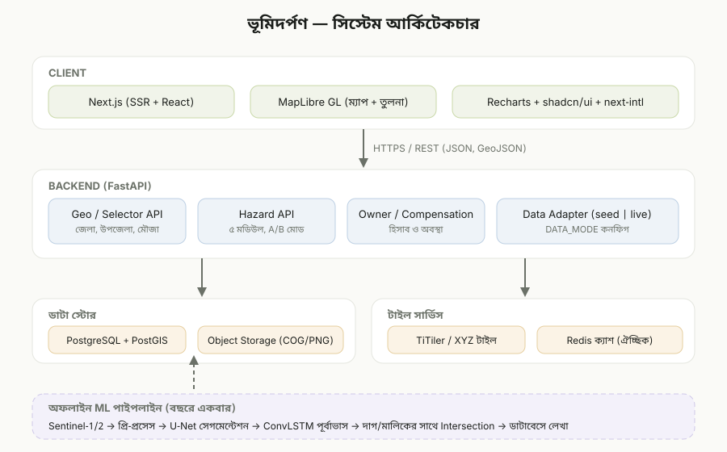

# ARCHITECTURE — ভূমিদর্পণ (BhumiDorpon)



> ডায়াগ্রামটি `architecture.svg` ফাইলে (স্ট্যাটিক SVG) আছে।

> **ডেমো সংস্করণ:** ডায়াগ্রামটি ভবিষ্যৎ পূর্ণ আর্কিটেকচার। ডেমোতে শুধু **Client + Mock Data Layer** থাকবে: Next.js অ্যাপ, `lib/data.ts` এবং `/mocks`-এর জেনারেটেড JSON/GeoJSON। কোনো API সার্ভার, ডাটাবেস, টাইল সার্ভিস বা ML নেই। সব ম্যাপ Leaflet দিয়ে, বাইরের tile layer ছাড়াই mock জ্যামিতি থেকে আঁকা হবে।

---

## 1. স্তরভিত্তিক ওভারভিউ

| স্তর | দায়িত্ব |
|---|---|
| Client | UI রেন্ডার, ম্যাপ তুলনা, চার্ট, ভাষা ও একক টগল |
| API (FastAPI) | নির্বাচন (selector) ডাটা, ঘটনা, মালিক টেবিল, ক্ষতিপূরণ হিসাব |
| Data Adapter | `seed` বা `live` মোডে ডাটা আনা |
| ডাটা স্টোর | PostGIS (জ্যামিতি ও টেবিল), অবজেক্ট স্টোরেজ (ইমেজ) |
| টাইল সার্ভিস | স্যাটেলাইট/প্রেডিকশন ম্যাপের টাইল |
| ML পাইপলাইন (অফলাইন) | বছরে একবার চলে, ফলাফল ডাটাবেসে লেখে |

## 2. মূল ডিজাইন সিদ্ধান্ত

1. **ML অফলাইন, API অনলাইন:** পূর্বাভাস আগে থেকেই হিসাব করে ডাটাবেসে রাখা হয়। ফলে ওয়েবসাইট দ্রুত থাকে এবং ডেমোতে GPU লাগে না।
2. **একই API, দুই মোড:** `mode=recorded|predicted` প্যারামিটার দিয়ে A/B অপশন চলে। ফ্রন্টএন্ডের কোড এক, শুধু প্রপ আলাদা।
3. **Data Adapter:** কাল্পনিক ডাটা থেকে বাস্তব ডাটায় যেতে ফ্রন্টএন্ড বদলাতে হবে না।
4. **দাগ-কেন্দ্রিক মডেল:** সব ক্ষতি/বৃদ্ধি শেষমেশ দাগ (plot) ও মালিকে নামানো হয়। এর ফলে পাঁচটি মডিউলের মালিক টেবিল একই কম্পোনেন্টে চলে।
5. **একক নিয়ন্ত্রণ:** সার্ভার শতাংশে সংরক্ষণ করে, ক্লায়েন্ট একক রূপান্তর করে।

## 3. ডাটা ফ্লো

### 3.1 অফলাইন (বছরে একবার)
```
Sentinel-1/2 ডাউনলোড
   → মেঘ/নয়েজ ফিল্টার, বার্ষিক কম্পোজিট
   → U-Net: পানি/স্থল mask
   → আগের বছরের mask-এর সাথে diff → loss/gain পলিগন   (recorded)
   → ConvLSTM: পরের বছরের mask                           (predicted)
   → ST_Intersection (মৌজা, দাগ) → plot_impacts
   → ownerships জয়েন → owner_impacts
   → ক্ষতিপূরণ হিসাব
   → hazard_events, event_geometries ইত্যাদিতে লেখা
```
বন্যা ও ভূমিধস: ঘটনা ঘটলে SAR/অপটিক্যাল ইমেজ থেকে একই পাইপলাইন চলে (ঘটনাভিত্তিক)।

### 3.2 অনলাইন (ব্যবহারকারীর অনুরোধ)
```
ব্রাউজার → Next.js → FastAPI → PostGIS
                         └──► ইমেজ/টাইল URL ফেরত
ব্রাউজার ──► টাইল সার্ভিস থেকে ম্যাপ লেয়ার লোড
```

## 4. মডিউল ও কম্পোনেন্ট ম্যাপ

| মডিউল | মূল ডাটা | ফ্রন্টএন্ড কম্পোনেন্ট |
|---|---|---|
| নদী ভাঙ্গন | hazard_events (river_erosion), owner_impacts | `SelectorChain`, `MapCompare`, `OwnerTable` |
| বন্যা | hazard_events (flood), event_assets | `SelectorChain(+year)`, `ImageSlider`, `OwnerSearch` |
| ভূমিধস | hazard_events (landslide), hills | `SelectorChain(hill)`, `EventList`, `MapCompare`, `OwnerTable` |
| চর | chars, hazard_events (char) | `SelectorChain(river)`, `CharList`, `MapCompare`, `OwnerTable(+unowned)` |
| উপকূলীয় | mouzas(is_virtual), hazard_events (coastal) | `SelectorChain`, `MapCompare`, `OwnerTable(+unowned)` |

## 5. শেয়ারড কম্পোনেন্ট

- `SelectorChain`: কনফিগ-চালিত cascading dropdown (ধাপের তালিকা প্রপ হিসেবে)।
- `MapCompare`: দুটি raster লেয়ার + পলিগন ওভারলে + slider।
- `OwnerTable`: কলাম কনফিগযোগ্য, সার্চ/সর্ট/CSV।
- `StatCard`, `TrendChart`, `EmptyState`, `ConfidenceBadge`, `UnitToggle`, `LangToggle`।

## 6. ডিপ্লয়মেন্ট টপোলজি (ডেমো)

```
[ব্রাউজার]
    │
[Vercel: Next.js] ──► [VPS/Fly.io: docker compose]
                         ├─ api (FastAPI)
                         ├─ db (postgis)
                         ├─ titiler
                         └─ (redis)
স্ট্যাটিক ইমেজ: S3-সামঞ্জস্যপূর্ণ বাকেট বা /public
```

লোকাল ডেভ: `docker compose up` একটি কমান্ডে সব চালু।

## 7. নিরাপত্তা

- CORS শুধু ফ্রন্টএন্ড ডোমেইনের জন্য।
- Rate limiting (সরল, IP ভিত্তিক)।
- ডেমোতে সব মালিক `is_synthetic`; UI-তে "ডেমো ডাটা" ব্যানার বাধ্যতামূলক।
- প্রোডাকশন: auth (OIDC), RBAC (নাগরিক শুধু নিজের তথ্য; কর্মকর্তা মৌজা-স্কোপ), অডিট লগ।

## 8. সম্প্রসারণ

- মোবাইল অ্যাপ বা PWA।
- মালিক যাচাই (NID/ভূমি পোর্টাল সংযোগ, আইনি অনুমোদনসহ)।
- ক্ষতিপূরণ আবেদন ওয়ার্কফ্লো।
- SMS/ইমেইল সতর্কতা (ঝুঁকিপূর্ণ মৌজার জন্য)।

## 9. ক্লায়েন্ট-সাইড ম্যাপিং আর্কিটেকচার (Client-Side Mapping Architecture)

1. **ডুয়াল ম্যাপ সিঙ্ক্রোনাইজেশন (Dual Leaflet Architecture)**:
   - `GisMapCompare.tsx` ও `MapCompare.tsx` পৃথক দুটি Leaflet কন্টেইনার (`leaf_before_*` ও `leaf_after_*`) নিয়ন্ত্রণ করে।
   - প্যান ও জুম ইভেন্ট রিয়েল-টাইমে `isSyncingRef` রি-এন্ট্রান্সি লক ব্যবহার করে পারস্পরিক আপডেট পরিচালনা করে।
   - জুম কন্ট্রোলার সরাসরি `map.setView(center, nextZ, { animate: false })` প্রয়োগ করে তাৎক্ষণিক রেসপন্স নিশ্চিত করে।
2. **টাইল লেয়ার ও প্যান স্ট্যাকিং (Pane Stacking)**:
   - `basemap-tiles` (zIndex: 195): Esri World Imagery / OSM টাইলস।
   - `plots` (zIndex: 300): সিএস/আরএস ক্যাডাস্ট্রাল দাগ জ্যামিতি।
   - `hazard` (zIndex: 350): প্লাবন স্তর, ভাঙ্গন হ্যাচ, স্লোপ রাপচার ও চরের জ্যামিতি।
   - `mouza-labels` (zIndex: 450): প্রশাসনিক মৌজা নামফলক ও লেবেল।
3. **স্থায়িত্ব ও ফলব্যাক (Fault Tolerance)**:
   - স্যাটেলাইট টাইল নেটওয়ার্ক লোড ব্যর্থ হলে অ্যাপ্লিকেশন ক্র্যাশ করে না; সরাসরি Light GIS-এ ফিরে যাওয়ার ইন্টারঅ্যাক্টিভ ফলব্যাক প্রদান করে।

