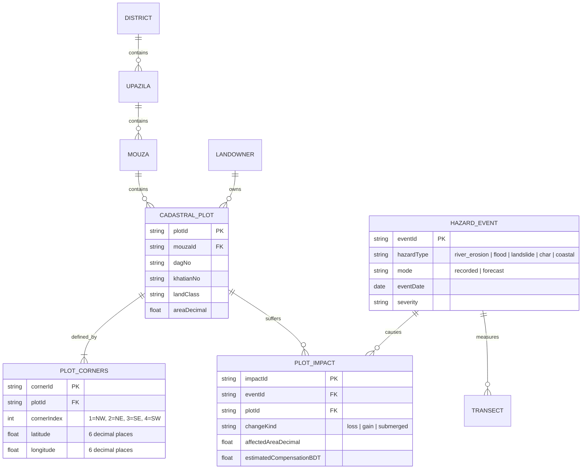
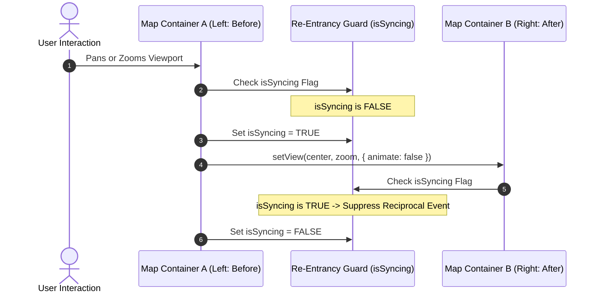
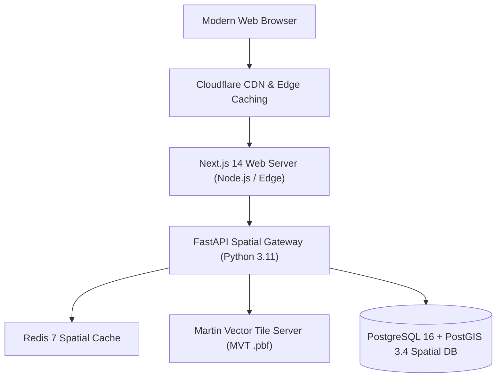

# System Architecture Documentation — BhumiDorpon
**Bangladesh Cadastral Land-Change Records & Multi-Hazard Geospatial Dashboard**

---

> **Document Status:** Authoritative Architectural Specification  
> **System Version:** 1.1 (Demonstration Release)  
> **Team:** GeoNeural  
> **Last Updated:** October 2026  
> **Cross-References:** [Main Documentation](MAIN_PROJECT_DOCUMENTATION.md) | [PRD](PRD.md) | [TRD](TRD.md) | [App Flow & User Flow](APP_FLOW.md) | [Database Schema](DATABASE_SCHEMA.md) | [API Documentation](API_DOCUMENTATION.md) | [UI/UX Design System](UI_UX_DESIGN_SYSTEM.md) | [Testing & QA](TESTING_QA.md)

---

## Table of Contents

- [1. Architectural Overview](#1-architectural-overview)
  - [1.1 Current Demonstration Architecture](#11-current-demonstration-architecture)
  - [1.2 Proposed Production Architecture](#12-proposed-production-architecture)
- [2. Current System Layered Architecture](#2-current-system-layered-architecture)
  - [2.1 Presentation & UI Layer](#21-presentation--ui-layer)
  - [2.2 Cartography & Mapping Layer](#22-cartography--mapping-layer)
  - [2.3 Data Access Layer (lib/data.ts)](#23-data-access-layer-libdatats)
  - [2.4 Serialization & Utility Layer (lib/googleEarth.ts)](#24-serialization--utility-layer-libgoogleearthts)
  - [2.5 Five-Hazard Information Store](#25-five-hazard-information-store)
- [3. Google Earth vs. Google Earth Engine Architectural Placement](#3-google-earth-vs-google-earth-engine-architectural-placement)
  - [3.1 Google Earth (Client-Side Viewer Integration)](#31-google-earth-client-side-viewer-integration)
  - [3.2 Google Earth Engine (Proposed Cloud Pipeline)](#32-google-earth-engine-proposed-cloud-pipeline)
  - [3.3 Architectural Boundary Matrix](#33-architectural-boundary-matrix)
- [4. Disaster Information Flow & Data Relationships](#4-disaster-information-flow--data-relationships)
- [5. Synchronized Dual-Map Subsystem](#5-synchronized-dual-map-subsystem)
- [6. Data Provenance and Single Source of Truth](#6-data-provenance-and-single-source-of-truth)
- [7. Proposed Production Cloud Architecture](#7-proposed-production-cloud-architecture)
  - [7.1 Online User Request Architecture](#71-online-user-request-architecture)
  - [7.2 Offline Annual Earth Observation Pipeline](#72-offline-annual-earth-observation-pipeline)
  - [7.3 Component Mapping: Prototype vs. Production](#73-component-mapping-prototype-vs-production)

---

## 1. Architectural Overview

### 1.1 Current Demonstration Architecture
BhumiDorpon currently operates as a **high-performance, client-side geospatial web application** built with Next.js 14, TypeScript, Tailwind CSS, and pure Leaflet. The system executes entirely within the user's browser sandbox, querying a deterministic, relational mock JSON store through an asynchronous data access layer (`lib/data.ts`). There are no external databases, server processes, or live neural network inference engines required for operation.

```mermaid
graph TD
    subgraph BrowserClient ["User Web Browser (Client Sandbox)"]
        UI["Next.js App Router (React 18 + Tailwind)"]
        Maps["Leaflet 1.9 GIS Mapping Engine (Pure SVG)"]
        DAL["Data Access Layer (lib/data.ts)"]
        GE["Google Earth Serializer (lib/googleEarth.ts)"]
    end

    subgraph StaticStore ["Deterministic Five-Hazard Information Store"]
        PublicMocks["public/mocks/*.json (Browser Fetch)"]
        NodeMocks["mocks/*.json (Server / Vitest fs.readFileSync)"]
        AreaPackages["public/mocks/areas/<hazard>/area_*.json"]
        Rasters["public/mocks/rasters/ (DEM Hillshades)"]
    end

    subgraph ExternalTargets ["External Targets (HTTPS)"]
        EsriTiles["Esri World Imagery (Optional Satellite Raster)"]
        EarthWeb["Google Earth Web (3D Parcel Inspection Target)"]
    end

    UI --> Maps
    UI --> DAL
    UI --> GE
    DAL -->|loadMockJson()| PublicMocks
    DAL -->|areas_index.json| AreaPackages
    Maps --> Rasters
    Maps -.->|Optional Basemap Toggle| EsriTiles
    GE -.->|Synchronous Camera Launch| EarthWeb
    GE -->|Browser File Download| KMLFile[".kml File"]
```

### 1.2 Proposed Production Architecture
In full enterprise production, the client layer will connect via RESTful and vector tile endpoints to a scalable backend comprising:
- **FastAPI (Python 3.11):** High-speed asynchronous spatial API service.
- **PostgreSQL 16 + PostGIS 3.4:** Spatial relational database storing cadastral plots, boundaries, hazard events, and landownership registries.
- **Redis 7:** In-memory caching for spatial bounding boxes and administrative hierarchies.
- **Martin / Tippecanoe:** Dynamic Mapbox Vector Tile (`.pbf`) server.
- **Google Earth Engine (GEE):** Cloud-scale automated ingestion pipeline for Sentinel-1/2 satellite data.

---

## 2. Current System Layered Architecture

### 2.1 Presentation & UI Layer
- **Framework:** Next.js 14 App Router utilizing React Server Components for layout shells and Client Components (`"use client"`) for interactive map viewports.
- **Styling & Tokens:** Tailwind CSS utility classes linked to CSS variables in `app/globals.css`.
- **Navigation:** Persistent fixed 72px icon sidebar (`AppSidebar.tsx`) with accessible tooltips and header controls (`AppHeader.tsx`).
- **Data Visualizations:** Recharts SVG components rendering multi-year trend lines, comparative hazard breakdown bars, and top-affected district rankings.

### 2.2 Cartography & Mapping Layer
- **Engine:** Pure Leaflet 1.9.4 and `react-leaflet`. All Mapbox GL JS and MapLibre dependencies have been removed in full adherence to competition rules.
- **Offline Light GIS Basemap:** Renders entirely offline using client-rendered SVG vector geometries with zero external tile dependencies (`components/map/basemap/LightGisBasemap.tsx`).
- **Cartographic Chrome:** Professional map chrome including degree graticules, dynamic metric scale bar (`L.control.scale`), north arrow compass, locator inset mini-map, and mouza loss/gain badges (`components/map/chrome/`).
- **Custom Map Panes:** Enforces strict z-index separation (`waterPane` 250, `plotsPane` 300, `hazardPane` 350, `labelsPane` 450, `markersPane` 500).
- **Hatch Patterns:** Dynamically injects SVG `<pattern>` elements for coral loss stripes, slate state khas cross-hatching, and purple forecast stripes.

### 2.3 Data Access Layer (`lib/data.ts`)
- **Module Interface:** Exposes typed asynchronous methods (`getDashboardSummary`, `getOptions`, `listResults`, `getFlood`, `getFloodOwners`, `getOwnerPlots`, `getMapArea`).
- **Caching & Latency Simulation:** Maintains an in-memory cache to eliminate duplicate network reads and introduces simulated latency (200–400ms) to validate loading skeletons.
- **Rule 5 Guardrails:** Automatically strips all financial disbursement fields (`paidBDT`, `approvedBDT`, `pendingBDT`) when `mode === "forecast"`.

### 2.4 Serialization & Utility Layer (`lib/googleEarth.ts`)
- **KML 2.2 Serializer:** Pure client-side functions synthesizing KML XML documents for cadastral parcels.
- **Camera Parameter Engine:** Calculates geographic bounding-box centroids, camera altitude ranges, and perspective tilt angles to format Google Earth Web URLs.
- **Unit Conversions (`lib/units.ts`):** Exact mathematical conversions between Decimals, Acres, Bighas, Kathas, and Hectares.

### 2.5 Five-Hazard Information Store
- **Single Source of Truth:** Structured JSON datasets in `public/mocks/` (runtime browser) and `mocks/` (server/Vitest) generated deterministically via `scripts/generate-mocks.ts`.
- **Decoupled Datasets:** Each hazard maintains an isolated schema: `river_erosion.json`, `flood.json`, `landslide.json`, `char.json`, `coastal.json`.

---

## 3. Google Earth vs. Google Earth Engine Architectural Placement

A primary architectural requirement is maintaining strict conceptual and operational boundaries between **Google Earth** and **Google Earth Engine (GEE)**.

```mermaid
graph TD
    subgraph ClientViewer ["Client-Side 3D Viewer Integration"]
        BrowserApp["BhumiDorpon UI (/owner/[ownerId])"] -->|Invokes| GESerializer["lib/googleEarth.ts"]
        GESerializer -->|1. window.open(Camera URL)| GEWeb["Google Earth Web (earth.google.com)"]
        GESerializer -->|2. KML 2.2 Download| LocalKML["Local .kml Parcel File"]
        LocalKML -.->|User Loads KML| GEWeb
    end

    subgraph CloudPipeline ["Proposed Cloud Processing Pipeline (Future)"]
        GEEAPI["Google Earth Engine API (Python SDK)"] -->|Automated Query| Copernicus["ESA Copernicus Sentinel-1/2 Hub"]
        Copernicus --> GEEProc["Cloud Masking, MNDWI, SAR Thresholding"]
        GEEProc --> CloudVectors["Annual Hazard Geometries"]
        CloudVectors --> SpatialDB["PostgreSQL 16 / PostGIS 3.4"]
    end
```

### 3.1 Google Earth (Client-Side Viewer Integration)
- **Role:** Interactive 3D visualization target for individual landowners and relief officers.
- **Implementation Status:** **Fully Implemented and Verified** (`tests/google_earth_kml.test.ts`, 7 tests passing).
- **Execution:** Pure client-side execution in `lib/googleEarth.ts`. Triggered by the "Open in Google Earth" button on the Flood Owner Land Detail page.
- **Network Footprint:** Zero backend, zero database, zero API key. Only bounding-box center coordinates pass via the public Earth URL; landowner names, deeds, and geometry remain strictly on the local device.

### 3.2 Google Earth Engine (Proposed Cloud Pipeline)
- **Role:** Planetary-scale cloud geospatial analysis engine for automated satellite imagery ingestion, cloud-masking, flood water delineation, and riverbank retreat calculation.
- **Implementation Status:** **Proposed Future Enhancement (Non-Operational)**.
- **Execution:** Server-side batch processing executed offline annually or after major flood events via Python worker scripts.
- **Credentials:** Requires Google Cloud Service Account and Earth Engine institutional access (documented for production migration).

### 3.3 Architectural Boundary Matrix

| Architectural Attribute | Google Earth Integration | Google Earth Engine (GEE) Pipeline |
|---|---|---|
| **Architectural Layer** | Client Presentation & Export Layer | External Data Ingestion & Cloud ETL Layer |
| **Current Operational Status** | **Operational & Verified** (v1.1 Demo) | **Planned / Proposed Future Enhancement** |
| **Execution Environment** | Client Web Browser | Google Cloud / Earth Engine Compute Infrastructure |
| **Data Flow** | Parcel geometry exported from client &rarr; Google Earth | Satellite imagery processed in cloud &rarr; PostGIS database |
| **API Keys & Secrets** | Zero credentials (Public URL scheme) | Google Cloud Service Account private keys required |
| **Source Code File** | [`lib/googleEarth.ts`](file:///d:/Project/Antigravity/BhumiDorpon/lib/googleEarth.ts) | Documented in `TRD.md` & `PROJECT_ROADMAP.md` |

---

## 4. Disaster Information Flow & Data Relationships

Disaster records, cadastral parcels, and satellite assets maintain strict relational integrity across the architecture:



1. **Macro Boundary Isolation:** Natural disasters operate at geographic extents (e.g., Jamuna River corridor, Gowainghat Haor basin).
2. **Micro Boundary Intersection:** Spatial intersections determine the exact affected area for each cadastral plot (`Dag No.`).
3. **Tenure & Compensation Resolution:** Linking plots to ownership deeds (`Khatian No.`) resolves affected citizens and calculates compensation liabilities without corrupting cadastral geometry.

---

## 5. Synchronized Dual-Map Subsystem

The dual Before/After map viewer (`GisMapCompare.tsx`) synchronizes viewports using an event-driven pub/sub architecture with active re-entrancy suppression:



This guarantees 60 fps fluid synchronization without infinite event recursion.

---

## 6. Data Provenance and Single Source of Truth

To prevent discrepancies across UI tables, map popups, copy actions, and exports:
- **Single Source of Truth:** Four-corner parcel coordinates stored in `plots.json` and `flood.json` serve as the singular authority.
- **Downstream Consumers:**
  1. **Map Overlay:** Renders Leaflet SVG polygon rings.
  2. **Owner Table:** Renders 4-corner coordinate cards with 6 decimal places.
  3. **Clipboard Copy:** Copies formatted coordinates for legal recordkeeping.
  4. **GeoJSON Export:** Exports standard RFC 7946 feature collections.
  5. **Google Earth KML:** Exports KML 2.2 documents via `lib/googleEarth.ts`.

---

## 7. Proposed Production Cloud Architecture

### 7.1 Online User Request Architecture



### 7.2 Offline Annual Earth Observation Pipeline
- **Frequency:** Executed once annually (or immediately following national disaster declarations).
- **Ingestion:** Automated Python workers query Copernicus Sentinel-1 (C-band SAR) and Sentinel-2 (optical) via the Google Earth Engine Python API.
- **Deep Learning Inference:**
  - **U-Net:** Water-body segmentation and bankline delineation.
  - **ConvLSTM:** Spatiotemporal predictive modeling generating 1-year hazard envelopes.
- **Vector Transformation:** Polygon extraction via GDAL/Rasterio and spatial intersection in PostGIS (`ST_Intersection(mouzas, plots)`).

### 7.3 Component Mapping: Prototype vs. Production

| Subsystem | Current Demonstration Prototype | Proposed Production Cloud Architecture |
|---|---|---|
| **Web Runtime** | Next.js 14 (Client-Side CSR / SSG) | Next.js 14 SSR + Edge Rendering |
| **Data Store** | Static JSON (`public/mocks/*.json`) | PostgreSQL 16 + PostGIS 3.4 Spatial Database |
| **Data Querying** | `lib/data.ts` in-memory queries | Asynchronous FastAPI REST / GraphQL endpoints |
| **Vector Mapping** | Leaflet SVG vector polygons | Martin Vector Tile Server (`.pbf` via Tippecanoe) |
| **Earth Observation** | Pre-rendered PNG hillshades & static contours | Automated Google Earth Engine (GEE) SAR/Optical Pipeline |
| **AI Inference** | Pre-computed synthetic forecast envelopes | Offline GPU worker pipelines running U-Net & ConvLSTM |
| **3D Earth View** | Client-side KML 2.2 serializer & URL launch | Hybrid KML export + Cloud-hosted KMZ spatial streaming |
