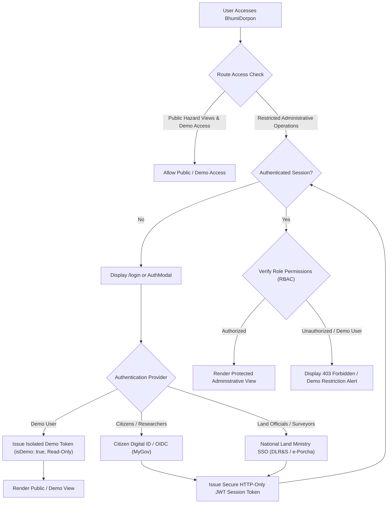

# Authentication & Authorization Specification — BhumiDorpon
**Bangladesh Cadastral Land-Change Records & Multi-Hazard Geospatial Dashboard**

---

> **Document Status:** Authoritative Security & Access Control Specification  
> **Current Authentication Status:** **IMPLEMENTED (Client-Side Prototype Authentication & Demo Access Subsystem v1.2)**  
> **Current Access Model:** Dual-Mode Entry (Authenticated Session / Isolated Demo Mode with Protected Admin Operations)  
> **Target Production Model:** Role-Based Access Control (RBAC) with Government SSO Integration (NextAuth.js v5 / DLR&S OIDC)  
> **Team:** GeoNeural  
> **Last Updated:** October 2026  
> **Cross-References:** [Main Documentation](MAIN_PROJECT_DOCUMENTATION.md) | [PRD](PRD.md) | [TRD](TRD.md) | [Security Specification](SECURITY_SPECIFICATION.md) | [System Architecture](ARCHITECTURE.md) | [Database Schema](DATABASE_SCHEMA.md) | [Testing & QA](TESTING_QA.md)

---

## Table of Contents

- [1. Current Authentication Status (v1.2 Release)](#1-current-authentication-status-v12-release)
  - [1.1 Implemented Client-Side Prototype Architecture](#11-implemented-client-side-prototype-architecture)
  - [1.2 Seeded User Accounts & Roles](#12-seeded-user-accounts--roles)
  - [1.3 Isolated Demo Access Subsystem](#13-isolated-demo-access-subsystem)
  - [1.4 Registration & Account Validation](#14-registration--account-validation)
- [2. Existing Route and Access Posture](#2-existing-route-and-access-posture)
- [3. Identity Provider and User Registry Status](#3-identity-provider-and-user-registry-status)
- [4. Proposed Production Authentication Architecture](#4-proposed-production-architecture)
  - [4.1 Identity Provider Strategy](#41-identity-provider-strategy)
  - [4.2 Government Single Sign-On (SSO) Integration](#42-government-single-sign-on-sso-integration)
- [5. Role-Based Access Control (RBAC)](#5-role-based-access-control-rbac)
  - [5.1 User Role Definitions](#51-user-role-definitions)
  - [5.2 Role-Based Permission Matrix](#52-role-based-permission-matrix)
- [6. Session Management and Route Protection Strategy](#6-session-management-and-route-protection-strategy)
  - [6.1 Current Session Management (`lib/auth.ts`)](#61-current-session-management-libauthts)
  - [6.2 Production JWT Session Tokens & Cookie Security](#62-production-jwt-session-tokens--cookie-security)
  - [6.3 Next.js Middleware Route Guards](#63-nextjs-middleware-route-guards)
- [7. Audit Logging & Compliance Standards](#7-audit-logging--compliance-standards)

---

## 1. Current Authentication Status (v1.2 Release)

### 1.1 Implemented Client-Side Prototype Architecture
In the v1.2 release, BhumiDorpon introduces a comprehensive, client-side authentication and session management subsystem located in `lib/auth.ts`, paired with a modal dialog (`components/auth/AuthModal.tsx`), a dedicated login route (`/login`), and a persistent global banner (`components/auth/DemoBanner.tsx`).

Key capabilities implemented in the active codebase:
1. **First-Visit Authentication Modal:** Upon navigating to the website without an active session (`bhumidorpon_session` absent from storage), a responsive modal is rendered over the dashboard prompting the user to log in, register, or enter as Demo.
2. **Dedicated Login & Registration Page:** A standalone route `/login` allows bookmarking, direct navigation, credential submission, new account registration, and demo entry.
3. **Form Validation & Visual Feedback:** Includes required field checks, minimum password length (6 characters), password confirmation matching, duplicate username/email detection, loading animations, and localized bilingual error messages.
4. **Password Visibility Controls:** Eye / EyeOff icon toggles allow users to inspect their entered password securely.
5. **Session Persistence & Portability:** Sessions are stored under `bhumidorpon_session` in `localStorage`, with graceful in-memory fallbacks when running in headless testing environments (Node.js/Vitest).
6. **Sign-Out Action:** AppHeader displays the active user badge (`Citizen`, `Surveyor`, `Admin`, or `Demo User`) with an instant sign-out button that purges the session and re-launches the authentication modal.

### 1.2 Seeded User Accounts & Roles
For demonstration and automated QA testing, the client registry is seeded with default test credentials:

| Username / Identifier | Default Password | Role | Permissions |
|---|---|---|---|
| `surveyor` (or `surveyor@bhumidorpon.gov.bd`) | `password123` | `surveyor_acland` | Full cadastral survey verification, parcel flagging, KML download |
| `citizen` (or `citizen@bhumidorpon.gov.bd`) | `citizen123` | `citizen` | Cadastral search, hazard visualization, KML parcel export |
| `admin` (or `admin@bhumidorpon.gov.bd`) | `admin123` | `sys_admin` | Full system access, data ingestion controls, audit logs |

### 1.3 Isolated Demo Access Subsystem
To ensure immediate evaluator access without requiring credential entry, a prominent **"Demo / ডেমো হিসেবে প্রবেশ করুন"** button is integrated into both `AuthModal.tsx` and `/login`.
- **Session Identity:** Creates an ephemeral session with `user.isDemo = true` and `role = 'citizen'`.
- **Privilege Containment:** Demo sessions are strictly isolated. Administrative functions (e.g., compensation approval, cadastral boundary modification, data ETL triggers) check `canPerformAdministrativeAction(user)` which returns `false` for all demo users.
- **Visual Notification:** A persistent top-bar banner (`DemoBanner.tsx`) warns visitors: *"You are exploring Bhumi-Dorpon in demonstration mode / আপনি ডেমো মোডে আছেন"*, with a quick switch to log in with real credentials.

### 1.4 Registration & Account Validation
New users can register directly from the entry screen:
- **Fields:** Full Name, Username, Email, Password, Confirm Password, and Intended Role (`citizen`, `surveyor_acland`).
- **Validation Rules:**
  - Full Name: Minimum 2 characters.
  - Username: Minimum 3 characters, alphanumeric plus underscores.
  - Email: Valid RFC 5322 format.
  - Password: Minimum 6 characters.
  - Confirm Password: Must match Password exactly.
  - Uniqueness: Usernames and emails are checked against existing accounts in `bhumidorpon_users`.

---

## 2. Existing Route and Access Posture

- **Login / Register Route:** Active at `/login`.
- **Landing Interceptor:** Active via `components/auth/AuthModal.tsx` mounted in root layout (`app/layout.tsx`).
- **Demo Mode:** Available on one-click bypass.
- **Land Information Route:** `/land-information` provides cadastral parcel queries with 5 cascading identifiers.
- **Disaster Modules:** All hazard routes (`/river-erosion`, `/char`, `/flood`, `/landslide`, `/coastal`) remain operational with dual-mode Leaflet synchronization.
- **Protected Administrative Operations:** Blocked for demo users via `canPerformAdministrativeAction()`.

---

## 3. Identity Provider and User Registry Status

- **Client Prototype Registry:** Stored in `localStorage` under `bhumidorpon_users` (browser) and `nodeMemoryUsers` (Vitest/Node test runner).
- **Production Backend IdP (Target Roadmap):** Integration planned with NextAuth.js (Auth.js v5) backed by PostgreSQL/Prisma or Government OIDC (MyGov Bangladesh / DLR&S).

---

## 4. Proposed Production Architecture

When migrating BhumiDorpon to an enterprise production environment connected to national land administration infrastructure:



### 4.1 Identity Provider Strategy
- **Framework:** **NextAuth.js (Auth.js v5)** integrated with Next.js App Router.
- **Session Mechanism:** Stateless JSON Web Tokens (JWT) signed using RS256 asymmetric encryption with rotating key pairs.
- **Cookie Security:** Strict flags applied to session cookies (`HttpOnly`, `Secure`, `SameSite=Lax`, `Path=/`).

### 4.2 Government Single Sign-On (SSO) Integration
In coordination with the Ministry of Land and the Directorate of Land Records and Surveys (DLR&S):
- Integration with Bangladesh National Digital Identity / MyGov OpenID Connect (OIDC) gateway.
- Integration with Land Ministry internal LDAP / Active Directory for Assistant Commissioners of Land (AC Land) and Upazila Surveyors.

---

## 5. Role-Based Access Control (RBAC)

### 5.1 User Role Definitions

1. **Demo Visitor (`isDemo: true, role: citizen`):**
   - Unauthenticated evaluators exploring prototype features.
   - Access: Read-only access to hazard maps, land information demo queries, and landslide historical selectors. Blocked from administrative operations, official verification, and data mutations.
2. **Citizen / Public User (`role: citizen`):**
   - General public, affected landowners, journalists, and students.
   - Access: Read-only access to all public hazard dashboards, side-by-side maps, 4-corner GPS boundary readouts, and individual parcel KML exports.
3. **Field Relief Officer (`role: relief_officer`):**
   - Union Parishad representatives, Disaster Management Officers (DMO), Red Crescent coordinators.
   - Access: Everything in Citizen role + access to aggregated village damage rosters, field verification checklists, and offline relief disbursement reports.
4. **Land Administration Official (`role: surveyor_acland`):**
   - Kanungos, Upazila Surveyors, and Assistant Commissioners of Land (AC Land).
   - Access: Everything in Relief Officer role + authority to review formal compensation claims, submit post-disaster boundary re-survey adjustments, and flag disputed plots.
5. **System Administrator (`role: sys_admin`):**
   - Technical operators and geospatial system managers.
   - Access: Complete administrative access, dataset ingestion pipeline management, user role assignment, and audit log inspection.

### 5.2 Role-Based Permission Matrix

| Route / Resource / Action | Demo User | Citizen | Field Relief Officer | Land Administration (AC Land) | System Administrator |
|---|---|---|---|---|---|
| **View Dashboard & Hazard Maps** | Permitted | Permitted | Permitted | Permitted | Permitted |
| **Inspect 4-Corner Plot Coordinates** | Permitted | Permitted | Permitted | Permitted | Permitted |
| **Export Parcel to Google Earth (KML)**| Permitted | Permitted | Permitted | Permitted | Permitted |
| **Search Land Information (`/land-information`)** | Permitted (Demo Data) | Permitted | Permitted | Permitted | Permitted |
| **Select Mountain & Historical Landslide Events** | Permitted | Permitted | Permitted | Permitted | Permitted |
| **Download Aggregated Mouza CSV** | Permitted | Permitted | Permitted | Permitted | Permitted |
| **Access Unmasked Landowner NID Data**| Denied | Denied | Permitted | Permitted | Permitted |
| **Submit Field Verification Survey** | Denied | Denied | Permitted | Permitted | Permitted |
| **Approve Compensation Disbursement** | Denied | Denied | Denied | Permitted | Permitted |
| **Trigger GEE Satellite ETL Ingest** | Denied | Denied | Denied | Denied | Permitted |
| **Manage User Roles & View Audit Logs**| Denied | Denied | Denied | Denied | Permitted |

---

## 6. Session Management and Route Protection Strategy

### 6.1 Current Session Management (`lib/auth.ts`)
The v1.2 prototype implements the following programmatic API:
- `getCurrentUser(): User | null`: Retrieves active session from storage.
- `login(credentials): Promise<{ success: boolean; user?: User; error?: string }>`: Authenticates against seeded and registered accounts.
- `register(data): Promise<{ success: boolean; user?: User; error?: string }>`: Validates input and persists new accounts.
- `createDemoSession(): User`: Generates an unprivileged demo user session.
- `logout(): void`: Clears session from storage and emits state change.
- `canPerformAdministrativeAction(user: User | null): boolean`: Rejects `null` and `isDemo === true` sessions; grants access only to `surveyor_acland` and `sys_admin`.

### 6.2 Production JWT Session Tokens & Cookie Security
For enterprise deployment:
- **Token Expiry:** Access tokens expire after 15 minutes; refresh tokens stored in secure database table with 7-day expiry and sliding expiration.
- **Payload Schema:**
  ```json
  {
    "sub": "usr_991823746",
    "name": "Pantho Raj Biswas",
    "email": "panthoraj@gov.bd",
    "role": "surveyor_acland",
    "isDemo": false,
    "jurisdiction": {
      "district_id": "dist-sirajganj",
      "upazila_id": "upz-kazipur"
    },
    "exp": 1792083600
  }
  ```

### 6.3 Next.js Middleware Route Guards
Protected administrative routes will be guarded by a unified Edge middleware (`middleware.ts`):

```typescript
// Proposed Next.js Middleware Implementation
import { NextResponse } from "next/server";
import type { NextRequest } from "next/server";
import { getToken } from "next-auth/jwt";

export async function middleware(request: NextRequest) {
  const token = await getToken({ req: request, secret: process.env.NEXTAUTH_SECRET });
  const { pathname } = request.nextUrl;

  // Protect administrative routes
  if (pathname.startsWith("/admin") || pathname.startsWith("/surveys/approve")) {
    if (!token || token.isDemo || !["surveyor_acland", "sys_admin"].includes(token.role as string)) {
      const loginUrl = new URL("/login", request.url);
      loginUrl.searchParams.set("callbackUrl", pathname);
      return NextResponse.redirect(loginUrl);
    }
  }

  return NextResponse.next();
}

export const config = {
  matcher: ["/admin/:path*", "/surveys/approve/:path*", "/api/v1/admin/:path*"]
};
```

---

## 7. Audit Logging & Compliance Standards

To satisfy national land tenure compliance and administrative accountability:
1. **Immutable Audit Trails:** Every administrative status modification generates an append-only audit log entry storing:
   - Timestamp (UTC ISO 8601).
   - User ID and authenticated role (with demo-session flagging).
   - Client IP address and User-Agent.
   - Action type and affected entity (e.g., `APPROVE_COMPENSATION`, `plot_id: 101`).
   - Before and after state values.
2. **PII Safeguards:** Citizen personal identification numbers (NID) and mobile numbers are masked by default (`88019******15`) and only visible to authorized land revenue officers. Demo users are prohibited from viewing unmasked records.
