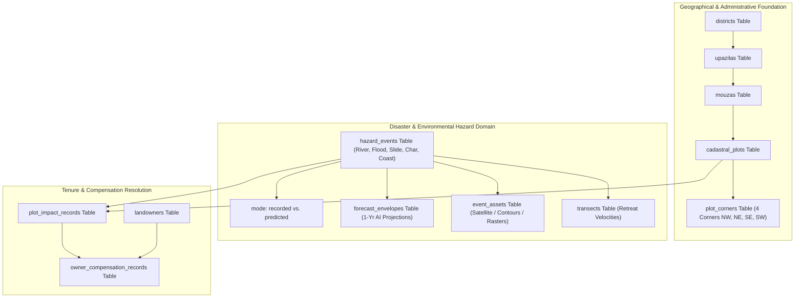

# Database & Backend Schema Specification — BhumiDorpon
**Bangladesh Cadastral Land-Change Records & Multi-Hazard Geospatial Dashboard**

---

> **Document Status:** Authoritative Database & Data Architecture Specification  
> **Current Storage Implementation:** Static Relational JSON Store (`public/mocks/` and `mocks/`)  
> **Target Production Database:** PostgreSQL 16 + PostGIS 3.4 Spatial Database  
> **Target Coordinate Systems:** Storage: EPSG:4326 (WGS 84) | Area Calculations: EPSG:32646 (UTM Zone 46N)  
> **Team:** GeoNeural  
> **Last Updated:** October 2026  
> **Cross-References:** [Main Documentation](MAIN_PROJECT_DOCUMENTATION.md) | [PRD](PRD.md) | [TRD](TRD.md) | [System Architecture](ARCHITECTURE.md) | [API Documentation](API_DOCUMENTATION.md) | [UI/UX Design System](UI_UX_DESIGN_SYSTEM.md) | [Testing & QA](TESTING_QA.md)

---

## Table of Contents

- [1. Data Architecture Strategy](#1-data-architecture-strategy)
  - [1.1 Current Implementation: Five-Hazard Information Store](#11-current-implementation-five-hazard-information-store)
  - [1.2 Target Implementation: PostgreSQL 16 + PostGIS 3.4](#12-target-implementation-postgresql-16--postgis-34)
- [2. Current JSON Mock Store Schema](#2-current-json-mock-store-schema)
  - [2.1 Administrative Schemas](#21-administrative-schemas)
  - [2.2 Hazard Master Event Schemas](#22-hazard-master-event-schemas)
  - [2.3 Cadastral Plot & 4-Corner Geometry Schema](#23-cadastral-plot--4-corner-geometry-schema)
  - [2.4 Landowner & Multi-Owner Flood Schema](#24-landowner--multi-owner-flood-schema)
- [3. Disaster Information Database Placement & Relationships](#3-disaster-information-database-placement--relationships)
- [4. Proposed Production PostgreSQL / PostGIS DDL](#4-proposed-production-postgresql--postgis-ddl)
  - [4.1 Database Extensions and Custom Enums](#41-database-extensions-and-custom-enums)
  - [4.2 Administrative & Geographical Tables](#42-administrative--geographical-tables)
  - [4.3 Cadastral Plots, Corners, and Ownership Tables](#43-cadastral-plots-corners-and-ownership-tables)
  - [4.4 Hazard Events, Assets, and Impact Records](#44-hazard-events-assets-and-impact-records)
  - [4.5 Transects and Predictive Envelopes](#45-transects-and-predictive-envelopes)
- [5. Spatial Indexing and Performance Optimization](#5-spatial-indexing-and-performance-optimization)
- [6. Analytical Views & Materialized Queries](#6-analytical-views--materialized-queries)
- [7. Geospatial Area Calculations & Projection Transformations](#7-geospatial-area-calculations--projection-transformations)
- [8. Schema Reconciliation and Terminology Alignment](#8-schema-reconciliation-and-terminology-alignment)

---

## 1. Data Architecture Strategy

### 1.1 Current Implementation: Five-Hazard Information Store
In the current v1.1 demonstration release, BhumiDorpon operates without a live SQL server or database daemon. All application state, geographical boundaries, hazard metrics, and cadastral plot records are persisted as structured, deterministic JSON files:
- **Client Runtime (`public/mocks/*.json`):** Static assets fetched asynchronously via `loadMockJson()` in `lib/data.ts`.
- **Node.js & Testing (`mocks/*.json`):** Synchronous source files read via `fs.readFileSync` in test environments.
- **Seeded Mock Generator (`scripts/generate-mocks.ts`):** Guarantees 100% deterministic reproducibility across builds and test suites.

### 1.2 Target Implementation: PostgreSQL 16 + PostGIS 3.4
For enterprise cloud deployment, the data layer transitions to a production PostgreSQL 16 instance equipped with PostGIS 3.4. The relational schema is engineered to handle millions of cadastral plots across Bangladesh, supporting complex spatial queries (`ST_Intersects`, `ST_Intersection`, `ST_Difference`) and sub-millisecond bounding-box filtering.

---

## 2. Current JSON Mock Store Schema

### 2.1 Administrative Schemas
Administrative units follow a strict hierarchical structure from Division down to Mouza:

```typescript
// public/mocks/districts.json
export interface DistrictRecord {
  id: string;            // e.g. "dist-sirajganj"
  name_en: string;       // "Sirajganj"
  name_bn: string;       // "সিরাজগঞ্জ"
  division_id: string;   // "div-rajshahi"
  is_coastal: boolean;
  is_hilly: boolean;
  bounds: [number, number, number, number]; // [minLon, minLat, maxLon, maxLat]
}

// public/mocks/mouzas.json
export interface MouzaRecord {
  id: string;            // e.g. "mouza-khanshama"
  upazila_id: string;    // "upz-kazipur"
  name_en: string;       // "Khanshama"
  name_bn: string;       // "খানশামা"
  jl_no: string;         // "42"
  is_virtual?: boolean;  // true for newly accreted char/coastal land blocks
  bounds: [number, number, number, number];
}
```

### 2.2 Hazard Master Event Schemas
Each hazard category maintains an isolated master JSON dataset:

```typescript
// public/mocks/river_erosion.json, flood.json, landslide.json, etc.
export interface HazardEventRecord {
  eventId: string;
  hazardType: "river_erosion" | "flood" | "landslide" | "char" | "coastal";
  mode: "recorded" | "forecast";
  title: string;
  eventDate: string;     // ISO 8601 date string
  mouzaId: string;
  mouzaName: string;
  totalLossDecimal: number;
  totalGainDecimal: number;
  affectedPlotsCount: number;
  affectedOwnersCount: number;
  estimatedCompensationBDT: number;
  paidBDT?: number;      // STRICTLY OMITTED in forecast mode
  approvedBDT?: number;  // STRICTLY OMITTED in forecast mode
  pendingBDT?: number;   // STRICTLY OMITTED in forecast mode
}
```

### 2.3 Cadastral Plot & 4-Corner Geometry Schema
Cadastral plots enforce strict 4-corner quadrilateral boundary definitions:

```typescript
// public/mocks/plots.json & flood.json
export interface CadastralPlot {
  plotId: string;        // "plot-jaflong-101"
  dagNo: string;         // "101"
  khatianNo: string;     // "12"
  mouzaId: string;
  ownerId: string;
  ownerName: string;
  landClass: "agri" | "homestead" | "commercial" | "pond" | "forest" | "khas";
  areaDecimal: number;   // e.g. 33.0
  corners: [             // Exactly 4 corners ordered NW, NE, SE, SW
    { cornerIndex: 1; name: "NW"; lat: number; lng: number },
    { cornerIndex: 2; name: "NE"; lat: number; lng: number },
    { cornerIndex: 3; name: "SE"; lat: number; lng: number },
    { cornerIndex: 4; name: "SW"; lat: number; lng: number }
  ];
}
```

### 2.4 Landowner & Multi-Owner Flood Schema
Fictional landowner registries are linked to cadastral plots for compensation tracking:

```typescript
// public/mocks/owners.json
export interface LandownerRecord {
  ownerId: string;       // "owner-01"
  name_en: string;       // "Abdul Karim"
  father_name: string;   // "Late Rahim Uddin"
  nid_hash: string;      // "8801928374615" (Simulated hashed NID)
  contact_village: string;
  totalOwnedDecimal: number;
  plots: string[];       // Array of plotIds
}
```

---

## 3. Disaster Information Database Placement & Relationships

In the BhumiDorpon architecture, disaster information is not treated as isolated map polygons; it is structurally integrated with cadastral records and administrative boundaries:



1. **Hazard Events Table (`hazard_events`):** Stores event metadata, dates, affected river/hill, and overall severity.
2. **Impact Records Table (`plot_impact_records`):** Stores the spatial intersection between the hazard boundary and specific cadastral plots (`ST_Intersection`).
3. **Compensation Table (`owner_compensation_records`):** Calculates financial liabilities by joining affected plots with deed ownerships (`Khatian No.`), applying land-use multipliers and upazila base rates.

---

## 4. Proposed Production PostgreSQL / PostGIS DDL

The following DDL defines the complete production database schema:

### 4.1 Database Extensions and Custom Enums

```sql
-- Enable PostGIS spatial extension and pg_trgm for fuzzy owner name searching
CREATE EXTENSION IF NOT EXISTS postgis;
CREATE EXTENSION IF NOT EXISTS pg_trgm;

-- Enumerations
CREATE TYPE hazard_type_enum AS ENUM (
  'river_erosion',
  'flood',
  'landslide',
  'char',
  'coastal'
);

CREATE TYPE data_mode_enum AS ENUM (
  'recorded',
  'predicted'  -- Maps to 'forecast' in UI
);

CREATE TYPE change_kind_enum AS ENUM (
  'loss',
  'gain',
  'submerged',
  'accreted'
);

CREATE TYPE compensation_status_enum AS ENUM (
  'not_applicable',
  'not_applied',
  'pending',
  'approved',
  'paid'
);

CREATE TYPE land_class_enum AS ENUM (
  'agri',
  'homestead',
  'pond',
  'commercial',
  'forest',
  'khas',
  'other'
);

CREATE TYPE flood_depth_class_enum AS ENUM (
  'shallow',    -- < 0.5m
  'moderate',   -- 0.5m - 1.5m
  'deep'        -- > 1.5m
);

CREATE TYPE asset_kind_enum AS ENUM (
  'satellite_raster',
  'survey_cadastral_map',
  'flood_extent_vector',
  'dem_hillshade_raster',
  'contour_vector'
);
```

### 4.2 Administrative & Geographical Tables

```sql
CREATE TABLE districts (
  id           SERIAL PRIMARY KEY,
  code         VARCHAR(16) UNIQUE NOT NULL,
  name_en      VARCHAR(64) NOT NULL,
  name_bn      VARCHAR(64) NOT NULL,
  division_en  VARCHAR(64) NOT NULL,
  is_coastal   BOOLEAN DEFAULT FALSE,
  is_hilly     BOOLEAN DEFAULT FALSE,
  geom         GEOMETRY(MultiPolygon, 4326) NOT NULL
);

CREATE TABLE upazilas (
  id           SERIAL PRIMARY KEY,
  district_id  INT NOT NULL REFERENCES districts(id) ON DELETE CASCADE,
  code         VARCHAR(16) UNIQUE NOT NULL,
  name_en      VARCHAR(64) NOT NULL,
  name_bn      VARCHAR(64) NOT NULL,
  base_rate_bdt NUMERIC(10,2) DEFAULT 20000.00,
  geom         GEOMETRY(MultiPolygon, 4326) NOT NULL
);

CREATE TABLE mouzas (
  id           SERIAL PRIMARY KEY,
  upazila_id   INT NOT NULL REFERENCES upazilas(id) ON DELETE CASCADE,
  jl_no        VARCHAR(32) NOT NULL,
  name_en      VARCHAR(64) NOT NULL,
  name_bn      VARCHAR(64) NOT NULL,
  is_virtual   BOOLEAN DEFAULT FALSE, -- Flag for unassigned char or coastal mudflats
  geom         GEOMETRY(MultiPolygon, 4326) NOT NULL,
  CONSTRAINT uq_mouza_jl UNIQUE (upazila_id, jl_no)
);

CREATE TABLE rivers (
  id           SERIAL PRIMARY KEY,
  name_en      VARCHAR(64) NOT NULL,
  name_bn      VARCHAR(64) NOT NULL,
  river_type   VARCHAR(32) DEFAULT 'braided',
  geom         GEOMETRY(MultiLineString, 4326)
);

CREATE TABLE river_upazilas (
  river_id     INT NOT NULL REFERENCES rivers(id) ON DELETE CASCADE,
  upazila_id   INT NOT NULL REFERENCES upazilas(id) ON DELETE CASCADE,
  PRIMARY KEY (river_id, upazila_id)
);

CREATE TABLE hills (
  id           SERIAL PRIMARY KEY,
  upazila_id   INT NOT NULL REFERENCES upazilas(id) ON DELETE CASCADE,
  name_en      VARCHAR(64) NOT NULL,
  name_bn      VARCHAR(64) NOT NULL,
  peak_elevation_m NUMERIC(6,2),
  average_slope_deg NUMERIC(4,1),
  geom         GEOMETRY(Polygon, 4326)
);
```

### 4.3 Cadastral Plots, Corners, and Ownership Tables

```sql
CREATE TABLE cadastral_plots (
  id           BIGSERIAL PRIMARY KEY,
  mouza_id     INT NOT NULL REFERENCES mouzas(id) ON DELETE CASCADE,
  dag_no       VARCHAR(32) NOT NULL,
  khatian_no   VARCHAR(32) NOT NULL,
  land_class   land_class_enum NOT NULL DEFAULT 'agri',
  area_decimal NUMERIC(10,4) NOT NULL,
  geom         GEOMETRY(Polygon, 4326) NOT NULL,
  CONSTRAINT uq_mouza_dag UNIQUE (mouza_id, dag_no)
);

CREATE TABLE plot_corners (
  id           BIGSERIAL PRIMARY KEY,
  plot_id      BIGINT NOT NULL REFERENCES cadastral_plots(id) ON DELETE CASCADE,
  corner_index INT NOT NULL CHECK (corner_index BETWEEN 1 AND 4),
  corner_label VARCHAR(8) NOT NULL CHECK (corner_label IN ('NW','NE','SE','SW')),
  latitude     NUMERIC(9,6) NOT NULL,
  longitude    NUMERIC(9,6) NOT NULL,
  geom         GEOMETRY(Point, 4326) NOT NULL,
  CONSTRAINT uq_plot_corner UNIQUE (plot_id, corner_index)
);

CREATE TABLE landowners (
  id           BIGSERIAL PRIMARY KEY,
  nid_hash     VARCHAR(64) UNIQUE NOT NULL,
  name_en      VARCHAR(128) NOT NULL,
  name_bn      VARCHAR(128),
  father_name  VARCHAR(128),
  village      VARCHAR(128)
);

CREATE TABLE plot_ownerships (
  id           BIGSERIAL PRIMARY KEY,
  plot_id      BIGINT NOT NULL REFERENCES cadastral_plots(id) ON DELETE CASCADE,
  owner_id     BIGINT NOT NULL REFERENCES landowners(id) ON DELETE CASCADE,
  share_ratio  NUMERIC(5,4) NOT NULL DEFAULT 1.0000,
  CONSTRAINT uq_plot_owner UNIQUE (plot_id, owner_id)
);
```

### 4.4 Hazard Events, Assets, and Impact Records

```sql
CREATE TABLE hazard_events (
  id           BIGSERIAL PRIMARY KEY,
  hazard_type  hazard_type_enum NOT NULL,
  data_mode    data_mode_enum NOT NULL DEFAULT 'recorded',
  mouza_id     INT NOT NULL REFERENCES mouzas(id) ON DELETE CASCADE,
  title        VARCHAR(128) NOT NULL,
  event_date   DATE NOT NULL,
  severity     VARCHAR(32) DEFAULT 'moderate',
  notes        TEXT,
  created_at   TIMESTAMPTZ DEFAULT NOW()
);

CREATE TABLE event_assets (
  id           BIGSERIAL PRIMARY KEY,
  event_id     BIGINT NOT NULL REFERENCES hazard_events(id) ON DELETE CASCADE,
  asset_kind   asset_kind_enum NOT NULL,
  storage_url  VARCHAR(256) NOT NULL,
  captured_at  TIMESTAMPTZ,
  metadata_json JSONB
);

CREATE TABLE plot_impact_records (
  id                 BIGSERIAL PRIMARY KEY,
  event_id           BIGINT NOT NULL REFERENCES hazard_events(id) ON DELETE CASCADE,
  plot_id            BIGINT NOT NULL REFERENCES cadastral_plots(id) ON DELETE CASCADE,
  change_kind        change_kind_enum NOT NULL,
  depth_class        flood_depth_class_enum,
  affected_area_dec  NUMERIC(10,4) NOT NULL,
  damage_percentage  NUMERIC(5,2) NOT NULL,
  impact_geom        GEOMETRY(Geometry, 4326),
  CONSTRAINT uq_event_plot UNIQUE (event_id, plot_id)
);

CREATE TABLE owner_compensation_records (
  id                 BIGSERIAL PRIMARY KEY,
  impact_id          BIGINT NOT NULL REFERENCES plot_impact_records(id) ON DELETE CASCADE,
  owner_id           BIGINT NOT NULL REFERENCES landowners(id) ON DELETE CASCADE,
  estimated_bdt      NUMERIC(12,2) NOT NULL,
  status             compensation_status_enum NOT NULL DEFAULT 'pending',
  approved_bdt       NUMERIC(12,2) DEFAULT 0.00,
  paid_bdt           NUMERIC(12,2) DEFAULT 0.00,
  disbursed_at       TIMESTAMPTZ
);
```

### 4.5 Transects and Predictive Envelopes

```sql
CREATE TABLE river_transects (
  id                 BIGSERIAL PRIMARY KEY,
  event_id           BIGINT NOT NULL REFERENCES hazard_events(id) ON DELETE CASCADE,
  transect_no        INT NOT NULL,
  baseline_point     GEOMETRY(Point, 4326) NOT NULL,
  current_point      GEOMETRY(Point, 4326) NOT NULL,
  retreat_meters     NUMERIC(8,2) NOT NULL,
  retreat_rate_m_yr  NUMERIC(6,2),
  geom               GEOMETRY(LineString, 4326) NOT NULL
);

CREATE TABLE forecast_envelopes (
  id                 BIGSERIAL PRIMARY KEY,
  event_id           BIGINT NOT NULL REFERENCES hazard_events(id) ON DELETE CASCADE,
  horizon_years      INT NOT NULL DEFAULT 1,
  confidence_score   NUMERIC(4,3) CHECK (confidence_score BETWEEN 0.000 AND 1.000),
  algorithm_name     VARCHAR(64) DEFAULT 'ConvLSTM-Delta-v2',
  envelope_geom      GEOMETRY(Polygon, 4326) NOT NULL
);
```

---

## 5. Spatial Indexing and Performance Optimization

To guarantee high-speed spatial queries across millions of parcels, production PostGIS instances apply GIST indexes across all geometry columns:

```sql
-- Spatial R-Tree (GIST) Indexes
CREATE INDEX idx_districts_geom ON districts USING GIST(geom);
CREATE INDEX idx_upazilas_geom ON upazilas USING GIST(geom);
CREATE INDEX idx_mouzas_geom ON mouzas USING GIST(geom);
CREATE INDEX idx_cadastral_plots_geom ON cadastral_plots USING GIST(geom);
CREATE INDEX idx_plot_corners_geom ON plot_corners USING GIST(geom);
CREATE INDEX idx_plot_impact_geom ON plot_impact_records USING GIST(impact_geom);
CREATE INDEX idx_forecast_envelopes_geom ON forecast_envelopes USING GIST(envelope_geom);
CREATE INDEX idx_river_transects_geom ON river_transects USING GIST(geom);

-- B-Tree Indexes on Foreign Keys and Query Filters
CREATE INDEX idx_plots_mouza ON cadastral_plots(mouza_id);
CREATE INDEX idx_plots_dag ON cadastral_plots(dag_no);
CREATE INDEX idx_plots_khatian ON cadastral_plots(khatian_no);
CREATE INDEX idx_events_mouza_hazard ON hazard_events(mouza_id, hazard_type, data_mode);
CREATE INDEX idx_impact_event ON plot_impact_records(event_id);
CREATE INDEX idx_impact_plot ON plot_impact_records(plot_id);

-- GIN Trigram Index for Fuzzy Landowner Name Search
CREATE INDEX idx_landowners_name_trgm ON landowners USING GIN(name_en gin_trgm_ops);
```

---

## 6. Analytical Views & Materialized Queries

### 6.1 Mouza Hazard Summary View

```sql
CREATE OR REPLACE VIEW v_mouza_hazard_summary AS
SELECT 
  e.id AS event_id,
  e.hazard_type,
  e.data_mode,
  m.id AS mouza_id,
  m.name_en AS mouza_name,
  u.name_en AS upazila_name,
  d.name_en AS district_name,
  COUNT(DISTINCT pir.plot_id) AS total_affected_plots,
  COUNT(DISTINCT ocr.owner_id) AS total_affected_owners,
  COALESCE(SUM(pir.affected_area_dec), 0) AS total_affected_area_decimal,
  COALESCE(SUM(ocr.estimated_bdt), 0) AS total_estimated_compensation_bdt,
  -- Suppress disbursement figures for forecast mode
  CASE WHEN e.data_mode = 'forecast' THEN 0 ELSE COALESCE(SUM(ocr.paid_bdt), 0) END AS total_paid_bdt
FROM hazard_events e
JOIN mouzas m ON e.mouza_id = m.id
JOIN upazilas u ON m.upazila_id = u.id
JOIN districts d ON u.district_id = d.id
LEFT JOIN plot_impact_records pir ON e.id = pir.event_id
LEFT JOIN owner_compensation_records ocr ON pir.id = ocr.impact_id
GROUP BY e.id, e.hazard_type, e.data_mode, m.id, m.name_en, u.name_en, d.name_en;
```

---

## 7. Geospatial Area Calculations & Projection Transformations

PostgreSQL stores coordinates in **EPSG:4326** (WGS 84 latitude and longitude). However, calculating true metric ground area or square meters requires projecting to **EPSG:32646** (WGS 84 / UTM Zone 46N), which spans Bangladesh:

```sql
-- Area calculation function returning area in Decimals
CREATE OR REPLACE FUNCTION fn_calculate_plot_area_decimal(geom_4326 GEOMETRY)
RETURNS NUMERIC AS $$
DECLARE
  area_sqm NUMERIC;
BEGIN
  -- Transform geometry to UTM Zone 46N (Meters) and compute area
  area_sqm := ST_Area(ST_Transform(geom_4326, 32646));
  -- 1 Decimal = 40.4686 Square Meters
  RETURN ROUND((area_sqm / 40.4686)::NUMERIC, 4);
END;
$$ LANGUAGE plpgsql IMMUTABLE;
```

---

## 8. Schema Reconciliation and Terminology Alignment

To eliminate ambiguity across documentation and code:
1. **`predicted` (Database) vs. `forecast` (Frontend UI):** In the database schema, the enum value is `predicted` to align with machine learning taxonomy. In the user interface, it is rendered exclusively as **Forecast** to provide friendly terminology for citizens and officials.
2. **`dag_no` & `khatian_no`:** Retained in standard government cadastral naming convention (Dag No. = parcel boundary ID; Khatian No. = land record deed ID).
3. **Four Corners Ordering:** Always persisted in strict clockwise order NW (`1`), NE (`2`), SE (`3`), SW (`4`).
