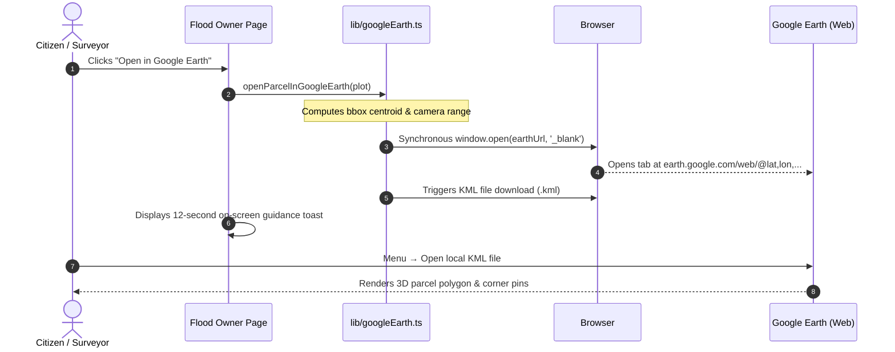

# BhumiDorpon — Main Project Documentation
**Bangladesh Cadastral Land-Change Records & Multi-Hazard Geospatial Dashboard**

---

> **Document Status:** Comprehensive Master System Reference  
> **Product Version:** 1.1 (Demonstration Release)  
> **Team:** GeoNeural  
> **Last Updated:** October 2026  
> **Target Audience:** Hackathon Evaluators, Academic Researchers, Land Surveyors, Engineering Teams  
> **Documentation Suite Navigation:**  
> [PRD](PRD.md) | [TRD](TRD.md) | [App Flow & User Flow](APP_FLOW.md) | [System Architecture](ARCHITECTURE.md) | [Database Schema](DATABASE_SCHEMA.md) | [API Documentation](API_DOCUMENTATION.md) | [UI/UX Design System](UI_UX_DESIGN_SYSTEM.md) | [Auth Specification](AUTH_SPECIFICATION.md) | [Testing & QA](TESTING_QA.md) | [Security Specification](SECURITY_SPECIFICATION.md) | [Project Roadmap](PROJECT_ROADMAP.md)

---

## Table of Contents

- [1. Executive Summary & Project Identity](#1-executive-summary--project-identity)
  - [1.1 What is BhumiDorpon?](#11-what-is-bhumidorpon)
  - [1.2 Map-Centered Cadastral Exploration](#12-map-centered-cadastral-exploration)
  - [1.3 Core Product Innovations](#13-core-product-innovations)
- [2. Geographical and Social Context of Bangladesh](#2-geographical-and-social-context-of-bangladesh)
  - [2.1 The Deltaic Reality](#21-the-deltaic-reality)
  - [2.2 Land Tenure Disruption & Boundary Loss](#22-land-tenure-disruption--boundary-loss)
  - [2.3 The Macro-Micro Information Gap](#23-the-macro-micro-information-gap)
- [3. The Five Core Hazard Domains in Depth](#3-the-five-core-hazard-domains-in-depth)
  - [3.1 Module 1: River Erosion (/river-erosion)](#31-module-1-river-erosion-river-erosion)
  - [3.2 Module 2: Flood Monitoring (/flood)](#32-module-2-flood-monitoring-flood)
  - [3.3 Module 3: Landslides (/landslide)](#33-module-3-landslides-landslide)
  - [3.4 Module 4: Char Island Dynamics (/char)](#34-module-4-char-island-dynamics-char)
  - [3.5 Module 5: Coastal Changes (/coastal)](#35-module-5-coastal-changes-coastal)
- [4. Pure Leaflet Cartography & Dual-Map Synchronizer Subsystem](#4-pure-leaflet-cartography--dual-map-synchronizer-subsystem)
  - [4.1 Offline Vector Basemap Architecture (Zero External Tiles)](#41-offline-vector-basemap-architecture-zero-external-tiles)
  - [4.2 Bidirectional Dual-Map Synchronization](#42-bidirectional-dual-map-synchronization)
  - [4.3 Cartographic Chrome & SVG Hatch Pattern Textures](#43-cartographic-chrome--svg-hatch-pattern-textures)
  - [4.4 Dedicated In-Map Direct Zoom Controls](#44-dedicated-in-map-direct-zoom-controls)
- [5. Cadastral Four-Corner GPS Boundary Readout Engine](#5-cadastral-four-corner-gps-boundary-readout-engine)
  - [5.1 Micro-Cadastral Quadrilateral Standardization](#51-micro-cadastral-quadrilateral-standardization)
  - [5.2 Six-Decimal Precision & Centroid Suppression](#52-six-decimal-precision--centroid-suppression)
  - [5.3 Dedicated Flood Owner Land Detail Page](#53-dedicated-flood-owner-land-detail-page)
- [6. Google Earth Parcel Outline Feature](#6-google-earth-parcel-outline-feature)
  - [6.1 3D Spatial Bridge Workflow](#61-3d-spatial-bridge-workflow)
  - [6.2 Client-Side KML 2.2 Serializer (lib/googleEarth.ts)](#62-client-side-kml-22-serializer-libgoogleearthts)
  - [6.3 External Camera URL Formulation](#63-external-camera-url-formulation)
  - [6.4 Zero-Backend Privacy Boundaries](#64-zero-backend-privacy-boundaries)
- [7. Distinction: Google Earth vs. Google Earth Engine](#7-distinction-google-earth-vs-google-earth-engine)
  - [7.1 Google Earth (Implemented 3D Viewer Integration)](#71-google-earth-implemented-3d-viewer-integration)
  - [7.2 Google Earth Engine (Proposed Cloud Pipeline)](#72-google-earth-engine-proposed-cloud-pipeline)
- [8. Five-Hazard Information Store Architecture](#8-five-hazard-information-store-architecture)
  - [8.1 Dual Storage Model (Runtime vs. Source)](#81-dual-storage-model-runtime-vs-source)
  - [8.2 Single Source of Truth Across Formats](#82-single-source-of-truth-across-formats)
  - [8.3 Single Data Access Layer (lib/data.ts)](#83-single-data-access-layer-libdatats)
- [9. GeoAI Forecasting & Rule 5 Compliance Disclosures](#9-geoai-forecasting--rule-5-compliance-disclosures)
  - [9.1 1-Year Predictive Hazard Envelopes](#91-1-year-predictive-hazard-envelopes)
  - [9.2 Rule 5 Guardrail Compliance (Disbursement Suppression)](#92-rule-5-guardrail-compliance-disbursement-suppression)
  - [9.3 Synthetic Mock Data Provenance & Honesty Notice](#93-synthetic-mock-data-provenance--honesty-notice)
- [10. Platform Settings Hub & Team Attribution](#10-platform-settings-hub--team-attribution)
- [11. Technical Architecture & Technology Stack](#11-technical-architecture--technology-stack)
- [12. Chronological Project Evolution & Update History](#12-chronological-project-evolution--update-history)
- [13. Testing and Quality Assurance Verification](#13-testing-and-quality-assurance-verification)
- [14. Complete Documentation Suite Index](#14-complete-documentation-suite-index)
- [15. Academic References & Citations](#15-academic-references--citations)
- [16. Team Information and Copyright](#16-team-information-and-copyright)

---

## 1. Executive Summary & Project Identity

### 1.1 What is BhumiDorpon?
**BhumiDorpon** (Bengali: ভূমিদর্পণ — literally *"Mirror of the Earth"*) is a specialized, map-centric geospatial web platform engineered to monitor, analyze, and visualize cadastral land changes, physical environmental hazards, and tenure displacement across Bangladesh. Built with modern web GIS technologies, it brings together parcel-level cadastral boundaries (Dag and Khatian numbers), historical environmental losses and accretion gains, and forward-looking hazard projections within an accessible, responsive light-mode user interface.

The platform directly addresses one of Bangladesh's most pervasive socioeconomic vulnerabilities: the continuous, dynamic reshaping of the country's land surface by natural phenomena, and the resulting displacement experienced by rural landowners, tenant farmers, and land administration authorities.

### 1.2 Map-Centered Cadastral Exploration
In Bangladesh, land administration and disaster reporting have traditionally operated in disconnected silos:
- Official land records (cadastral sheets, khatians, and mouza maps) are stored as physical paper sheets or semi-digitized tabular portals that do not reflect ground environmental realities.
- Disaster warnings and flood bulletins are published as high-level meteorological summaries or river-basin water level charts that fail to link to parcel boundaries.

BhumiDorpon bridges this divide through **map-centered exploration**. Instead of presenting abstract statistical tables, the platform places interactive, geographically synchronized maps at the center of the user experience. Users navigate through administrative hierarchies (Division &rarr; District &rarr; Upazila &rarr; River/Hill/Mouza) and visually inspect how specific physical hazards intersect with cadastral plots, homesteads, agricultural parcels, and community infrastructure.

### 1.3 Core Product Innovations
1. **Five Unifed Hazard Modules:** River Erosion, Flood Inundation, Landslides, Char Island Dynamics, and Coastal Changes unified under consistent spatial schemas.
2. **Synchronized Dual-Map Viewer:** Simultaneous side-by-side Before/After Leaflet maps with bidirectional zoom/pan synchronization and re-entrancy locks.
3. **Offline Light GIS Basemap:** Custom high-contrast vector cartography rendering completely offline with zero external tile server dependencies.
4. **Cadastral 4-Corner Boundary Readout:** Granular plot geometry featuring strict 4-corner GPS coordinates (NW, NE, SE, SW to 6 decimal places).
5. **Google Earth 3D Parcel Bridge:** One-click "Open in Google Earth" button with client-side KML 2.2 export, automated camera positioning, and on-screen import guidance.
6. **Strict Data Transparency & Rule 5 Compliance:** Complete separation of observed facts from predictive forecasts, strict suppression of financial disbursement fields on forecast views, and prominent synthetic mock data labeling.

---

## 2. Geographical and Social Context of Bangladesh

### 2.1 The Deltaic Reality
Bangladesh lies at the downstream confluence of three mighty Himalayan river systems—the **Ganges (Padma)**, the **Brahmaputra (Jamuna)**, and the **Meghna**—forming the world’s largest and most active delta. Over 80% of the country consists of low-lying alluvial floodplains rarely rising more than 10 meters above mean sea level.

This unique deltaic geology produces extreme territorial volatility:
- High monsoon river discharges and unstable alluvial sediment cause rapid riverbank collapse, consuming thousands of hectares of arable land annually.
- Seasonal monsoon downpours and transboundary upstream runoff inundate vast haor and floodplain depressions.
- Coastal storm surges, tropical cyclones, and tidal dynamics continually erode marine coastlines while depositing ephemeral mid-channel sandbars (*chars*).
- Intense localized monsoon rainfall in the southeastern tertiary hills triggers deadly debris slides on deforested slopes.

### 2.2 Land Tenure Disruption & Boundary Loss
In a country with a population density exceeding 1,100 people per square kilometer, land is the fundamental basis of livelihood, food security, social dignity, and intergenerational survival. When a river swallows a plot of land or floodwaters submerge a mouza:
- Ground boundary markers (*ails*) are completely obliterated.
- Landowners lose physical possession of their ancestral plots.
- When water recedes or new char islands emerge, violent land disputes erupt between displaced original owners and land grabbers due to the absence of verifiable spatial boundary coordinates.

### 2.3 The Macro-Micro Information Gap
When environmental hazards strike, affected citizens and local administration officials face a critical information void:
- Citizens cannot verify which specific Dag numbers were lost or submerged.
- Assistant Commissioners of Land (AC Land) and Upazila Surveyors lack spatial tools to rapidly compute aggregate loss areas for disaster relief compensation.
- Disaster planners lack an integrated portal connecting macro-level hazard envelopes to micro-level landownership deeds.

---

## 3. The Five Core Hazard Domains in Depth

BhumiDorpon unites five distinct yet geographically interconnected hazard modules:

### 3.1 Module 1: River Erosion (`/river-erosion`)
- **Geographic Pilot:** Kazipur Upazila, Sirajganj District along the braided Jamuna River corridor.
- **Physical Dynamics:** Braided river channels migrate hundreds of meters during monsoon flood surges, collapsing sand-silt riverbanks and swallowing entire mouzas.
- **Visual Cartography:** Dark blue surveyed baseline bankline vs. light blue current bankline; eroded loss strips filled with coral diagonal hatch (`pattern-loss`); dynamic transect retreat markers measuring bankline migration (e.g., `42 m`, `38 m`).
- **Data Outputs:** Mouza Summary Panel, Water Status Card (river width, erosion velocity), and Landowner Compensation Table.

### 3.2 Module 2: Flood Monitoring (`/flood`)
- **Geographic Pilot:** Gowainghat and Jaflong, Sylhet District / Tahirpur, Sunamganj District.
- **Physical Dynamics:** Seasonal monsoon flooding and upstream transboundary flash runoff submerging haors, agricultural plains, and rural homesteads.
- **Visual Cartography:** Multi-depth flood inundation contours (Shallow `<0.5m`, Moderate `0.5–1.5m`, Deep `>1.5m`); submerged cadastral parcels color-coded by individual landowner.
- **Cadastral Detail Flow:** Direct drill-down to individual Flood Owner Land Detail pages displaying 4-corner GPS coordinates, one-click copy buttons, GeoJSON export, and Google Earth KML export.

### 3.3 Module 3: Landslides (`/landslide`)
- **Geographic Pilot:** Kawkhali Upazila, Rangamati District in the Chittagong Hill Tracts.
- **Physical Dynamics:** Saturated tertiary shale-sandstone slopes failing under intense localized monsoon downpours ($> 200\text{ mm}/24\text{h}$).
- **Visual Cartography:** Synthetic DEM hillshade overlays, 10-meter index contour isolines, spot elevation tags, failure scarp polygons (red), and debris runout risk buffers (orange).
- **Physical Metrics:** Displaced soil volume ($m^3$), slope angle ($38^\circ$–$44^\circ$), and trigger rainfall metrics.

### 3.4 Module 4: Char Island Dynamics (`/char`)
- **Geographic Pilot:** Char Girish, Kazipur, Sirajganj along the Jamuna River.
- **Physical Dynamics:** Dynamic mid-channel sandbars (*chars*) emerging, migrating, and eroding through alluvial sediment deposition and monsoon floods.
- **Visual Cartography:** Baseline char perimeter vs. current shape; green accretion tips (newly deposited land) vs. coral erosion flanks; river channel corridors.
- **Tenure Protection:** Dedicated card cataloging unowned `State Khas Alluvial Accretion` under deed `1/1 (State)` to prevent illegal land grabbing.

### 3.5 Module 5: Coastal Changes (`/coastal`)
- **Geographic Pilot:** Monpura and Char Fasson, Bhola District / Hatiya, Noakhali District.
- **Physical Dynamics:** Estuarine tidal dynamics, storm surges, and marine shoreline erosion interacting with active deltaic mudflat accretion in the Bay of Bengal.
- **Visual Cartography:** Historical shoreline vs. current shoreline; coastal embankment defense lines; intertidal mudflats; marine depth contours.
- **Revenue Protection:** Dedicated card tracking unassigned offshore mudflats for state revenue administration.

---

## 4. Pure Leaflet Cartography & Dual-Map Synchronizer Subsystem

### 4.1 Offline Vector Basemap Architecture (Zero External Tiles)
In full adherence to competition rules, BhumiDorpon eliminates all external vector tile server dependencies, Mapbox GL JS, and MapLibre imports:
- Complete migration across all 5 hazard modules to pure **Leaflet 1.9.4**.
- Custom **Light GIS Basemap** renders completely offline using client-rendered SVG vector paths (`components/map/basemap/LightGisBasemap.tsx`).
- Background canvas styled in high-contrast neutral `#EEF0E6`, delivering superior legibility under varying screen conditions.

### 4.2 Bidirectional Dual-Map Synchronization
Before and After maps are displayed side-by-side in simultaneous viewports (`components/map/HazardMapContainer.tsx` and `components/map/GisMapCompare.tsx`):
- Panning or zooming either map immediately mirrors the viewport coordinates to the paired map.
- Synchronized using Leaflet `move` and `zoom` event listeners guarded by an active re-entrancy lock (`isSyncing` flag) to prevent recursive loop stutter.

### 4.3 Cartographic Chrome & SVG Hatch Pattern Textures
Each map viewport features integrated professional cartographic chrome:
- **Graticules:** Thin geographic coordinate lines with latitude/longitude degree tags.
- **Dynamic Scale Bar:** Metric-only scale bar (`L.control.scale({ imperial: false, metric: true })`).
- **North Arrow Compass:** Crisp SVG north arrow indicator.
- **Locator Inset Mini-Map:** 100x100px overview inset displaying regional position within Bangladesh.
- **SVG Hatch Pattern Injection:** Dynamic `<pattern>` definitions injected into the Leaflet SVG renderer (`pattern-loss` coral diagonal stripes, `pattern-khas` slate cross-hatch, `pattern-forecast` purple dashed stripes) ensuring non-color-dependent accessibility.

### 4.4 Dedicated In-Map Direct Zoom Controls
- High-visibility `+` and `−` zoom buttons mounted on the map chrome.
- **Immediate First-Click Execution:** Directly invokes Leaflet `zoomIn()` / `zoomOut()` on the very first user click without requiring secondary activations.

---

## 5. Cadastral Four-Corner GPS Boundary Readout Engine

### 5.1 Micro-Cadastral Quadrilateral Standardization
To resolve boundary loss disputes after floods or riverbank erosion, BhumiDorpon standardizes cadastral parcels into strict 4-corner quadrilaterals:
- Every plot boundary is defined by a closed ring of 5 coordinate tuples where the 5th point repeats the 1st.
- Boundary vertices are sorted clockwise starting from the North-West:
  1. **Corner 1 (NW):** North-West boundary stone.
  2. **Corner 2 (NE):** North-East boundary stone.
  3. **Corner 3 (SE):** South-East boundary stone.
  4. **Corner 4 (SW):** South-West boundary stone.

### 5.2 Six-Decimal Precision & Centroid Suppression
- All corner coordinates are formatted to **6 decimal places** of GPS latitude and longitude ($\sim 0.11\text{m}$ ground accuracy).
- **Centroid Suppression:** Geometric centroids are intentionally removed from owner plot data to prevent confusion between boundary corners and plot centers.

### 5.3 Dedicated Flood Owner Land Detail Page
Located at `/flood/[mouzaId]/[floodId]/owner/[ownerId]`:
- Displays landowner profile header (Name, Father's Name, NID hash, total land).
- Individual parcel cards with Dag No., Khatian No., Land Class, and Submersion Status.
- Interactive Four Corner Coordinates Table.
- One-click copy buttons ("Copy 4 Corners", "Copy All Coordinates") with instant visual feedback.
- One-click "Download GeoJSON" button.

---

## 6. Google Earth Parcel Outline Feature

### 6.1 3D Spatial Bridge Workflow
To enable landowners and surveyors to inspect parcels within 3D satellite terrain, BhumiDorpon features an **Open in Google Earth** button directly below the Four Corner Coordinates table on the Flood Owner Land Detail page.



### 6.2 Client-Side KML 2.2 Serializer (`lib/googleEarth.ts`)
- Implemented as pure TypeScript functions generating valid OGC KML 2.2 XML strings.
- **Polygon Styling:** Orange outline (`#ff0088ff`, 3px line width) with translucent fill (`#440088ff`).
- **Corner Placemarks:** Four numbered placemark points (`1 (NW)`, `2 (NE)`, `3 (SE)`, `4 (SW)`).
- **XML Sanitization:** Comprehensive XML escaping across all fields (`&amp;`, `&lt;`, `&gt;`, `&quot;`, `&apos;`).
- **Metadata Table:** Embeds Dag No., Khatian No., Owner Name, Mouza, Area (decimals), and mandatory demo disclaimers into the placemark description.

### 6.3 External Camera URL Formulation
Google Earth Web is launched with mathematically calculated camera parameters:
$$\text{URL} = \text{https://earth.google.com/web/@}\langle\text{lat}\rangle,\langle\text{lon}\rangle,0\text{a},\langle\text{range}\rangle\text{d},35\text{y},0\text{h},0\text{t},0\text{r}$$
Where $\langle\text{lat}\rangle, \langle\text{lon}\rangle$ represent the bounding-box centroid, and $\langle\text{range}\rangle$ is set to $3\times$ the parcel dimension (minimum 60m), tilted at 35 degrees for perspective viewing.

### 6.4 Zero-Backend Privacy Boundaries
- Only the numeric coordinates for the parcel centroid and camera range pass via the external URL.
- Landowner names, NID records, deeds, and boundary vertices remain strictly on the local device inside the generated KML file.
- Verified by 7 automated unit tests in `tests/google_earth_kml.test.ts`.

---

## 7. Distinction: Google Earth vs. Google Earth Engine

It is vital to distinguish between **Google Earth** and **Google Earth Engine (GEE)**:

| Dimension | Google Earth (Implemented Feature) | Google Earth Engine (Proposed Future Pipeline) |
|---|---|---|
| **Role & Purpose** | Client-side 3D geographic visualizer for parcel inspection. | Cloud-scale planetary geospatial computing platform for satellite data analysis. |
| **Operational Status** | **Operational & Verified** in current v1.1 prototype. | **Proposed Future Enhancement** (Phase 3 Roadmap). |
| **Execution Environment**| User's web browser (`earth.google.com/web`). | Google Cloud / Earth Engine compute infrastructure. |
| **Data Ingestion** | Reads client-downloaded KML 2.2 files locally. | Automates Sentinel-1 SAR and Sentinel-2 optical image ETL. |
| **Credentials & Keys** | Zero credentials required (Public URL scheme). | Google Cloud Service Account and private keys required. |
| **Source Implementation** | [`lib/googleEarth.ts`](file:///d:/Project/Antigravity/BhumiDorpon/lib/googleEarth.ts) | Documented in `TRD.md` and `PROJECT_ROADMAP.md`. |

---

## 8. Five-Hazard Information Store Architecture

### 8.1 Dual Storage Model (Runtime vs. Source)
All hazard information is maintained as static, deterministic JSON files without a live SQL database:
- **Runtime Store (`public/mocks/*.json`):** Static assets served at `/mocks/*` and fetched by client components via `loadMockJson()` in `lib/data.ts`. Flat hazard datasets include `river_erosion.json`, `flood.json`, `landslide.json`, `char.json`, `coastal.json`, and administrative indices (`districts.json`, `upazilas.json`, `mouzas.json`).
- **Source / Test Store (`mocks/*.json`):** Synchronous copy read by Node.js and Vitest test environments using `fs.readFileSync`.
- **Per-Area Map Packages (`mocks/areas/<hazard>/` & `public/mocks/areas/<hazard>/`):** Modular spatial bundles resolved via `areas_index.json`.

### 8.2 Single Source of Truth Across Formats
Four-corner coordinates stored in `plots.json` and `flood.json` serve as the singular authority across:
1. Cadastral map SVG polygon layers.
2. Four Corner Coordinates tables.
3. Clipboard copy actions.
4. GeoJSON export files.
5. Google Earth KML outlines.

### 8.3 Single Data Access Layer (`lib/data.ts`)
All UI components interact strictly with typed helper methods (`getFlood()`, `getOwnerPlots()`, `getResult()`, `getMapArea()`). Raw `fetch()` calls from components are strictly prohibited.

---

## 9. GeoAI Forecasting & Rule 5 Compliance Disclosures

### 9.1 1-Year Predictive Hazard Envelopes
BhumiDorpon features **GeoAI 1-Year Predictive Forecast Mode** as an exploratory demonstration showing where riverbank retreat, coastal erosion, and flood risks will intersect cadastral plots over the next 12 months.

### 9.2 Rule 5 Guardrail Compliance (Disbursement Suppression)
Under the LandTech Innovation Hackathon rules (**Rule 5**):
- Predictive forecast models must never present financial disbursements as facts.
- When `mode === "forecast"`, all compensation disbursement fields (`Paid`, `Approved`, `Pending`) are **strictly stripped** from dashboard cards, summary panels, and owner tables. Only `Projected Compensation` is displayed.
- Verified by automated unit tests in `tests/step3_and_step4.test.ts`.

### 9.3 Synthetic Mock Data Provenance & Honesty Notice
- **Mock Data Disclosure:** All names, plot numbers, deed records, and figures are deterministic synthetic mock datasets generated via `scripts/generate-mocks.ts`.
- **Honesty Banner:** A persistent amber banner remains visible across the top of every screen:
  ```text
  Demo data: all names, plots and figures are fictional.
  ```
- **Forecast Notice:** All forecast views conclude with the mandatory disclaimer:
  ```text
  This is a model-based estimate, not an official government record.
  ```

---

## 10. Platform Settings Hub & Team Attribution

The Settings hub (`/settings`) provides access to exactly two verified views:
1. **About Project (`/settings/about`):** Detailed architectural overview, five hazard explanations, offline cartography notes, and mock data transparency disclosures.
2. **Team Information (`/settings/team`):** Official team attribution cards displaying:
   - **Team Name:** GeoNeural
   - **Team Leader:** Pantho Raj Biswas
   - **Team Member:** Puja Paul
   - **Copyright:** © 2026 GeoNeural. All rights reserved.

---

## 11. Technical Architecture & Technology Stack

The project technology stack is verified against `package.json`:
- **Core Framework:** Next.js `14.2.15` (App Router).
- **Language:** TypeScript `5.6.2` (Strict mode).
- **Styling:** Tailwind CSS `3.4.13` with custom design tokens.
- **Mapping:** Leaflet `1.9.4` and `react-leaflet` `4.2.1` (Zero MapLibre/Mapbox).
- **Spatial Analysis:** Turf.js `7.4.0`.
- **State Store:** Zustand `4.5.5`.
- **Data Caching:** TanStack React Query `5.59.0`.
- **Unit Testing:** Vitest `4.1.11` (10 test suites, 61 unit tests).

---

## 12. Chronological Project Evolution & Update History

In accordance with hackathon documentation specifications, the complete 15-milestone evolution of BhumiDorpon is documented below:

| Milestone / Version | Date | Key Enhancements & Modifications |
|---|---|---|
| **Initial Submission** | Oct 2026 | Initial prototype establishing the 5 core hazard modules (River Erosion, Flood, Landslide, Char Formation, Coastal Erosion), baseline side-by-side Before/After map comparison, and preliminary mock data models. |
| **Data Architecture Refactoring & Deterministic Mock Engine** | Oct 2026 | Rebuilt core data architecture with deterministic mock generator (`scripts/generate-mocks.ts`), resolving empty cascading dropdowns and producing synchronized relational JSON stores across administrative hierarchies (Division, District, Upazila, Mouza) in `public/mocks/` and `mocks/`. |
| **SelectorChain Cascading & Rule 5 Forecast Guardrails** | Oct 2026 | Refactored `SelectorChain` cascading dropdown hierarchy (`lib/data.ts`); implemented strict compliance with Rule 5 by suppressing all financial disbursement metrics (paid, approved, pending) on predictive forecast views, retaining only projected compensation metrics (`tests/step3_and_step4.test.ts`). |
| **Flood Multi-Owner Flow & Landslide Terrain Overhaul** | Oct 2026 | Implemented flood event views with individual landowner plot color-coding and search by owner name / Dag number (`tests/step5_flood_flow.test.ts`); built landslide terrain engine with togglable elevation tints, hillshade rasters, index contour labels, and slope change metrics (`components/map/LandslideMap.tsx`). |
| **Cadastral 4-Corner Boundary Readout & Owner Detail Page** | Oct 2026 | Standardized all cadastral parcels into strict 4-corner quadrilaterals with fixed NW, NE, SE, SW vertex ordering and 6-decimal GPS coordinate readouts (`tests/four_corners_geometry.test.ts`); launched dedicated Flood Owner Land Detail route (`/flood/[mouzaId]/[floodId]/owner/[ownerId]`) with one-click clipboard copying and centroid suppression. |
| **Leaflet Migration & Offline Cartography (Zero External Tiles)** | Oct 2026 | Removed all external tile server dependencies and MapLibre/Mapbox imports in full adherence to hackathon competition rules; migrated the complete mapping engine across all hazard views and previews to pure Leaflet with client-rendered SVG vector geometry (`components/map/`). |
| **Light-Themed GIS Basemap & Cartographic Chrome Upgrade** | Oct 2026 | Engineered custom high-contrast Light GIS basemap (`components/map/basemap/`), cartographic map chrome (graticules, dynamic scale bar, north arrow, locator inset mini-map in `components/map/chrome/`), mouza loss/gain badges, and `MouzaSummaryPanel` for river erosion, char, and coastal maps (`tests/change3_part1_gis_basemap.test.ts`). |
| **Side-by-Side Dual Map Viewer, Dedicated Zoom & Basemap Switcher** | Oct 2026 | Upgraded Before/After comparison to simultaneous dual-panel synchronized layout (`components/map/HazardMapContainer.tsx`); introduced dedicated in-map zoom controls (+/-) and an interactive basemap switcher (Light GIS vs. Satellite Remote Sensing) (`tests/map_comparison_side_by_side.test.ts`). |
| **Geographic Extent Bounds & Instant Dual-Zoom Synchronicity** | Oct 2026 | Configured regional bounding boxes per hazard (Kazipur, Sunamganj, Cox's Bazar, Bhashan Char, Kuakata in `tests/map_fixes.test.ts`); aligned geographic coordinate systems and implemented single-click simultaneous dual-map zoom synchronicity with active re-entrancy locks (`components/map/GisMapCompare.tsx`). |
| **Settings Navigation Hub & Verified Team Attribution** | Oct 2026 | Added dedicated Settings Hub (`/settings`) featuring verified **About Project** (`/settings/about`) detailing project capabilities and mock disclosures, and **Team Information** (`/settings/team`) displaying official team attribution (Team GeoNeural: Pantho Raj Biswas, Puja Paul) (`tests/settings_information.test.ts`). |
| **Comprehensive Technical Documentation Suite** | Oct 2026 | Published exhaustive engineering and specification suite in `/docs` (PRD, TRD, System Architecture, Database Schema, Security Specification, QA Testing Documentation, UI/UX Design System, API Documentation, and Roadmap). |
| **GeoAI Forecast Highlighting & Technical Readme Enhancement** | Oct 2026 | Enhanced README with comprehensive GeoAI 1-year predictive forecast hazard envelope highlight, operational troubleshooting guide, and transparent disclosures that all predictive data is pre-computed mock/synthetic datasets generated via scripts rather than live neural network outputs. |
| **Google Earth Parcel Outline Feature & Five-Hazard Information Store** | Oct 2026 | Implemented full-width "Open in Google Earth" button on Flood Owner Land Detail pages (`app/flood/[mouzaId]/[floodId]/owner/[ownerId]/page.tsx`) with pure client-side KML 2.2 serializer (`lib/googleEarth.ts`), synchronous Google Earth web launch, KML file download, on-screen guidance hint, and 7 automated tests (`tests/google_earth_kml.test.ts`, bringing suite to 61/61 passing tests); documented the deterministic Five-Hazard Information Store architecture. |
| **Documentation Alignment & History Synchronization** | Oct 2026 | Re-audited and updated complete 14-milestone project update history in `README.md` and `docs/MAIN_PROJECT_DOCUMENTATION.md`; synchronized test counts across documentation to 10 test suites (61/61 passing unit tests). |
| **Documentation Consolidation, Standardization & English Translation** | Oct 2026 | Audited entire documentation suite; consolidated 25 historical, prompt, and specification documents into exactly 12 authoritative Markdown specifications in `/docs`; translated all Bengali prose into professional English; clearly separated Google Earth client KML export from planned GEE pipelines; codified deterministic Five-Hazard Information Store architecture; verified all internal cross-references and zero regressions across 10 test suites (61/61 passing unit tests). |

---

## 13. Testing and Quality Assurance Verification

BhumiDorpon includes an automated Vitest test suite executing **10 test suites and 61 unit tests**:

```text
 ✓ tests/four_corners_geometry.test.ts (5 tests)
 ✓ tests/step5_flood_flow.test.ts (6 tests)
 ✓ tests/data_layer.test.ts (4 tests)
 ✓ tests/step3_and_step4.test.ts (8 tests)
 ✓ tests/google_earth_kml.test.ts (7 tests)
 ✓ tests/change3_part1_gis_basemap.test.ts (8 tests)
 ✓ tests/map_fixes.test.ts (4 tests)
 ✓ tests/units_and_compensation.test.ts (12 tests)
 ✓ tests/settings_information.test.ts (4 tests)
 ✓ tests/map_comparison_side_by_side.test.ts (3 tests)

 Test Files  10 passed (10)
      Tests  61 passed (61)
   Duration  22.14s
```

Execution Commands:
- `npm test`: Runs Vitest test runner across all 10 suites.
- `npx tsc --noEmit`: Strict TypeScript compiler verification (0 errors).
- `npm run lint`: Next.js ESLint and type check.

---

## 14. Complete Documentation Suite Index

The `/docs` directory is organized into **exactly 12 authoritative Markdown documents**:

1. [`docs/PRD.md`](PRD.md) — Product Requirements Document
2. [`docs/TRD.md`](TRD.md) — Technical Requirements Document
3. [`docs/APP_FLOW.md`](APP_FLOW.md) — App Flow & User Flow
4. [`docs/ARCHITECTURE.md`](ARCHITECTURE.md) — System Architecture Documentation
5. [`docs/DATABASE_SCHEMA.md`](DATABASE_SCHEMA.md) — Database & Backend Schema Specification
6. [`docs/API_DOCUMENTATION.md`](API_DOCUMENTATION.md) — API Documentation
7. [`docs/UI_UX_DESIGN_SYSTEM.md`](UI_UX_DESIGN_SYSTEM.md) — UI/UX Design System
8. [`docs/AUTH_SPECIFICATION.md`](AUTH_SPECIFICATION.md) — Authentication & Authorization Specification
9. [`docs/TESTING_QA.md`](TESTING_QA.md) — Testing & QA Documentation
10. [`docs/SECURITY_SPECIFICATION.md`](SECURITY_SPECIFICATION.md) — Security Specification
11. [`docs/PROJECT_ROADMAP.md`](PROJECT_ROADMAP.md) — Project Roadmap
12. [`docs/MAIN_PROJECT_DOCUMENTATION.md`](MAIN_PROJECT_DOCUMENTATION.md) — Main Project Documentation

---

## 15. Academic References & Citations

1. **Center for Environmental and Geographic Information Services (CEGIS):** *Monitoring of River Morphological Changes and Riverbank Erosion Forecasting in Bangladesh*, Annual Technical Reports, Dhaka, Bangladesh. [https://www.cegisbd.com](https://www.cegisbd.com)
2. **Bangladesh Water Development Board (BWDB) & Flood Forecasting and Warning Centre (FFWC):** *Annual Flood Report and Hydrological Bulletins*, Ministry of Water Resources, Government of the People's Republic of Bangladesh. [http://www.ffwc.gov.bd](http://www.ffwc.gov.bd)
3. **Directorate of Land Records and Surveys (DLRS):** *Manual of Cadastral Surveying and Mouza Map Preparation*, Ministry of Land, Government of the People's Republic of Bangladesh. [https://www.dlrs.gov.bd](https://www.dlrs.gov.bd)
4. **Ministry of Disaster Management and Relief (MoDMR):** *National Plan for Disaster Management (NPDM 2021–2025)*, Disaster Management and Relief Division, Dhaka, Bangladesh. [https://modmr.gov.bd](https://modmr.gov.bd)
5. **Bangladesh Bureau of Statistics (BBS):** *Statistical Yearbook of Bangladesh*, Ministry of Planning, Government of the People's Republic of Bangladesh. [https://www.bbs.gov.bd](https://www.bbs.gov.bd)
6. **Brammer, H. (2012):** *The Physical Geography of Bangladesh*, The University Press Limited (UPL), Dhaka, ISBN: 978-984-506-056-1.
7. **European Space Agency (ESA):** *Copernicus Sentinel-1 SAR and Sentinel-2 Multi-Spectral Earth Observation Technical Guidelines*. [https://sentinels.copernicus.eu](https://sentinels.copernicus.eu)
8. **Esri:** *ArcGIS Online World Imagery Basemap Services and Documentation*. [https://www.arcgis.com](https://www.arcgis.com)
9. **Leaflet Open-Source Project:** *Leaflet JavaScript Library for Mobile-Friendly Interactive Maps (v1.9.4)*. [https://leafletjs.com](https://leafletjs.com)
10. **Shi, X., Chen, Z., Wang, H., Yeung, D. Y., Wong, W. K., & Woo, W. C. (2015):** *Convolutional LSTM Network: A Machine Learning Approach for Precipitation Nowcasting*, Advances in Neural Information Processing Systems (NeurIPS 2015), 28, 802–810.
11. **Ronneberger, O., Fischer, P., & Brox, T. (2015):** *U-Net: Convolutional Networks for Biomedical Image Segmentation*, Medical Image Computing and Computer-Assisted Intervention (MICCAI), Springer, LNCS 9351, 234–241.

---

## 16. Team Information and Copyright

- **Team Name:** GeoNeural
- **Team Leader:** Pantho Raj Biswas
- **Team Member:** Puja Paul

**Copyright:** © 2026 GeoNeural. All rights reserved.  
*BhumiDorpon is developed and maintained by Team GeoNeural as an advanced geospatial research and demonstration platform for cadastral hazard monitoring in Bangladesh.*
