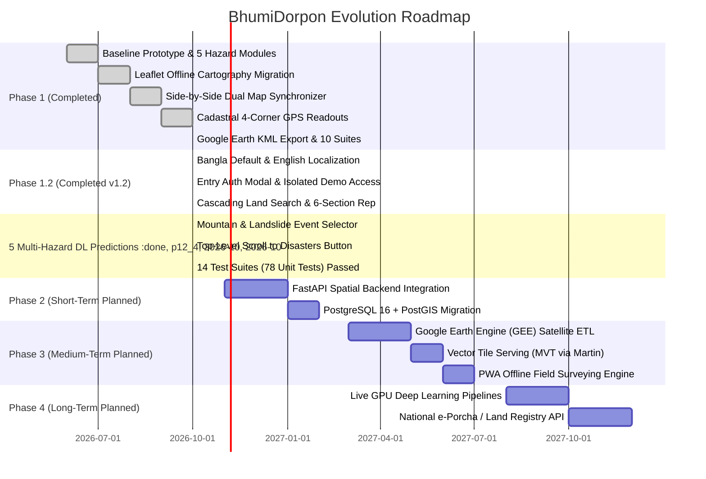

# Project Roadmap — BhumiDorpon
**Bangladesh Cadastral Land-Change Records & Multi-Hazard Geospatial Dashboard**

---

> **Document Status:** Authoritative Development & Evolution Roadmap  
> **Current Project Status:** **v1.2 Release Complete (Full Enhancement with Client Auth, Localization, Land Search & Landslide Selectors)**  
> **Team:** GeoNeural  
> **Last Updated:** October 2026  
> **Cross-References:** [Main Documentation](MAIN_PROJECT_DOCUMENTATION.md) | [PRD](PRD.md) | [TRD](TRD.md) | [System Architecture](ARCHITECTURE.md) | [Database Schema](DATABASE_SCHEMA.md) | [Testing & QA](TESTING_QA.md)

---

## Table of Contents

- [1. Current Project Maturity Status](#1-current-project-maturity-status)
- [2. Chronological Milestones Completed & Verified](#2-chronological-milestones-completed--verified)
  - [2.1 Phase 1 Baseline Prototype (v1.1)](#21-phase-1-baseline-prototype-v11)
  - [2.2 Phase 1.2 System Enhancement (v1.2 Release) — COMPLETED](#22-phase-12-system-enhancement-v12-release--completed)
- [3. Strategic Evolution Phases](#3-strategic-evolution-phases)
  - [3.1 Phase 2: Production Spatial Backend & Database (Q4 2026 – Q1 2027)](#31-phase-2-production-spatial-backend--database-q4-2026--q1-2027)
  - [3.2 Phase 3: Earth Observation & Cloud Ingestion Pipeline (Q2 2027 – Q3 2027)](#32-phase-3-earth-observation--cloud-ingestion-pipeline-q2-2027--q3-2027)
  - [3.3 Phase 4: Institutional Land Integration & Operational Deep Learning (Q4 2027 – 2028)](#33-phase-4-institutional-land-integration--operational-deep-learning-q4-2027--2028)
- [4. Detailed Feature Roadmap & Status Matrix](#4-detailed-feature-roadmap--status-matrix)
- [5. Resource Requirements and Governance](#5-resource-requirements-and-governance)

---

## 1. Current Project Maturity Status

BhumiDorpon is currently in an advanced **Enhanced Functional Release (v1.2)** stage. The entire user-facing web application is fully interactive, responsive, bilingual (Bangla default / English toggle), and operational across modern desktop and mobile browsers. It operates with client-side execution backed by a deterministic, relational JSON store located in `public/mocks/` and `mocks/`, client-side authentication and session isolation (`lib/auth.ts`), cascading cadastral parcel searching (`lib/landSearch.ts`), and mountain-based landslide historical analysis (`lib/landslideEvents.ts`).

---

## 2. Chronological Milestones Completed & Verified

### 2.1 Phase 1 Baseline Prototype (v1.1)
1. **National Summary Dashboard:** High-level KPI aggregations, multi-year trend charts, hazard breakdown bars, and top-impacted district rankings.
2. **Five Core Hazard Modules:**
   - **River Erosion:** Kazipur pilot with bankline migration, retreat transect metrics, and landowner compensation table.
   - **Flood Monitoring:** Sylhet/Jaflong pilot with multi-depth contours (Shallow, Moderate, Deep) and parcel submersion.
   - **Landslides:** Rangamati pilot with synthetic DEM hillshades, contours, spot heights, slope angles, and debris runout buffers.
   - **Char Islands:** Jamuna Char Girish pilot with accretion tips (green), erosion flanks (coral), and state khas land cards.
   - **Coastal Changes:** Bhola pilot with marine shoreline retreat, embankments, and unassigned mudflats.
3. **Synchronized Side-by-Side Map Comparison:**
   - Simultaneous Before/After dual-panel synchronized layout with re-entrancy locks (`isSyncing`).
   - Dual basemaps: Authoritative `Light GIS` vector cartography (zero external tile dependencies) and `Satellite` (Esri World Imagery).
   - Dedicated direct-click `+` / `−` zoom controls.
4. **Cadastral Four-Corner GPS Boundary Readouts:**
   - Flood Owner Land Page displaying individual plots with **Corner 1 NW, 2 NE, 3 SE, 4 SW coordinates to 6 decimal places**.
   - One-click "Copy 4 Corners", "Copy All Coordinates", and "Download GeoJSON" actions.
5. **Google Earth Parcel Outline Feature:**
   - One-click "Open in Google Earth" button on Flood Owner Land Detail pages.
   - Pure client-side KML 2.2 serializer (`lib/googleEarth.ts`) generating closed parcel polygons and 4 corner placemarks.
6. **Rule 5 Compliance (Strict Forecast Guardrails):**
   - In Forecast mode, all financial disbursement fields (`Paid`, `Approved`, `Pending`) are strictly omitted.
7. **Platform Settings Hub:**
   - Dedicated Settings route (`/settings`) with verified About Project (`/settings/about`) and Team Information (`/settings/team`) views.

### 2.2 Phase 1.2 System Enhancement (v1.2 Release) — COMPLETED
1. **Bilingual Localization Engine (`lib/translations.ts`):**
   - Bangla configured as the primary default language (`bn`) upon first visit.
   - Header toggle (`বাংলা | English`) switches all UI text, headings, buttons, empty states, and badges instantly without reloading or resetting active filters.
   - Bengali numeral localization (`formatNumberLocalized`) converting `0-9` to `০-৯`.
2. **Initial Authentication Entry & Isolated Demo Access (`lib/auth.ts`, `AuthModal.tsx`, `/login`):**
   - Responsive authentication modal displayed on first unauthenticated visit.
   - Standalone `/login` route with login and registration tabs.
   - Prominent **"Demo / ডেমো হিসেবে প্রবেশ করুন"** button granting immediate exploration access.
   - Strict demo isolation (`isDemo: true`) preventing unauthorized administrative actions via `canPerformAdministrativeAction`.
   - Top-level persistent banner (`DemoBanner.tsx`) providing demo status and quick login switch.
3. **Global Land Information Cascading Search (`/land-information`, `lib/landSearch.ts`):**
   - Header action button **"Land Information / ভূমির তথ্য"** linking to dedicated search route.
   - 5 cascading search fields: District &rarr; Upazila &rarr; Mouza &rarr; Dag No. &rarr; Khatian No.
   - Leading zero string preservation (`"0101"`, `"RS-475"` never cast to numbers).
   - Structured 6-section report:
     - Section A: Land Identification with 4-corner GPS coordinates.
     - Section B: Ownership Information (recorded names, shares, verification status).
     - Section C: Sale & Transaction Status.
     - Section D: Legal Dispute & Court Case Information.
     - Section E: Land Development Tax (LD Tax) & Payment Records.
     - Section F: Ownership & Registration History.
   - Standardized status badges (`যাচাই করা`, `ডেমো ডেটা`, `তথ্য পাওয়া যায়নি`, `বাহ্যিক ডেটা সংযোগ প্রয়োজন`).
4. **Section 5: Disaster-Related Land Change and Risk Analysis:**
   - Dedicated analysis module embedded below general land information.
   - Historical land change records (loss, accretion, deposition, event dates).
   - Physical parcel status preservation: Clearly separates completely submerged parcels (`Completely Submerged / নদীগর্ভে বিলীন`) from existing plots while preserving cadastral identity.
   - Deep-learning multi-hazard risk prediction displaying 4 model forecasts (ConvLSTM, HydroSAR, InSAR SlopeNet, CoastWatch) with probability, period, and confidence scores.
5. **Two-Step Mountain and Historical Landslide Selector (`components/MountainEventSelector.tsx`):**
   - Step 1: Mountain / Hill selection (Batali Hill, Tiger Pass, Moti Jhorna, Rangamati Sadar, Kaptai, Nilachal).
   - Step 2: Dependent historical landslide event selection showing date, impact, rainfall trigger, and coordinates.
   - Integrated into both Recorded and Forecast modes on `/landslide` and `/landslide/[mode]`.
   - Automatic event reset when mountain changes.
6. **Top-Level Scroll to Disasters Button:**
   - **"Explore Disasters / দুর্যোগসমূহ দেখুন"** button added to homepage hero.
   - Smoothly scrolls to `#disaster-options` with `scroll-mt-24` accounting for sticky header chrome.
7. **Comprehensive Testing & Validation:**
   - 14 test suites and 78 unit tests passing with 100% success (`npm test`).
   - Zero TypeScript compilation errors (`npm run lint`).
   - Successful Next.js static production build of all 15 routes (`npm run build`).

---

## 3. Strategic Evolution Phases

### 3.1 Phase 2: Production Spatial Backend & Database (Q4 2026 – Q1 2027)
- **FastAPI Spatial Backend:** Replace client mock services with high-performance asynchronous REST endpoints written in Python 3.11.
- **PostgreSQL 16 + PostGIS 3.4 Migration:** Deploy the production relational schema defined in `DATABASE_SCHEMA.md`, enabling sub-millisecond bounding box searches across millions of cadastral plots.

### 3.2 Phase 3: Earth Observation & Cloud Ingestion Pipeline (Q2 2027 – Q3 2027)
- **Google Earth Engine (GEE) Automated Satellite Ingest:** Deploy cloud-scale GEE pipelines querying Copernicus Sentinel-1 (SAR) for cloud-penetrating flood mapping and Sentinel-2 (optical) for riverbank retreat monitoring.
- **Dynamic Vector Tile Serving:** Implement Martin / Tippecanoe to serve cadastral plots and hazard overlays as lightweight Mapbox Vector Tiles (`.pbf`).
- **Progressive Web App (PWA) Offline Engine:** Introduce Service Workers and IndexedDB local storage to allow rural land surveyors to collect field GPS coordinates without cellular connectivity.

### 3.3 Phase 4: Institutional Land Integration & Operational Deep Learning (Q4 2027 – 2028)
- **Operational Spatiotemporal Forecasting (Live GPU Pipeline):** Deploy trained ConvLSTM and HydroSAR models on dedicated GPU clusters for real-time inference on new satellite acquisitions.
- **National Land Registry Integration:** Establish secure API connectors with the Ministry of Land's **e-Porcha** and **e-Mutation** portals under official government regulatory frameworks.
- **Disaster Displacement Warning System:** Automated SMS and Union Parishad bulletin generation notifying registered landowners when their specific Dag numbers fall within 1-year high-vulnerability hazard zones.

---

## 4. Detailed Feature Roadmap & Status Matrix

| Subsystem / Capability | Planned Timeline | Current Status | Target Architecture |
|---|---|---|---|
| **National Summary Dashboard** | Phase 1 (Oct 2026) | **Completed** | Next.js 14 + Recharts (Client-Side) |
| **5 Core Hazard Modules** | Phase 1 (Oct 2026) | **Completed** | Next.js 14 App Router |
| **Offline Light GIS Basemap** | Phase 1 (Oct 2026) | **Completed** | Pure Leaflet 1.9 + SVG Vectors |
| **Dual-Map Synchronizer** | Phase 1 (Oct 2026) | **Completed** | Event-driven pub/sub with re-entrancy locks |
| **Cadastral 4-Corner Readout** | Phase 1 (Oct 2026) | **Completed** | Fixed NW, NE, SE, SW ordering to 6 decimals |
| **Google Earth KML Export** | Phase 1 (Oct 2026) | **Completed** | Client-side KML 2.2 serializer (`lib/googleEarth.ts`) |
| **Rule 5 Forecast Guardrail** | Phase 1 (Oct 2026) | **Completed** | Strict suppression of disbursement metrics |
| **Settings Navigation Hub** | Phase 1 (Oct 2026) | **Completed** | About Project & Team Information |
| **Bangla Default & English Localization** | Phase 1.2 (v1.2) | **Completed** | Centralized dictionary & numeral formatter (`lib/translations.ts`) |
| **Entry Auth & Demo Access Bypass** | Phase 1.2 (v1.2) | **Completed** | Client-side session manager & AuthModal (`lib/auth.ts`) |
| **Cascading Land Information Search** | Phase 1.2 (v1.2) | **Completed** | 5-field cascading search & 6-section report (`lib/landSearch.ts`) |
| **Section 5 Multi-Hazard DL Predictions**| Phase 1.2 (v1.2) | **Completed** | Historical change & 4 DL prediction models |
| **Mountain & Landslide Event Selector** | Phase 1.2 (v1.2) | **Completed** | 2-step selector across both modes (`MountainEventSelector.tsx`) |
| **Scroll to Disasters Navigation Button**| Phase 1.2 (v1.2) | **Completed** | Smooth scroll to `#disaster-options` with header offset |
| **14-Suite Automated Test Suite** | Phase 1.2 (v1.2) | **Completed** | Vitest (78/78 tests passing) |
| **FastAPI REST Gateway** | Phase 2 (Dec 2026) | **Planned** | Python 3.11 + Pydantic v2 |
| **PostgreSQL 16 + PostGIS 3.4** | Phase 2 (Jan 2027) | **Planned** | Spatial database with UTM 46N area math |
| **Google Earth Engine (GEE) ETL** | Phase 3 (Mar 2027) | **Planned** | Cloud-scale Sentinel-1/2 automated ingest |
| **Vector Tile Serving (MVT)** | Phase 3 (May 2027) | **Planned** | Martin Vector Tile Server (`.pbf`) |
| **PWA Offline Field Surveying** | Phase 3 (Jun 2027) | **Planned** | Service Workers + IndexedDB local caching |
| **Operational Live GPU Deep Learning** | Phase 4 (Aug 2027) | **Planned** | Live PyTorch inference cluster |
| **e-Porcha / DLRS API Connector** | Phase 4 (Oct 2027) | **Under Review**| Institutional Land Ministry API integration |

---

## 5. Resource Requirements and Governance

- **Frontend Hosting:** Next.js 14 edge deployment via Vercel or sovereign government data center.
- **Spatial Backend Hosting:** Scalable container cluster (Kubernetes / Docker) hosting FastAPI backend and PostGIS database.
- **Geospatial Compute:** Google Cloud Service Account with Earth Engine compute enablement for seasonal satellite composites.
- **Governance:** Development governed by Team GeoNeural under national land administration data privacy standards.
