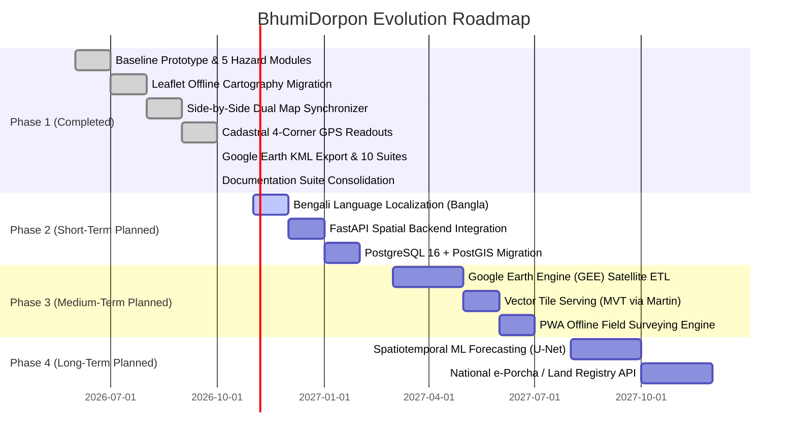

# Project Roadmap — BhumiDorpon
**Bangladesh Cadastral Land-Change Records & Multi-Hazard Geospatial Dashboard**

---

> **Document Status:** Authoritative Development & Evolution Roadmap  
> **Current Project Status:** **Phase 1 Complete (Operational Demonstration Prototype v1.1)**  
> **Team:** GeoNeural  
> **Last Updated:** October 2026  
> **Cross-References:** [Main Documentation](MAIN_PROJECT_DOCUMENTATION.md) | [PRD](PRD.md) | [TRD](TRD.md) | [System Architecture](ARCHITECTURE.md) | [Database Schema](DATABASE_SCHEMA.md) | [Testing & QA](TESTING_QA.md)

---

## Table of Contents

- [1. Current Project Maturity Status](#1-current-project-maturity-status)
- [2. Chronological Milestones Completed & Verified (Phase 1)](#2-chronological-milestones-completed--verified-phase-1)
- [3. Strategic Evolution Phases](#3-strategic-evolution-phases)
  - [3.1 Phase 2: Production Spatial Backend & Localization (Q4 2026 – Q1 2027)](#31-phase-2-production-spatial-backend--localization-q4-2026--q1-2027)
  - [3.2 Phase 3: Earth Observation & Cloud Ingestion Pipeline (Q2 2027 – Q3 2027)](#32-phase-3-earth-observation--cloud-ingestion-pipeline-q2-2027--q3-2027)
  - [3.3 Phase 4: Institutional Land Integration & Deep Learning (Q4 2027 – 2028)](#33-phase-4-institutional-land-integration--deep-learning-q4-2027--2028)
- [4. Detailed Feature Roadmap & Status Matrix](#4-detailed-feature-roadmap--status-matrix)
- [5. Resource Requirements and Governance](#5-resource-requirements-and-governance)

---

## 1. Current Project Maturity Status

BhumiDorpon is currently in a mature **Demonstration Prototype (v1.1)** stage. The entire user-facing web application is fully interactive, responsive, and operational across modern desktop and mobile browsers. It operates with client-side execution backed by a deterministic, relational JSON store located in `public/mocks/` and `mocks/`.

---

## 2. Chronological Milestones Completed & Verified (Phase 1)

The following capabilities have been fully implemented, verified, and merged into the active repository:

1. **National Summary Dashboard:** High-level KPI aggregations, multi-year trend charts, hazard breakdown bars, and top-impacted district rankings.
2. **Five Core Hazard Modules:**
   - **River Erosion:** Kazipur pilot with bankline migration, retreat transect metrics, and landowner compensation table.
   - **Flood Monitoring:** Sylhet/Jaflong pilot with multi-depth contours (Shallow, Moderate, Deep) and parcel submersion.
   - **Landslides:** Rangamati pilot with synthetic DEM hillshades, contours, spot heights, slope angles, and debris runout buffers.
   - **Char Islands:** Jamuna Char Girish pilot with accretion tips (green), erosion flanks (coral), and state khas land cards.
   - **Coastal Changes:** Bhola pilot with marine shoreline retreat, embankments, and unassigned mudflats.
3. **Synchronized Side-by-Side Map Comparison:**
   - Simultaneous Before/After dual-panel synchronized layout with re-entrancy locks (`isSyncing`).
   - Dual basemaps: Authoritative `Light GIS` vector cartography (zero external tile dependencies) and `Satellite` (Esri World Imagery).
   - Dedicated direct-click `+` / `−` zoom controls.
4. **Cadastral Four-Corner GPS Boundary Readouts:**
   - Flood Owner Land Page displaying individual plots with **Corner 1 NW, 2 NE, 3 SE, 4 SW coordinates to 6 decimal places**.
   - One-click "Copy 4 Corners", "Copy All Coordinates", and "Download GeoJSON" actions.
   - Centroid coordinates intentionally suppressed to eliminate geometric confusion.
5. **Google Earth Parcel Outline Feature:**
   - One-click "Open in Google Earth" button on Flood Owner Land Detail pages.
   - Pure client-side KML 2.2 serializer (`lib/googleEarth.ts`) generating closed parcel polygons and 4 corner placemarks.
   - Synchronous Google Earth Web URL camera positioning and 12-second on-screen import guidance toast.
   - 7 automated unit tests in `tests/google_earth_kml.test.ts`.
6. **Rule 5 Compliance (Strict Forecast Guardrails):**
   - In Forecast mode, all financial disbursement fields (`Paid`, `Approved`, `Pending`) are strictly omitted, displaying only projected compensation metrics.
7. **Platform Settings Hub:**
   - Dedicated Settings route (`/settings`) with verified **About Project** (`/settings/about`) and **Team Information** (`/settings/team`) views displaying official team attribution (Team GeoNeural: Pantho Raj Biswas, Puja Paul).
8. **Automated Testing Suite:**
   - 10 comprehensive Vitest test suites executing **61 passing unit tests** with 100% pass rate.
   - Clean TypeScript compilation (`npx tsc --noEmit`: 0 errors).
9. **Technical Documentation Suite:**
   - Consolidated into exactly 12 authoritative Markdown specifications in `/docs` with consistent numbering, working anchors, and professional English.

---

## 3. Strategic Evolution Phases

### 3.1 Phase 2: Production Spatial Backend & Localization (Q4 2026 – Q1 2027)
- **Bengali Language Localization (Bangla UI):** Implement internationalization (i18n) across all navigation, headings, table columns, and map controls, allowing seamless toggling between English and Bengali.
- **FastAPI Spatial Backend:** Replace in-memory `lib/data.ts` queries with high-performance asynchronous REST endpoints written in Python 3.11.
- **PostgreSQL 16 + PostGIS 3.4 Migration:** Deploy the production relational schema defined in `DATABASE_SCHEMA.md`, enabling sub-millisecond bounding box searches across millions of cadastral plots.

### 3.2 Phase 3: Earth Observation & Cloud Ingestion Pipeline (Q2 2027 – Q3 2027)
- **Google Earth Engine (GEE) Automated Satellite Ingest:** Deploy cloud-scale GEE pipelines querying Copernicus Sentinel-1 (SAR) for cloud-penetrating flood mapping and Sentinel-2 (optical) for riverbank retreat monitoring.
- **Dynamic Vector Tile Serving:** Implement Martin / Tippecanoe to serve cadastral plots and hazard overlays as lightweight Mapbox Vector Tiles (`.pbf`).
- **Progressive Web App (PWA) Offline Engine:** Introduce Service Workers and IndexedDB local storage to allow rural land surveyors to collect field GPS coordinates without cellular connectivity.

### 3.3 Phase 4: Institutional Land Integration & Deep Learning (Q4 2027 – 2028)
- **Operational Spatiotemporal Forecasting (U-Net / ConvLSTM):** Train and deploy deep neural networks on historical multitemporal satellite rasters to generate verified 1-year predictive hazard envelopes.
- **National Land Registry Integration:** Establish secure API connectors with the Ministry of Land's **e-Porcha** and **e-Mutation** portals under official government regulatory frameworks.
- **Disaster Displacement Warning System:** Automated SMS and Union Parishad bulletin generation notifying registered landowners when their specific Dag numbers fall within 1-year high-vulnerability hazard zones.

---

## 4. Detailed Feature Roadmap & Status Matrix

| Subsystem / Capability | Planned Timeline | Current Status | Target Architecture |
|---|---|---|---|
| **National Summary Dashboard** | Phase 1 (Oct 2026) | **Completed** | Next.js 14 + Recharts (Client-Side) |
| **5 Core Hazard Modules** | Phase 1 (Oct 2026) | **Completed** | Next.js 14 App Router |
| **Offline Light GIS Basemap** | Phase 1 (Oct 2026) | **Completed** | Pure Leaflet 1.9 + SVG Vectors |
| **Dual-Map Synchronizer** | Phase 1 (Oct 2026) | **Completed** | Event-driven pub/sub with re-entrancy locks |
| **Cadastral 4-Corner Readout** | Phase 1 (Oct 2026) | **Completed** | Fixed NW, NE, SE, SW ordering to 6 decimals |
| **Google Earth KML Export** | Phase 1 (Oct 2026) | **Completed** | Client-side KML 2.2 serializer (`lib/googleEarth.ts`) |
| **Rule 5 Forecast Guardrail** | Phase 1 (Oct 2026) | **Completed** | Strict suppression of disbursement metrics |
| **Settings Navigation Hub** | Phase 1 (Oct 2026) | **Completed** | About Project & Team Information |
| **10-Suite Automated Test Suite** | Phase 1 (Oct 2026) | **Completed** | Vitest (61/61 tests passing) |
| **12-File Documentation Suite** | Phase 1 (Oct 2026) | **Completed** | 12 standardized Markdown files in `/docs` |
| **Bengali Language Localization** | Phase 2 (Nov 2026) | **In Progress** | `next-intl` bilingual UI toggling |
| **FastAPI REST Gateway** | Phase 2 (Dec 2026) | **Planned** | Python 3.11 + Pydantic v2 |
| **PostgreSQL 16 + PostGIS 3.4** | Phase 2 (Jan 2027) | **Planned** | Spatial database with UTM 46N area math |
| **Google Earth Engine (GEE) ETL** | Phase 3 (Mar 2027) | **Planned** | Cloud-scale Sentinel-1/2 automated ingest |
| **Vector Tile Serving (MVT)** | Phase 3 (May 2027) | **Planned** | Martin Vector Tile Server (`.pbf`) |
| **PWA Offline Field Surveying** | Phase 3 (Jun 2027) | **Planned** | Service Workers + IndexedDB local caching |
| **U-Net / ConvLSTM Prediction** | Phase 4 (Aug 2027) | **Planned** | Offline GPU training on multitemporal rasters |
| **e-Porcha / DLRS API Connector** | Phase 4 (Oct 2027) | **Under Review**| Institutional Land Ministry API integration |

---

## 5. Resource Requirements and Governance

- **Cloud Hosting:** Scalable container cluster (Kubernetes / Docker) hosting Next.js frontend and FastAPI backend.
- **Spatial Storage:** Managed PostgreSQL 16 instance with 500GB SSD storage and automated spatial backups.
- **Geospatial Compute:** Google Cloud Service Account with Earth Engine compute enablement for seasonal satellite composites.
- **Governance:** Development governed by Team GeoNeural under the LandTech Innovation Hackathon guidelines and national land administration data privacy standards.
