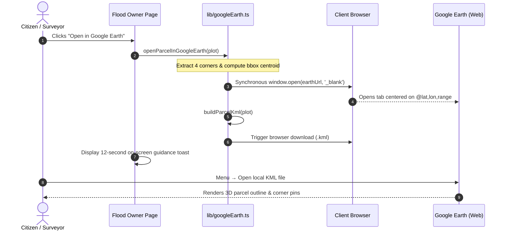
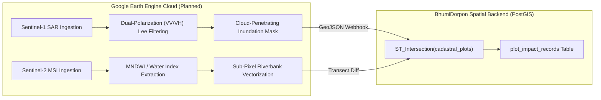

# Technical Requirements Document (TRD) — BhumiDorpon
**Bangladesh Cadastral Land-Change Records & Multi-Hazard Geospatial Dashboard**

---

> **Document Status:** Authoritative Technical Specification  
> **System Version:** 1.1 (Demonstration Release)  
> **Target Runtime:** Node.js 18+ / 20+ | Modern Web Browsers  
> **Team:** GeoNeural  
> **Last Updated:** October 2026  
> **Cross-References:** [Main Documentation](MAIN_PROJECT_DOCUMENTATION.md) | [PRD](PRD.md) | [System Architecture](ARCHITECTURE.md) | [Database Schema](DATABASE_SCHEMA.md) | [API Documentation](API_DOCUMENTATION.md) | [UI/UX Design System](UI_UX_DESIGN_SYSTEM.md) | [Testing & QA](TESTING_QA.md)

---

## Table of Contents

- [1. Technology Stack and Verified Versions](#1-technology-stack-and-verified-versions)
- [2. Framework and Programming Languages](#2-framework-and-programming-languages)
- [3. Project Directory Structure](#3-project-directory-structure)
- [4. Five-Hazard Information Store Architecture](#4-five-hazard-information-store-architecture)
  - [4.1 Dual JSON Storage Model](#41-dual-json-storage-model)
  - [4.2 Information Store Catalog](#42-information-store-catalog)
  - [4.3 Data Access Layer (lib/data.ts)](#43-data-access-layer-libdatats)
- [5. Mathematical Specifications and Unit Conversions](#5-mathematical-specifications-and-unit-conversions)
  - [5.1 Land Area Conversion Ratios](#51-land-area-conversion-ratios)
  - [5.2 Financial Compensation Formula](#52-financial-compensation-formula)
- [6. Cadastral Four-Corner Geometry Engine](#6-cadastral-four-corner-geometry-engine)
  - [6.1 Quadrilateral Invariant & Vertex Ordering](#61-quadrilateral-invariant--vertex-ordering)
  - [6.2 GPS Coordinate Readout & Centroid Suppression](#62-gps-coordinate-readout--centroid-suppression)
- [7. Google Earth Integration (Client-Side)](#7-google-earth-integration-client-side)
  - [7.1 Architecture & Workflow](#71-architecture--workflow)
  - [7.2 KML 2.2 Document Serializer (lib/googleEarth.ts)](#72-kml-22-document-serializer-libgoogleearthts)
  - [7.3 Camera Parameter Math & URL Formatting](#73-camera-parameter-math--url-formatting)
  - [7.4 Client Privacy & Network Boundary](#74-client-privacy--network-boundary)
- [8. Google Earth Engine (GEE) — Proposed Cloud Pipeline](#8-google-earth-engine-gee--proposed-cloud-pipeline)
  - [8.1 Distinct Technical Role](#81-distinct-technical-role)
  - [8.2 Planned Remote Sensing Ingestion Pipeline](#82-planned-remote-sensing-ingestion-pipeline)
  - [8.3 Current Non-Operational Status](#83-current-non-operational-status)
- [9. Cartography & Dual-Map Synchronization Engine](#9-cartography--dual-map-synchronization-engine)
  - [9.1 Pure Leaflet Offline Architecture](#91-pure-leaflet-offline-architecture)
  - [9.2 Leaflet Custom Panes & Stacking Order](#92-leaflet-custom-panes--stacking-order)
  - [9.3 SVG Hatch Pattern Injection](#93-svg-hatch-pattern-injection)
  - [9.4 Bidirectional Synchronization with Re-Entrancy Guards](#94-bidirectional-synchronization-with-re-entrancy-guards)
- [10. State Management & Data Fetching](#10-state-management--data-fetching)
- [11. Component Hierarchy and Design System](#11-component-hierarchy-and-design-system)
- [12. Testing and Quality Assurance Specifications](#12-testing-and-quality-assurance-specifications)
- [13. Performance Constraints and Build Rules](#13-performance-constraints-and-build-rules)
- [14. Browser Compatibility](#14-browser-compatibility)
- [15. Troubleshooting and Maintenance](#15-troubleshooting-and-maintenance)
- [16. Proposed Production Architecture](#16-proposed-production-architecture)

---

## 1. Technology Stack and Verified Versions

The technology stack is verified directly against [`package.json`](file:///d:/Project/Antigravity/BhumiDorpon/package.json) and project configuration files:

| Layer / Subsystem | Package / Technology | Verified Version | Purpose & Technical Rationale |
|---|---|---|---|
| **Core Framework** | Next.js | `^14.2.15` | App Router architecture, static generation, file-based routing, and React Server/Client Component model. |
| **Runtime Language** | TypeScript | `^5.6.2` | Static type safety, strict interface definitions, and compile-time contract enforcement. |
| **UI Library** | React & React DOM | `^18.3.1` | Component-based interactive UI rendering. |
| **CSS Framework** | Tailwind CSS | `^3.4.13` | Utility-first styling framework integrated with custom design tokens in `app/globals.css`. |
| **PostCSS Processor** | PostCSS / Autoprefixer | `^8.4.47` / `^10.4.20` | CSS preprocessing and automated vendor prefixing. |
| **Class Utilities** | clsx & tailwind-merge | `^2.1.1` / `^2.5.3` | Conflict-free conditional CSS class concatenation. |
| **Component Primitives**| Radix UI Primitives | Dialog (`^1.1.2`), Dropdown (`^2.1.2`), Popover (`^1.2.0`), Slider (`^1.2.1`), Tabs (`^1.1.1`), Tooltip (`^1.1.3`) | Unstyled, fully accessible WAI-ARIA compliant interactive primitives. |
| **Command Palette** | cmdk | `^1.1.1` | Fast, keyboard-accessible command menu. |
| **Iconography** | Lucide React | `^0.447.0` | Consistent, lightweight SVG iconography. |
| **Mapping Engine** | Leaflet & react-leaflet | `^1.9.4` / `^4.2.1` | Lightweight, mobile-friendly interactive mapping, pure SVG vector rendering, and dynamic hatch pattern injection (Zero MapLibre/Mapbox). |
| **Spatial Analysis** | Turf.js (`@turf/turf`) | `^7.4.0` | Client-side geospatial polygon intersections, bounding box math, and centroid calculation. |
| **Data Visualization** | Recharts | `^2.12.7` | Declarative SVG charting for multi-year trends, distributions, and KPI metrics. |
| **Client State Store** | Zustand | `^4.5.5` | Lightweight global state store for active units, selections, and layer visibility. |
| **Data Fetching / Cache** | TanStack React Query | `^5.59.0` | Asynchronous query management, caching, and state synchronization with simulated network latency. |
| **Unit Testing** | Vitest | `^4.1.11` | High-speed unit test runner executing 10 comprehensive test suites (61 tests). |
| **E2E Testing** | Playwright | Configured (`e2e/`) | Browser verification of map viewports, cascades, and corner coordinates. |

---

## 2. Framework and Programming Languages

- **Programming Language:** TypeScript 5.6.2 configured in strict mode (`"strict": true` in [`tsconfig.json`](file:///d:/Project/Antigravity/BhumiDorpon/tsconfig.json)).
- **Module Resolution:** Bundler mode (`"moduleResolution": "bundler"`) with ES2020 target and custom path aliases (`@/*` pointing to project root).
- **Framework Strategy:** Next.js 14 App Router. Interactive map components and client hooks utilize the `"use client"` directive to enable browser DOM rendering.
- **Node.js Memory Allocation:** Build scripts are configured with `--max-old-space-size=1536` to guarantee successful compilation in constrained CI/CD and containerized environments.

---

## 3. Project Directory Structure

```text
BhumiDorpon/
├── app/                                 # Next.js App Router route segments
│   ├── layout.tsx                       # Root HTML shell and QueryProvider wrapper
│   ├── page.tsx                         # National Summary Dashboard
│   ├── globals.css                      # Design tokens, CSS variables, and Leaflet overrides
│   ├── river-erosion/                   # River erosion hazard routes
│   │   ├── page.tsx                     # Top-level selector / mode dispatcher
│   │   └── [mode]/                      # Mode-specific route (`recorded` | `forecast`)
│   │       ├── page.tsx                 # Selector view and mouza results list
│   │       └── [mouzaId]/page.tsx       # Detailed side-by-side mouza map view
│   ├── flood/                           # Flood monitoring hazard routes
│   │   ├── page.tsx                     # Flood archive event list
│   │   └── [mouzaId]/[floodId]/         # Detailed flood inundation map view
│   │       ├── page.tsx                 # Flood map and parcel submersion table
│   │       └── owner/[ownerId]/page.tsx # Owner land page with 4-corner GPS & Google Earth button
│   ├── landslide/                       # Landslide hazard routes
│   │   └── [mode]/                      # Recorded / Forecast routes
│   │       ├── page.tsx                 # Hill selector and event list
│   │       └── [eventId]/page.tsx       # Detailed DEM hillshade and debris map view
│   ├── char/                            # Char island hazard routes
│   │   └── [mode]/                      # Recorded / Forecast routes
│   │       ├── page.tsx                 # River & char island selector
│   │       └── [resultId]/page.tsx      # Detailed accretion/erosion map view
│   ├── coastal/                         # Coastal shoreline hazard routes
│   │   └── [mode]/                      # Recorded / Forecast routes
│   │       ├── page.tsx                 # Coastal mouza selector
│   │       └── [resultId]/page.tsx      # Detailed coastal retreat map view
│   ├── settings/                        # Platform settings hub
│   │   ├── page.tsx                     # Settings menu (About & Team)
│   │   ├── about/page.tsx               # About Project details
│   │   └── team/page.tsx                # Team Information and copyright
│   └── dev/components/page.tsx          # Component library testing harness
├── components/                          # Shared UI and visualization components
│   ├── AppHeader.tsx                    # Top application header with title and unit toggle
│   ├── AppSidebar.tsx                   # Fixed 72px left-hand icon navigation bar
│   ├── DemoBanner.tsx                   # Sticky mock data disclaimer banner
│   ├── EmptyState.tsx                   # Standardized zero-result empty state component
│   ├── SelectorChain.tsx                # Cascading dropdown hierarchy
│   ├── map/                             # Leaflet mapping engine subsystem
│   │   ├── HazardMapContainer.tsx       # Map wrapper with basemap switcher & sync
│   │   ├── GisMapCompare.tsx            # Synchronized side-by-side dual Leaflet instances
│   │   ├── RiverErosionMap.tsx          # River erosion vector banklines & transects
│   │   ├── FloodMap.tsx                 # Multi-depth flood contours & owner parcels
│   │   ├── LandslideMap.tsx             # Synthetic DEM hillshade & contour layers
│   │   ├── CharMap.tsx                  # Accretion tips & erosion flank polygons
│   │   ├── CoastalMap.tsx               # Shoreline retreat & intertidal mudflats
│   │   ├── basemap/LightGisBasemap.tsx  # Custom high-contrast Light GIS vector basemap
│   │   └── chrome/                      # Graticules, scale bar, north arrow, locator inset
├── lib/                                 # Business logic, data access, and utilities
│   ├── data.ts                          # Single Data Access Layer (loadMockJson)
│   ├── googleEarth.ts                   # Pure client-side KML 2.2 serializer & URL math
│   ├── units.ts                         # Mathematical land unit conversions & currency formatters
│   ├── utils.ts                         # Class merging and string utilities
│   └── types.ts                         # TypeScript domain models and hazard interfaces
├── mocks/                               # Server/Test source copy of mock JSON files
├── public/mocks/                        # Client browser copy of mock JSON files
├── tests/                               # Vitest automated unit test suites (10 suites, 61 tests)
└── docs/                                # Exactly 12 consolidated documentation files
```

---

## 4. Five-Hazard Information Store Architecture

### 4.1 Dual JSON Storage Model
All data for the five hazard categories is organized as a deterministic, relational JSON store. There is no external database or backend server.
1. **Runtime Store (`public/mocks/*.json`):** Static assets served at `/mocks/*` and fetched by client browser components through `loadMockJson()` in `lib/data.ts`.
2. **Server / Test Store (`mocks/*.json`):** Synchronous mirror read via `fs.readFileSync` in Node.js and Vitest test environments.
3. Both stores are generated simultaneously by `npm run generate:mocks` (`scripts/generate-mocks.ts`), ensuring 100% deterministic reproducibility.

### 4.2 Information Store Catalog

| Store Category | File Path | Content & Entity Schema | Consumer |
|---|---|---|---|
| **Administrative Indices** | `districts.json`, `upazilas.json`, `mouzas.json`, `rivers.json`, `hills.json` | Hierarchical administrative bounds, names (English and Bengali), and parent IDs. | `SelectorChain.tsx`, `lib/data.ts` |
| **Hazard Master Datasets** | `river_erosion.json`, `flood.json`, `landslide.json`, `char.json`, `coastal.json` | Master hazard events, damage metrics, compensation totals, and affected plot IDs. | `lib/data.ts` (`listResults`, `getFlood`) |
| **Cadastral Ownership Store** | `owners.json`, `plots.json` | Fictional landowner profiles, deeds (Khatian No.), Dag numbers, and 4-corner coordinates. | `OwnerLandDetail`, `GoogleEarth` |
| **Per-Area Map Packages** | `public/mocks/areas/<hazard>/area_*.json` | Self-contained spatial packages (`areaId`, `bounds`, `basemap`, `hazardLayers`, `context`, `owners`). | `HazardMapContainer`, `lib/data.ts` |
| **Landslide Terrain Rasters** | `public/mocks/rasters/<area>/`, `public/mocks/hillshades/` | Pre-rendered elevation PNGs, hillshade rasters, 10m contour GeoJSON, and spot heights. | `LandslideMap.tsx` |
| **Spatial Package Index** | `areas_index.json` | Hash map resolving `(hazard, mode, mouzaId)` tuples to specific map package filenames. | `lib/data.ts` (`getMapArea`) |

### 4.3 Data Access Layer (`lib/data.ts`)
All UI components read hazard information exclusively through `lib/data.ts`. Direct `fetch()` calls to mock files from React components are strictly prohibited:
- Implements in-memory module-level caching after initial fetch.
- Simulates natural network latency (200ms–400ms) to validate loading skeletons and UI spinners.
- Enforces Rule 5 guardrails on `getDashboardSummary("forecast")` by stripping all financial disbursement fields.

---

## 5. Mathematical Specifications and Unit Conversions

### 5.1 Land Area Conversion Ratios
All internal geospatial areas in BhumiDorpon are stored in **Decimals** (শতাংশ) as the standard deltaic land unit. Conversions execute with double-precision floating-point arithmetic defined in [`lib/units.ts`](file:///d:/Project/Antigravity/BhumiDorpon/lib/units.ts):

$$\begin{aligned}
1\text{ Decimal} &= 40.4686\text{ m}^2 = 435.6\text{ sq ft} \\
1\text{ Acre} &= 100.0\text{ Decimals} = 4,046.86\text{ m}^2 \\
1\text{ Bigha} &= 33.0\text{ Decimals} = 1,335.46\text{ m}^2 \\
1\text{ Katha} &= 1.65\text{ Decimals} = 66.77\text{ m}^2 \\
1\text{ Hectare} &= 247.10538\text{ Decimals} = 10,000\text{ m}^2
\end{aligned}$$

### 5.2 Financial Compensation Formula
Estimated compensation liabilities for affected cadastral plots are computed deterministically:

$$\text{Compensation (BDT)} = \text{LostArea (Decimals)} \times \text{BaseRate}_{\text{Upazila}} \times \text{Multiplier}_{\text{LandClass}} \times \text{Weight}_{\text{Hazard}}$$

Where:
- $\text{BaseRate}$: Base rate per decimal established per upazila (e.g., ৳15,000 to ৳35,000).
- $\text{Multiplier}_{\text{LandClass}}$: Agricultural (`1.0`), Homestead (`2.5`), Commercial (`4.0`), Pond (`1.2`), Forest (`0.8`), State Khas (`0.0`).
- $\text{Weight}_{\text{Hazard}}$: River Erosion total loss (`1.0`), Deep Flood severe damage (`0.4`), Moderate Flood (`0.2`), Shallow Flood (`0.05`), Landslide failure zone (`1.0`).

---

## 6. Cadastral Four-Corner Geometry Engine

### 6.1 Quadrilateral Invariant & Vertex Ordering
In deltaic Bangladesh, cadastral boundary disputes frequently center on lost corner boundary stones (*ails*). BhumiDorpon standardizes all cadastral parcels into strict 4-corner quadrilaterals:
- **Topology:** Closed polygon ring composed of exactly 5 coordinate tuples $[[\text{lon}, \text{lat}], \dots]$ where Point 5 strictly repeats Point 1.
- **Fixed Vertex Ordering:** Verified algorithm sorts vertices clockwise starting from the North-West:
  1. **Corner 1 (NW):** Minimum Longitude, Maximum Latitude.
  2. **Corner 2 (NE):** Maximum Longitude, Maximum Latitude.
  3. **Corner 3 (SE):** Maximum Longitude, Minimum Latitude.
  4. **Corner 4 (SW):** Minimum Longitude, Minimum Latitude.

### 6.2 GPS Coordinate Readout & Centroid Suppression
On the Flood Owner Land Detail page (`/flood/[mouzaId]/[floodId]/owner/[ownerId]`):
- Every corner coordinate is formatted to **6 decimal places** of GPS latitude and longitude (providing $\sim 0.11\text{m}$ ground resolution).
- **Centroid Suppression:** Centroid coordinates are intentionally stripped from owner plot responses to eliminate ambiguity between boundary corners and geometric centers.
- Single-click clipboard actions allow copying formatted text:
  ```text
  Corner 1 (NW): 25.123456, 91.876543
  Corner 2 (NE): 25.123489, 91.877012
  Corner 3 (SE): 25.122987, 91.877045
  Corner 4 (SW): 25.122954, 91.876578
  ```

---

## 7. Google Earth Integration (Client-Side)

### 7.1 Architecture & Workflow
To bridge 2D flat web maps with immersive 3D terrain visualization, BhumiDorpon provides a dedicated **Open in Google Earth** workflow on the Flood Owner Land Detail page.



### 7.2 KML 2.2 Document Serializer (`lib/googleEarth.ts`)
The KML file is generated entirely client-side without any backend server or API key:
- **Format:** Strict KML 2.2 XML with standard namespace declaration (`xmlns="http://www.opengis.net/kml/2.2"`).
- **Geometry:** A single `<Polygon>` with `<tessellate>1</tessellate>` and `<altitudeMode>clampToGround</altitudeMode>`, coordinates serialized as `lon,lat,0`.
- **Corner Placemarks:** Four distinct numbered `<Point>` placemarks (`1 (NW)`, `2 (NE)`, `3 (SE)`, `4 (SW)`).
- **Cartographic Styling:** Orange perimeter outline (`#ff0088ff`, 3px line width) with translucent fill (`#440088ff`).
- **Metadata Description:** Clean XML-escaped HTML table displaying Owner Name, Mouza, Dag No., Khatian No., Land Class, Area (decimals), Flood Depth Class, and mandatory disclaimer: *"BhumiDorpon demo (mock / synthetic data, not a legal survey)"*.

### 7.3 Camera Parameter Math & URL Formatting
Google Earth Web is launched with mathematically positioned camera parameters:
$$\text{URL} = \text{https://earth.google.com/web/@}\langle\text{lat}\rangle,\langle\text{lon}\rangle,0\text{a},\langle\text{range}\rangle\text{d},35\text{y},0\text{h},0\text{t},0\text{r}$$
Where:
- $\langle\text{lat}\rangle, \langle\text{lon}\rangle$: Bounding box center coordinates of the parcel.
- $\langle\text{range}\rangle$: Camera distance in meters, computed as $3 \times \max(\text{widthMeters}, \text{heightMeters})$, clamped to a minimum of 60 meters.
- `35y`: 35-degree heading tilt for perspective terrain viewing.

### 7.4 Client Privacy & Network Boundary
- Only the numeric coordinates for the parcel center and camera distance pass through the external URL.
- Landowner personal names, Khatian records, compensation figures, and parcel vertices never leave the client's device; they remain strictly in local browser memory and in the downloaded `.kml` file.
- Verified by 7 automated unit tests in `tests/google_earth_kml.test.ts`.

---

## 8. Google Earth Engine (GEE) — Proposed Cloud Pipeline

### 8.1 Distinct Technical Role
It is vital to distinguish between **Google Earth** and **Google Earth Engine (GEE)**:
- **Google Earth:** Client-side 3D geographic visualizer accessed via web browser or desktop app (Implemented in BhumiDorpon for parcel export).
- **Google Earth Engine (GEE):** Cloud-scale platform for earth observation data analysis, planetary geospatial processing, and automated satellite image collection (Proposed future architecture).

### 8.2 Planned Remote Sensing Ingestion Pipeline
In future operational phases (Phase 3 Roadmap), GEE will serve as the automated Earth Observation ingestion engine:



### 8.3 Current Non-Operational Status
- GEE processing is **not operational** in the current demonstration prototype.
- No GEE service account credentials, private keys, or server-side GEE Python/Node SDK dependencies exist in the repository.
- All current hazard rasters, contours, and vectors are pre-computed mock datasets generated deterministically via local TypeScript scripts.

---

## 9. Cartography & Dual-Map Synchronization Engine

### 9.1 Pure Leaflet Offline Architecture
In full adherence to hackathon competition rules, all external vector tile server dependencies and MapLibre/Mapbox imports have been eliminated:
- Migrated across all 5 hazard modules to pure **Leaflet 1.9.4**.
- Zero external tile network calls are required for core operations; the default **Light GIS Basemap** renders completely offline using client-rendered SVG vector paths.
- An optional **Satellite** basemap connects to public Esri World Imagery raster tiles when internet connectivity is available.

### 9.2 Leaflet Custom Panes & Stacking Order
To prevent layer collision and ensure crisp rendering, Leaflet custom panes enforce strict CSS z-indices:

| Pane Name | Z-Index | Contents Rendered |
|---|---|---|
| `waterPane` | 250 | Baseline rivers, channels, and water bodies (*beels*) |
| `plotsPane` | 300 | Secondary cadastral boundaries and surveyed plots |
| `hazardPane` | 350 | Hazard overlay polygons (flood depth contours, erosion strips, landslide scars) |
| `labelsPane` | 450 | Graticule degree labels, transect distance tags, and spot heights |
| `markersPane` | 500 | Interactive pins, 4-corner markers, and transect badges |

### 9.3 SVG Hatch Pattern Injection
Dynamic SVG `<pattern>` definitions are injected into Leaflet's SVG renderer instance to provide accessible, non-color-dependent hazard textures:
- `pattern-loss`: Coral 45° diagonal hatching representing permanent land loss.
- `pattern-khas`: Slate cross-hatching representing unowned state khas alluvial land.
- `pattern-forecast`: Violet dashed hatching representing 1-year predictive vulnerability envelopes.

### 9.4 Bidirectional Synchronization with Re-Entrancy Guards
Dual Before/After maps achieve instant, lock-step synchronicity:
- When Map A fires a `move` or `zoom` event, Map B synchronizes via `setView(mapA.getCenter(), mapA.getZoom(), { animate: false })`.
- **Re-Entrancy Lock:** An active `isSyncing` boolean flag suppresses reciprocal event emission, preventing recursive event loops and UI thread stutter.
- Verified by unit tests in `tests/map_comparison_side_by_side.test.ts`.

---

## 10. State Management & Data Fetching

1. **Zustand (`lib/store.ts`):** Lightweight client state store managing:
   - `unit`: Active land area unit (`"decimal"` | `"acre"` | `"hectare"`).
   - `basemap`: Active basemap layer (`"light_gis"` | `"satellite"`).
   - `selection`: Active cascading selector choices.
2. **TanStack React Query (`@tanstack/react-query`):** Manages asynchronous data queries to `lib/data.ts`:
   - `staleTime: 5 * 60 * 1000` (5 minutes).
   - Deduplicates simultaneous requests across paired Before and After map containers.

---

## 11. Component Hierarchy and Design System

The UI follows a modular component hierarchy styled with Tailwind CSS tokens:
- **Layout Shell:** `app/layout.tsx` &rarr; `components/AppHeader.tsx` & `components/AppSidebar.tsx`.
- **Selectors:** `components/SelectorChain.tsx` (supports 2 to 4 cascading stages with `hasRecords` chips).
- **Comparison Engine:** `components/map/HazardMapContainer.tsx` &rarr; `components/map/GisMapCompare.tsx`.
- **Cartographic Chrome:** `components/map/chrome/` (Graticules, Dynamic Scale Bar, North Arrow Compass, Locator Inset Mini-Map, Mouza Loss/Gain Badges).
- **Cadastral Readout:** `app/flood/.../owner/.../page.tsx` (4-Corner Coordinate Cards, One-Click Copy, Open in Google Earth button).

---

## 12. Testing and Quality Assurance Specifications

BhumiDorpon includes an automated Vitest test suite executing **10 test suites and 61 unit tests**:

```text
 ✓ tests/four_corners_geometry.test.ts (5 tests)
 ✓ tests/step5_flood_flow.test.ts (6 tests)
 ✓ tests/data_layer.test.ts (4 tests)
 ✓ tests/step3_and_step4.test.ts (8 tests)
 ✓ tests/google_earth_kml.test.ts (7 tests)
 ✓ tests/change3_part1_gis_basemap.test.ts (8 tests)
 ✓ tests/map_fixes.test.ts (4 tests)
 ✓ tests/units_and_compensation.test.ts (12 tests)
 ✓ tests/settings_information.test.ts (4 tests)
 ✓ tests/map_comparison_side_by_side.test.ts (3 tests)

 Test Files  10 passed (10)
      Tests  61 passed (61)
```

Execution Commands:
- `npm test`: Runs Vitest test runner across all 10 suites.
- `npx tsc --noEmit`: Strict TypeScript compiler verification (0 errors).
- `npm run lint`: Next.js ESLint and type check.

---

## 13. Performance Constraints and Build Rules

1. **ENGLISH ONLY UI:** All navigation, headings, labels, button text, and map controls are strictly in English.
2. **DEMO DATA ONLY:** All records, names, plots, and figures are deterministic mock datasets. No live database or backend process is connected.
3. **LEAFLET CARTOGRAPHY ONLY:** No Mapbox GL JS, MapLibre GL, or Cesium libraries are imported.
4. **MEMORY CEILING:** Build scripts enforce `--max-old-space-size=1536` to ensure stable builds.
5. **ZERO RUNTIME MUTATION:** The application never attempts to write to the local filesystem or execute arbitrary network commands during browser execution.

---

## 14. Browser Compatibility

- Google Chrome / Chromium: v110+ (Fully Verified)
- Mozilla Firefox: v110+ (Fully Verified)
- Apple Safari: v16+ (Fully Verified)
- Microsoft Edge: v110+ (Fully Verified)

---

## 15. Troubleshooting and Maintenance

- **Map Zero-Height Rendering:** If a Leaflet container renders blank, verify that the parent CSS defines an explicit height (`h-[450px]` or `min-h-[400px]`) and call `map.invalidateSize()`.
- **Synchronization Recursion:** If panning locks the browser, verify that `isSyncing` guards are evaluated prior to `setView` propagation.
- **Node Heap Exhaustion:** Ensure `NODE_OPTIONS="--max-old-space-size=1536"` is set when running production builds (`npm run build`).

---

## 16. Proposed Production Architecture

When moving beyond the demonstration prototype, the technical stack will evolve:
- **Backend:** High-performance FastAPI (Python 3.11) serving asynchronous REST and GeoJSON endpoints.
- **Database:** PostgreSQL 16 with PostGIS 3.4 spatial extension, SRID 4326 for storage, SRID 32646 (UTM 46N) for exact metric area calculations.
- **Vector Tiles:** Martin / Tippecanoe serving Mapbox Vector Tiles (`.pbf`) for million-plot scalability.
- **Satellite Ingest:** Google Earth Engine (GEE) Python API for automated Sentinel-1 SAR flood mapping and Sentinel-2 riverbank optical composites.
