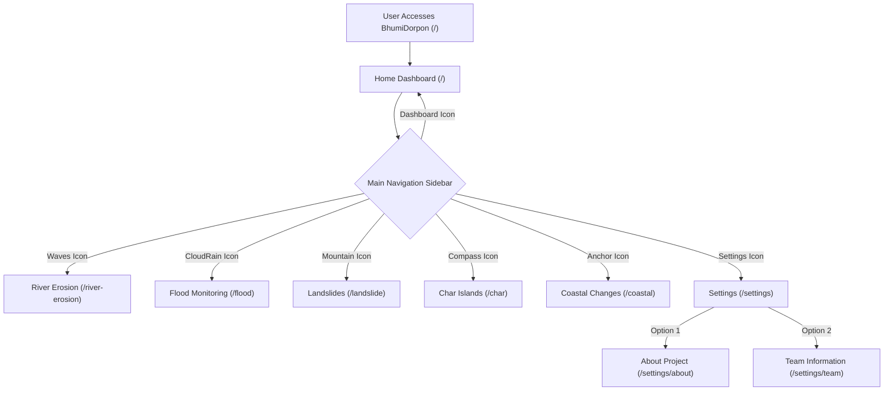
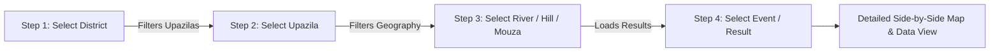
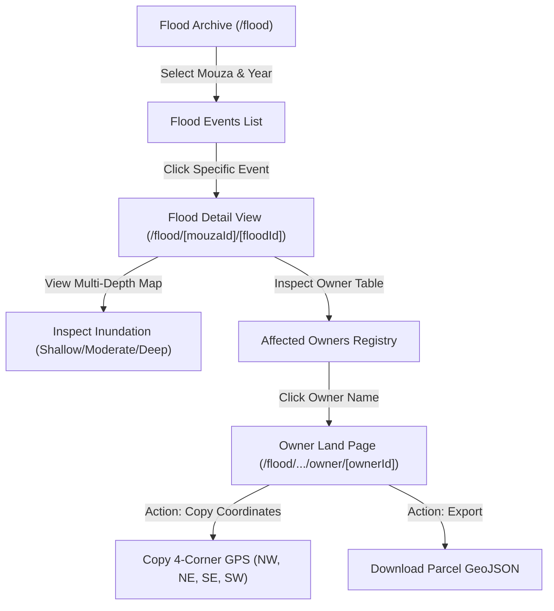
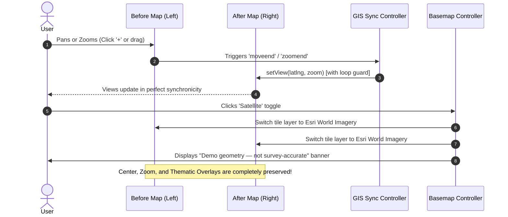
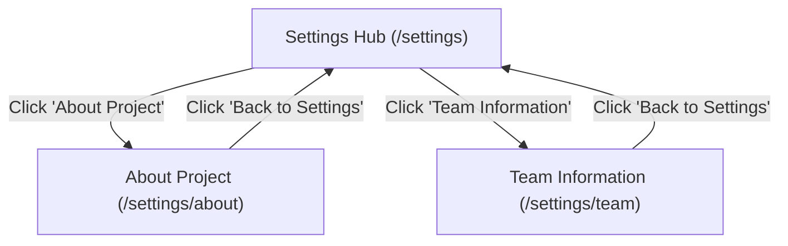

# Application Flow & User Flow — BhumiDorpon
**Bangladesh Cadastral Land-Change Records & Hazard Dashboard**

---

> **Document Status:** Authoritative Navigation & Interaction Specification  
> **System Version:** 1.1 (Demonstration Release)  
> **Team:** GeoNeural  
> **Last Updated:** October 2026  
> **Cross-References:** [Main Documentation](file:///d:/SOFTWARE/Project/Antigravity/BhumiDorpon/docs/MAIN-PROJECT-DOCUMENTATION.md) | [PRD](file:///d:/SOFTWARE/Project/Antigravity/BhumiDorpon/docs/prd.md) | [TRD](file:///d:/SOFTWARE/Project/Antigravity/BhumiDorpon/docs/trd.md) | [UI/UX Design System](file:///d:/SOFTWARE/Project/Antigravity/BhumiDorpon/docs/ui-ux-design-system.md)

---

## 1. Application Entry Point

When a user accesses BhumiDorpon, the application boots at the **Root URL (`/`)**. The initial entry point initializes client-side providers:
- **`QueryProvider`**: Instantiates TanStack React Query client with 5-minute stale-time caching.
- **`appStore`**: Loads default user preferences (Area Unit: `Decimal`, Basemap: `Light GIS`, Mode: `Recorded`).
- **`AppHeader` & `AppSidebar`**: Renders the persistent navigation shell.
- **`DemoBanner`**: Injects the sticky top disclaimer: *"Demo data: all names, plots and figures are fictional."*

---

## 2. Main Navigation Structure

Navigation is managed via the **fixed 72px left-hand icon sidebar (`AppSidebar.tsx`)** which expands on desktop hover and remains accessible via keyboard navigation.



---

## 3. National Summary Dashboard Flow (`/`)

The Home Dashboard aggregates high-level metrics across all five hazard modules:
1. **Mode Selection:** The user toggles between `Recorded` and `Forecast` tabs in the upper right.
   - *Recorded:* Displays verified historical losses, gained land, affected owners, and disbursed compensation sums.
   - *Forecast:* Updates KPI cards to show projected vulnerability; strictly removes `Paid`, `Approved`, and `Pending` compensation numbers.
2. **Unit Conversion:** Changing the unit toggle in the header (`Decimal` | `Acre` | `Hectare`) immediately converts all numerical metrics across the dashboard.
3. **Visual Exploration:**
   - User hovers over the **Multi-Year Trend Chart** to inspect annual land loss versus accretion gains.
   - User examines the **Hazard Breakdown Chart** to view comparative impacts across the five categories.
   - User reviews the **Top Impacted Districts** ranking list.
4. **Module Transition:** Clicking any of the five hazard preview cards routes directly to that specific hazard module.

---

## 4. Cascading Selector Flow (Shared Geographic Navigation)

All hazard modules employ a standardized, dependent **Cascading Selector Chain**:



### Selector Rules & Behavior:
- **Sequential Activation:** Dropdown $N+1$ remains disabled until Dropdown $N$ has a valid selection.
- **Parent Reset:** Changing an upstream dropdown (e.g., selecting a new District) instantly resets all downstream selections.
- **Active Record Badges:** Dropdown options with existing hazard records display a visual indicator badge (`hasRecords = true`).
- **URL Synchronization:** Selections update the URL query parameters (e.g., `?d=sirajganj&u=kazipur&r=jamuna`), ensuring that page reloads or shared links preserve the exact view.

---

## 5. Hazard Module Access Flows

### 5.1 River Erosion Flow (`/river-erosion`)
1. User enters `/river-erosion` and selects `Recorded` or `Forecast` mode.
2. Selector path: **District (`Sirajganj`) &rarr; Upazila (`Kazipur`) &rarr; River (`Jamuna`) &rarr; Riverside Mouzas**.
3. User selects a mouza (e.g., `Mouza Khanshama`).
4. System loads `/river-erosion/[mode]/[mouzaId]`:
   - Left Map: Surveyed baseline bankline.
   - Right Map: Current eroded bankline (or 1-year projected retreat line with uncertainty band).
   - Below Maps: Mouza-wise summary panel, Water Status card, and Affected Owner Compensation Table.

### 5.2 Flood Monitoring Flow (`/flood`)
1. User enters `/flood`.
2. Selector path: **District (`Sylhet`) &rarr; Upazila (`Gowainghat`) &rarr; Mouza (`Jaflong`) &rarr; Optional Year Filter (`2022–2025`)**.
3. System renders the **Flood Archive List** displaying historical events with severity, inundated area, and maximum depth.
4. User clicks an event to open `/flood/[mouzaId]/[floodId]`:
   - Map renders multi-depth flood contours (Shallow `<0.5m`, Moderate `0.5–1.5m`, Deep `>1.5m`) and submerged plots.
   - Table displays affected landowners with Dag No. and Khatian No.
5. **Drill-down to Owner Page:** Clicking an owner name opens `/flood/[mouzaId]/[floodId]/owner/[ownerId]`:
   - Map isolates the owner's specific parcels.
   - Table details **Corner 1 NW, 2 NE, 3 SE, 4 SW coordinates to 6 decimal places**.
   - User clicks **"Copy 4 Corners"**, **"Copy All Coordinates"**, or **"Download GeoJSON"**.



### 5.3 Landslides Flow (`/landslide`)
1. Selector path: **District (`Rangamati`) &rarr; Upazila (`Kawkhali`) &rarr; Hill Corridor (`Ghagra`) &rarr; Recorded / Forecast Event**.
2. Detailed view renders:
   - Left Map: Baseline hill topography and slope profile.
   - Right Map: Post-slide failure scarp (red outline) and debris runout accumulation zone (orange hatch).
   - Below Maps: Slope angle ($41.5^\circ$), displaced soil volume ($45,200\text{ m}^3$), trigger rainfall, and Terrain Context card.

### 5.4 Char Islands Flow (`/char`)
1. Selector path: **District (`Sirajganj`) &rarr; Upazila (`Kazipur`) &rarr; River (`Jamuna`) &rarr; Char Island (`Char Girish`)**.
2. Detailed view renders:
   - Synchronized Before/After sandbar boundaries.
   - Downstream accretion tips highlighted in green; flanking erosion in coral.
   - Below Maps: Net area change metric (+14.2%) and dedicated **Unowned Land (State Khas Alluvial Accretion)** card.

### 5.5 Coastal Shoreline Flow (`/coastal`)
1. Selector path: **District (`Bhola`) &rarr; Upazila (`Monpura` or `Char Fasson`) &rarr; Coastal Mouza**.
2. Detailed view renders:
   - Marine shoreline migration and tidal mudflats.
   - Dedicated **Unassigned Mudflats Card** displaying virtual cadastral blocks seaward of established mouzas.

---

## 6. Map Interaction & Comparison Flow



---

## 7. Direct Zoom & Basemap Switching Flow

### 7.1 Direct Zoom Operation
- User clicks the visible **Zoom In (`+`)** or **Zoom Out (`−`)** button on either map chrome.
- The handler directly calls Leaflet's `map.zoomIn()` / `map.zoomOut()` on that single click.
- The paired comparison map immediately mirrors the new zoom level via the synchronization controller.

### 7.2 Basemap Switching Operation
- User clicks the **Basemap Selector** in the map chrome.
- Options: `Light GIS` (default), `Satellite`, or `Street`.
- Upon selection:
  1. Leaflet removes the active base tile layer.
  2. The new tile layer is mounted in `pane-basemap` ($z = 200$).
  3. All thematic hazard overlays, cadastral plot outlines, and labels remain untouched in higher panes ($z \ge 300$).
  4. If `Satellite` is selected, the persistent disclaimer *"Demo geometry — not survey-accurate"* is displayed.

---

## 8. Settings Navigation Flow (`/settings`)

The Settings option in the sidebar routes to the **Settings Hub (`/settings`)**, which presents exactly two verified choices:



- **About Project (`/settings/about`):** Presents verified information regarding platform scope, the five hazard modules, side-by-side comparison, basemaps, and demo data transparency.
- **Team Information (`/settings/team`):** Displays official development team metadata:
  - Team Name: **GeoNeural**
  - Team Leader: **Pantho Raj Biswas**
  - Team Member: **Puja Paul**
  - Copyright: **© 2026 GeoNeural. All rights reserved.**
- Both views feature breadcrumb navigation and a prominent **"Back to Settings"** button.

---

## 9. Empty, Loading, Error, and Unavailable-Data States

1. **Loading State:** When data queries execute, components display animated **Skeletons** matching the layout of cards, tables, and map headers. Simulated latency (200–400ms) prevents abrupt visual flashing.
2. **Empty State (`EmptyState.tsx`):** If a user selects an administrative combination with no recorded events (e.g., an unimpacted upazila), the UI renders an informative empty-state card with a specific explanation (e.g., *"No river erosion has occurred in this mouza."*) and an action button to reset filters.
3. **External Tile Error Fallback:** If Esri satellite tiles fail to load due to network disconnection or firewall restrictions, the map gracefully falls back to the local `Light GIS` basemap and displays a non-blocking toast alert.
4. **Unavailable Data State:** Forecast views suppress financial disbursement fields (`Paid`, `Approved`, `Pending`), replacing them with explicit *"Not Applicable in Forecast Mode"* notices.

---

## 10. Responsive / Mobile Navigation Flow

- **Mobile Shell ($< 768\text{px}$):**
  - The left sidebar transforms into a collapsible bottom/top navigation bar.
  - The header compresses title and subtitle, keeping the unit toggle accessible.
- **Mobile Map Comparison:**
  - The desktop 50/50 side-by-side grid shifts to a **vertical stack**:
    1. **Before Map** renders at full width with its own zoom and basemap controls.
    2. **After Map** renders immediately below it, maintaining pan/zoom synchronization.
    3. Supporting context panels, summaries, and owner tables stack sequentially beneath both maps.
- **Table Adaptability:** Data tables enable horizontal scrolling with pinned left columns (Owner Name & Dag No.).

---

## 11. Important User Journeys

### Journey 1: Landowner Boundary Verification Post-Flood
```text
1. User enters website -> Clicks "Flood Monitoring" in sidebar.
2. In Cascading Selector: Chooses "Sylhet" -> "Gowainghat" -> "Jaflong".
3. Reviews 2024 Flood Event card (Severity: Severe, Max Depth: 2.1m) -> Clicks "View Inundation Map".
4. Observes multi-depth flood overlay (Shallow, Moderate, Deep).
5. Searches family name "Abdul Karim" in Affected Owners Table.
6. Clicks row to navigate to Karim's dedicated Owner Land Page.
7. Observes Karim's parcels highlighted in orange with numbered corner pins (1, 2, 3, 4).
8. Reviews Corner Coordinates table:
   - Corner 1 (NW): 25.158421 N, 92.014582 E
   - Corner 2 (NE): 25.158419 N, 92.015241 E
   - Corner 3 (SE): 25.157832 N, 92.015239 E
   - Corner 4 (SW): 25.157834 N, 92.014580 E
9. Clicks "Copy 4 Corners" to copy coordinates to mobile clipboard.
```

### Journey 2: Upazila Disaster Committee Relief Planning
```text
1. Officer opens BhumiDorpon -> Clicks "River Erosion" in sidebar.
2. Selects "Recorded" mode -> "Sirajganj" -> "Kazipur" -> "Jamuna River".
3. Reviews riverside mouzas list -> Selects "Mouza Khanshama".
4. Inspects side-by-side map: Left shows 2024 baseline, Right shows 2025 collapsed bankline.
5. Zooms into southern boundary; observes that 3 transects indicate 65m–82m of bank collapse.
6. Switches basemap to "Satellite" to verify real riverbed topography behind plot boundaries.
7. Notes persistent warning: "Demo geometry — not survey-accurate".
8. Reviews Mouza Summary Panel: 842.5 Decimals lost, 37 families displaced, ৳2.4 Crore (BDT) compensation.
9. Clicks "Export Table to CSV" to generate administrative spreadsheet for Deputy Commissioner.
```

---

## 12. Current Usability Gaps & Proposed Improvements

| Current Usability Gap | Impact | Proposed Future Enhancement |
|---|---|---|
| **English-Only Interface** | Limits accessibility for grassroots rural citizens. | Implement full Bengali (Bangla) localization toggle across all pages. |
| **No GPS Location Detection** | Users must manually select District and Upazila. | Add a "Use My Current Location" button to auto-detect the user's upazila. |
| **No Direct Plot Search** | Users cannot search directly by Dag No. from the dashboard. | Implement a global command palette (`Cmd + K`) to search Dag/Khatian numbers nationally. |
| **Offline Map Caching** | Satellite imagery cannot be viewed without an active internet connection. | Add Service Worker Progressive Web App (PWA) tile caching for field operations. |
