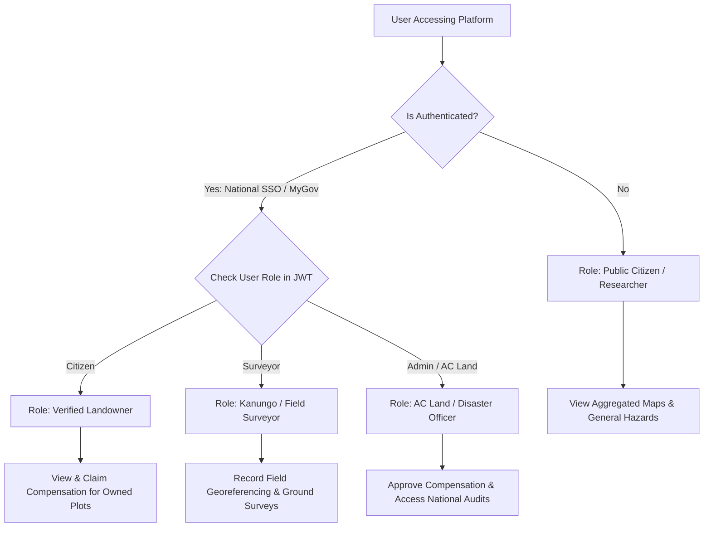

# Authentication & Authorization Specification — BhumiDorpon
**Bangladesh Cadastral Land-Change Records & Hazard Dashboard**

---

> **Document Status:** Authoritative Security & Access Control Specification  
> **Current Authentication Status:** **NOT IMPLEMENTED (Public Demonstration Application)**  
> **Current Access Model:** Unrestricted Public Access (Zero Authentication / Zero Authorization)  
> **Team:** GeoNeural  
> **Last Updated:** October 2026  
> **Cross-References:** [Security Specification](file:///d:/SOFTWARE/Project/Antigravity/BhumiDorpon/docs/security-specification.md) | [System Architecture](file:///d:/SOFTWARE/Project/Antigravity/BhumiDorpon/docs/system-architecture.md) | [Database & Backend Schema](file:///d:/SOFTWARE/Project/Antigravity/BhumiDorpon/docs/database-backend-schema.md)

---

## 1. Current Authentication Status

> [!IMPORTANT]
> **NO AUTHENTICATION OR AUTHORIZATION SYSTEM IS CURRENTLY IMPLEMENTED.**
> An exhaustive inspection of the BhumiDorpon repository confirms that the application does not implement user login, account registration, session tokens, passwords, multi-factor authentication, OAuth integrations, identity providers, or role-based access control (RBAC).

All routes, dashboard metrics, cascading selectors, side-by-side maps, landowner compensation tables, and 4-corner GPS coordinate readouts are **fully accessible to any user without authentication**.

---

## 2. Existing Login and Logout Flows

- **Current Status:** **None.**
- There are no `/login`, `/logout`, `/register`, or `/auth` routes in the application.
- The user interface does not feature login buttons, user profile avatars, or sign-in modals.

---

## 3. Identity Provider and User Registry

- **Identity Provider (IdP):** **None.** (No integration with NextAuth.js, Auth0, Firebase Auth, Clerk, Keycloak, or Supabase Auth).
- **User Database:** **None.** No database tables, JSON registries, or browser local storage records exist to store user accounts, emails, hashed passwords, or credentials.

---

## 4. User Roles and Permission Checks

- **Current Status:** **None.**
- There are no user role abstractions (`Admin`, `Surveyor`, `Officer`, `Citizen`) in the active codebase.
- No code guards, middleware checks, or conditional component permissions restrict access to any data or administrative view.

---

## 5. Session Management & Protected Routes

- **Session Tokens / Cookies:** **None.** No HTTP cookies, session tokens, JSON Web Tokens (JWT), or bearer headers are generated, stored, or validated.
- **Protected Routes:** **None.** Next.js middleware ([`middleware.ts`](file:///d:/SOFTWARE/Project/Antigravity/BhumiDorpon/middleware.ts)) does not exist in the repository. All URL routes under `/app` are public and render directly upon navigation.

---

## 6. Account and Credential Handling

Because no accounts exist:
- The system collects zero user credentials, passwords, or personal payment details.
- No cryptographic password hashing (bcrypt, argon2) or secret key handling is present in the repository.
- Landowner names (e.g., *Abdul Karim*, *Rahima Begum*) displayed in the demo tables are **fictional mock identities** embedded in static JSON files, not authenticated user profiles.

---

## 7. Current Architectural Rationale & Limitations

### 7.1 Rationale for Current Public Access
BhumiDorpon was deliberately developed as an open, accessible technology demonstration prototype for university evaluations, hackathon judging, and academic research. Enforcing login barriers would impede immediate evaluation of the five hazard modules, side-by-side map comparisons, and cadastral boundary tools.

### 7.2 Limitations of the Unauthenticated Model
1. **Zero Access Control:** Anyone with web access can view all mock compensation liabilities, landowner records, and parcel boundaries.
2. **Read-Only Operation:** Because identity cannot be verified, citizens cannot submit formal compensation applications, and surveyors cannot record official field verifications.
3. **No Audit Logging:** The system cannot attribute data queries or export actions to specific individuals or administrative staff.

---

## 8. Security Considerations for Current Prototype

1. **Synthetic Data Insulation:** Because all landowner names, Dag numbers, Khatian deeds, and compensation amounts are completely fictional mock data, public unauthenticated access does not expose real citizens' private personal data or land assets.
2. **Client-Side Sandbox:** The application runs client-side in the browser sandbox with zero elevated system permissions and zero database connections to breach.

---

## 9. Proposed Future Authentication & Authorization Model

> [!NOTE]
> **PROPOSED FUTURE DESIGN ONLY — NOT IMPLEMENTED IN CURRENT REPOSITORY.**
> When BhumiDorpon transitions to an operational government land administration and disaster management system, the following multi-tiered authentication and RBAC model is proposed.

### 9.1 Proposed Identity Architecture
- **Identity Protocol:** OpenID Connect (OIDC) & OAuth 2.0 with JWT access tokens.
- **National Single Sign-On (SSO):** Integration with the Bangladesh National Digital Identity Platform (*Porichoy* / *MyGov* SSO).
- **Session Transport:** HTTP-only, Secure, SameSite=Strict cookies.



### 9.2 Proposed Role-Based Access Control (RBAC) Matrix

| Proposed User Role | Intended Audience | Permitted Capabilities & Data Access |
|---|---|---|
| **Public Citizen / Guest** | General public, students, academic researchers | View national dashboard, explore hazard maps on Light GIS and Satellite basemaps, view anonymized mouza summaries. Cannot view private landowner NID numbers. |
| **Verified Landowner** | Citizens authenticated via National NID (Porichoy) | View private cadastral deeds, inspect owned parcel 4-corner GPS coordinates, download personal GeoJSON, submit compensation dispute claims. |
| **Field Surveyor / Kanungo** | Upazila land office surveyors | Record ground-truth survey points, flag boundary discrepancies, submit post-disaster field inspection sheets. |
| **Revenue Officer (AC Land / UNO)** | Assistant Commissioner of Land, Upazila Nirbahi Officer | Approve or adjust compensation liabilities, manage mouza land classification rates, export official government relief spreadsheets. |
| **System Administrator** | Ministry of Land IT administrators | Manage system configurations, audit logs, tile server endpoints, and administrative user provisioning. |

### 9.3 Proposed Route Protection Implementation (Next.js Middleware)
In future production, protected routes would be enforced via `middleware.ts`:

```typescript
// PROPOSED IMPLEMENTATION (Not active in current codebase)
import { NextResponse } from "next/server";
import type { NextRequest } from "next/server";

export function middleware(request: NextRequest) {
  const token = request.cookies.get("bhumidorpon_session")?.value;
  const { pathname } = request.nextUrl;

  // Protect administrative and surveyor endpoints
  if (pathname.startsWith("/admin") || pathname.startsWith("/surveys")) {
    if (!token) {
      return NextResponse.redirect(new URL("/auth/login", request.url));
    }
  }
  return NextResponse.next();
}
```
