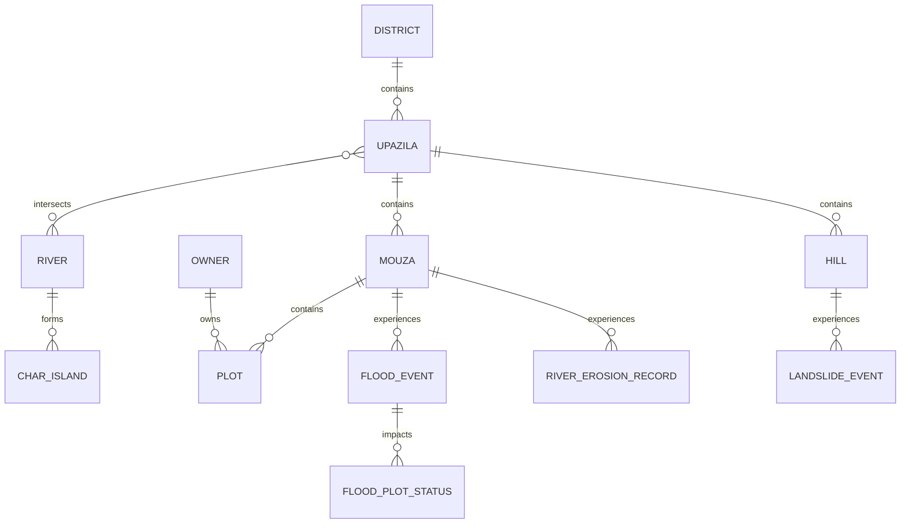

# Database & Backend Schema Specification — BhumiDorpon
**Bangladesh Cadastral Land-Change Records & Hazard Dashboard**

---

> **Document Status:** Authoritative Data Layer Specification  
> **Current Database Status:** **NOT IMPLEMENTED (Frontend-Only Prototype)**  
> **Current Data Store:** Static Relational JSON Files (`/mocks/*.json`)  
> **Team:** GeoNeural  
> **Last Updated:** October 2026  
> **Cross-References:** [Main Documentation](file:///d:/SOFTWARE/Project/Antigravity/BhumiDorpon/docs/main-project-documentation.md) | [TRD](file:///d:/SOFTWARE/Project/Antigravity/BhumiDorpon/docs/trd.md) | [System Architecture](file:///d:/SOFTWARE/Project/Antigravity/BhumiDorpon/docs/system-architecture.md) | [API Documentation](file:///d:/SOFTWARE/Project/Antigravity/BhumiDorpon/docs/api-documentation.md)

---

## 1. Current Data Architecture

> [!IMPORTANT]
> **NO DATABASE SERVER IS CURRENTLY RUNNING OR CONNECTED.**
> BhumiDorpon does not use PostgreSQL, MySQL, MongoDB, SQLite, Redis, or any other live database daemon. No backend API server or persistence layer exists in the repository. All data operations run entirely within the user's web browser using client-side memory and static JSON files located in the `/mocks` directory.

The current architecture is a **Typed In-Memory Relational Mock Data Store**:
- Static JSON files are loaded asynchronously through TypeScript import statements in [`lib/data.ts`](file:///d:/SOFTWARE/Project/Antigravity/BhumiDorpon/lib/data.ts).
- Relational queries (filtering, joining, aggregating) are executed in JavaScript runtime memory using array methods (`filter`, `find`, `reduce`, `map`).
- Geospatial queries (bounding boxes, point-in-polygon checks, area calculations) are computed client-side using Turf.js (`@turf/turf`).

---

## 2. Actual Data Storage Method

Data is persisted on disk as static JSON files in the `/mocks` directory. These files are deterministically generated by [`scripts/generate-mocks.ts`](file:///d:/SOFTWARE/Project/Antigravity/BhumiDorpon/scripts/generate-mocks.ts) using seeded pseudo-random algorithms.

### Verified Files in `/mocks`:
- [`districts.json`](file:///d:/SOFTWARE/Project/Antigravity/BhumiDorpon/mocks/districts.json) (2.5 KB): Administrative districts.
- [`upazilas.json`](file:///d:/SOFTWARE/Project/Antigravity/BhumiDorpon/mocks/upazilas.json) (8.8 KB): Upazilas with center coordinates and hazard associations.
- [`mouzas.json`](file:///d:/SOFTWARE/Project/Antigravity/BhumiDorpon/mocks/mouzas.json) (62.0 KB): Cadastral mouzas with JL numbers and centroids.
- [`rivers.json`](file:///d:/SOFTWARE/Project/Antigravity/BhumiDorpon/mocks/rivers.json) (2.7 KB): Major river systems and upazila cross-references.
- [`hills.json`](file:///d:/SOFTWARE/Project/Antigravity/BhumiDorpon/mocks/hills.json) (2.3 KB): Hill corridors with slope angles and soil types.
- [`chars.json`](file:///d:/SOFTWARE/Project/Antigravity/BhumiDorpon/mocks/chars.json) (5.6 KB): Char islands with stability indices and emergence years.
- [`plots.json`](file:///d:/SOFTWARE/Project/Antigravity/BhumiDorpon/mocks/plots.json) (3.26 MB): Cadastral plot polygons with 4-corner coordinates.
- [`owners.json`](file:///d:/SOFTWARE/Project/Antigravity/BhumiDorpon/mocks/owners.json) (5.6 KB): Landowner profiles and deeds.
- [`river_erosion.json`](file:///d:/SOFTWARE/Project/Antigravity/BhumiDorpon/mocks/river_erosion.json) (1.67 MB): Riverbank migration polygons, transects, and affected plots.
- [`flood.json`](file:///d:/SOFTWARE/Project/Antigravity/BhumiDorpon/mocks/flood.json) (3.85 MB): Multi-depth flood events, inundation zones, and plot submersion statuses.
- [`landslide.json`](file:///d:/SOFTWARE/Project/Antigravity/BhumiDorpon/mocks/landslide.json) (625 KB): Landslide failure scarps, debris runouts, and contours.
- [`char.json`](file:///d:/SOFTWARE/Project/Antigravity/BhumiDorpon/mocks/char.json) (460 KB): Accretion tips, erosion flanks, and state khas lands.
- [`coastal.json`](file:///d:/SOFTWARE/Project/Antigravity/BhumiDorpon/mocks/coastal.json) (779 KB): Shoreline retreat vectors and unassigned mudflats.
- [`summary.json`](file:///d:/SOFTWARE/Project/Antigravity/BhumiDorpon/mocks/summary.json) (6.2 KB): Pre-computed dashboard KPI metrics.

---

## 3. Existing Data Entities and Entity Relationships

The static datasets in `/mocks` maintain strict relational foreign-key references:



---

## 4. Actual TypeScript Schema Definitions

Defined in [`lib/types.ts`](file:///d:/SOFTWARE/Project/Antigravity/BhumiDorpon/lib/types.ts), these interfaces govern all data structures:

### 4.1 Geographic Entities
```typescript
export interface District {
  id: string;               // e.g. "dist_sirajganj"
  name: string;             // e.g. "Sirajganj"
  division: string;         // e.g. "Rajshahi"
  isCoastal: boolean;
  isHilly: boolean;
  hasChars: boolean;
  primaryHazards: HazardType[];
}

export interface Upazila {
  id: string;               // e.g. "upz_kazipur"
  districtId: string;       // Foreign key -> District.id
  name: string;             // e.g. "Kazipur"
  rivers: string[];         // Foreign keys -> River.id
  hasChars: boolean;
  hasHills: boolean;
  centerCoordinates?: [number, number]; // [lon, lat]
}

export interface Mouza {
  id: string;               // e.g. "m_kazipur_01"
  name: string;             // e.g. "Khanshama"
  jlNo: string;             // e.g. "42" (Jurisdiction List Number)
  upazilaId: string;       // Foreign key -> Upazila.id
  districtId: string;       // Foreign key -> District.id
  riverId?: string;
  hillId?: string;
  kind: "registered" | "unassigned";
  isVirtual: boolean;       // True for unassigned offshore mudflats
  totalPlots: number;
  centroid?: [number, number];
  boundary?: [number, number][];
}
```

### 4.2 Cadastral Plot & Four-Corner Coordinate Entity
```typescript
export type CornerLabel = "NW" | "NE" | "SE" | "SW";

export interface Corner {
  label: CornerLabel;
  lat: number;              // WGS84 Latitude rounded to 6 decimal places
  lon: number;              // WGS84 Longitude rounded to 6 decimal places
}

export interface Plot {
  id: string;               // e.g. "plot_101"
  mouzaId: string;          // Foreign key -> Mouza.id
  dagNo: string;            // Mandatory cadastral Dag number (e.g. "101")
  khatianNo: string;        // Mandatory cadastral Khatian deed (e.g. "56")
  landClass: LandClass;     // "agri" | "homestead" | "pond" | "commercial" | "khas" | "char_accretion"
  areaDecimal: number;      // Area in Bangladeshi Decimals (1 dec = 40.4686 m²)
  ownerId: string;          // Foreign key -> Owner.id
  polygon: [number, number][][]; // GeoJSON polygon coordinates
  corners: [Corner, Corner, Corner, Corner]; // Exactly 4 distinct corners (NW, NE, SE, SW)
}
```

### 4.3 Flood Event & Parcel Status Entity
```typescript
export interface FloodPlotStatus {
  plotId: string;
  dagNo: string;
  khatianNo: string;
  ownerId: string;
  ownerName: string;
  landClass: LandClass;
  totalAreaDecimal: number;
  floodedAreaDecimal: number;
  depthClass: "shallow" | "moderate" | "deep" | "none";
  status: string;
  corners: [Corner, Corner, Corner, Corner];
  estCompensationBdt: number;
  paidBdt?: number;
  colorIndex?: number;
}

export interface FloodEvent {
  id: string;
  mouzaId: string;
  date: string;             // ISO date string (e.g. "2024-07-15")
  year: number;
  severity: "Moderate" | "Severe" | "Extreme" | "Catastrophic";
  floodedAreaDecimal: number;
  maxDepthM: number;
  durationDays: number;
  affectedOwnersCount?: number;
  geometry: {
    mouzaBoundary: [number, number][][];
    channels: [number, number][][];
    beels: [number, number][][][];
    shallowZone: [number, number][][];
    moderateZone: [number, number][][];
    deepZone: [number, number][][];
  };
  plotStatus: FloodPlotStatus[];
}
```

---

## 5. Data Field Descriptions and Types

| Field Name | Type | Unit / Format | Description |
|---|---|---|---|
| `dagNo` | `string` | Alphanumeric (e.g. "101") | Cadastral plot number (Bengali: *Dag No.* / Plot Number) uniquely identifying the land parcel within its mouza. |
| `khatianNo` | `string` | Alphanumeric (e.g. "56") | Cadastral deed and record-of-rights identifier (Bengali: *Khatian No.* / Deed Number). |
| `areaDecimal` | `number` | Decimals | Parcel surface area in decimals (Bengali: *Shatangsha*; $1\text{ Decimal} = 40.4686\text{ m}^2 = 435.6\text{ sq ft}$). |
| `depthClass` | `enum` | `shallow` \| `moderate` \| `deep` | Inundation depth tier: Shallow ($<0.5\text{m}$), Moderate ($0.5-1.5\text{m}$), Deep ($>1.5\text{m}$). |
| `lat` / `lon` | `number` | WGS84 Decimal Degrees | Geographic latitude and longitude rounded strictly to 6 decimal places. |
| `estCompensationBdt`| `number` | Bangladeshi Taka (BDT / ৳) | Estimated financial compensation liability based on land classification rates. |
| `slopeAngleDeg` | `number` | Degrees ($^\circ$) | Average inclination of hillside terrain ($38^\circ - 44^\circ$). |
| `soilVolumeM3` | `number` | Cubic Meters ($\text{m}^3$) | Estimated volume of displaced landslide soil mass. |

---

## 6. Validation Rules Found in Implementation

1. **Four-Corner Invariant:** Every plot record must possess an array of exactly 4 `Corner` objects labeled `NW`, `NE`, `SE`, and `SW` in clockwise order.
2. **Mandatory Dag & Khatian:** All owner records must feature non-empty `dagNo` and `khatianNo` values.
3. **Forecast Disbursement Suppression:** In `mode === "forecast"`, `compensationStatus` and `paidAmountBDT` fields must be `undefined` or omitted.
4. **State Khas Exemption:** Plots with `isUnownedOrKhas === true` must have an estimated compensation liability of exactly `৳0`.

---

## 7. Data Lifecycle and Access Patterns

- **Initialization:** Data is loaded lazily per route via TanStack React Query.
- **Read-Only In-Memory Cache:** Datasets are cached in browser memory for 5 minutes (`staleTime: 5 * 60 * 1000`).
- **No Mutation:** The frontend never modifies the underlying JSON files or posts data back to a server. All filtering and sorting operations generate ephemeral derived arrays.

---

## 8. Data Source and Provenance

- **Cadastral Plots & Boundaries:** Fictional synthetic geometries generated by `/scripts/generate-mocks.ts`.
- **Landowner Names & Profiles:** Fictional Bangladeshi names (e.g., Abdul Karim, Rahima Begum) invented for demonstration purposes only.
- **Hazard Scenarios:** Modeled after historical events documented by CEGIS, BWDB, and FFWC.

---

## 9. Mock / Synthetic Data Limitations

1. **Not Field-Verified:** Coordinates and plot lines do not correspond to legally surveyed real-world parcel boundaries.
2. **Client Memory Constraints:** Relational filtering in JavaScript memory works well for demo regions (~5,000 records) but cannot scale to nationwide data (~50 million plots) without a database.
3. **No Dynamic Transactions:** Users cannot edit records, register land transactions, or submit relief applications.

---

## 10. Missing Backend Capabilities

The following enterprise capabilities do not exist in the current application:
- PostgreSQL 16 + PostGIS spatial database engine.
- Spatial indexing (`GIST` indexes on geometries).
- Server-side RESTful API routes (`/api/v1/...`).
- User authentication, JWT sessions, and role-based access control.
- Automated ETL pipelines for ingesting live satellite rasters.

---

## 11. Proposed Future Production Schema (PostgreSQL 16 + PostGIS)

> [!NOTE]
> **PROPOSED FUTURE DESIGN ONLY — NOT IMPLEMENTED IN CURRENT REPOSITORY.**
> The following schema outlines the planned relational architecture for a future production deployment.

```sql
-- Enable PostGIS and text search extensions
CREATE EXTENSION IF NOT EXISTS postgis;
CREATE EXTENSION IF NOT EXISTS pg_trgm;

-- Enumerations
CREATE TYPE hazard_type AS ENUM ('river_erosion','flood','landslide','char','coastal');
CREATE TYPE data_mode AS ENUM ('recorded','forecast');
CREATE TYPE land_class AS ENUM ('agri','homestead','pond','commercial','forest','khas','char_accretion');
CREATE TYPE compensation_status AS ENUM ('not_applicable','not_applied','pending','approved','paid');

-- Administrative Divisions
CREATE TABLE districts (
    id VARCHAR(32) PRIMARY KEY,
    name VARCHAR(64) NOT NULL,
    division VARCHAR(64) NOT NULL,
    is_coastal BOOLEAN DEFAULT FALSE,
    is_hilly BOOLEAN DEFAULT FALSE,
    geom GEOMETRY(MultiPolygon, 4326)
);

CREATE TABLE upazilas (
    id VARCHAR(32) PRIMARY KEY,
    district_id VARCHAR(32) REFERENCES districts(id),
    name VARCHAR(64) NOT NULL,
    center_coords GEOMETRY(Point, 4326),
    geom GEOMETRY(MultiPolygon, 4326)
);

CREATE TABLE mouzas (
    id VARCHAR(32) PRIMARY KEY,
    upazila_id VARCHAR(32) REFERENCES upazilas(id),
    name VARCHAR(64) NOT NULL,
    jl_no VARCHAR(16) NOT NULL,
    is_virtual BOOLEAN DEFAULT FALSE,
    geom GEOMETRY(MultiPolygon, 4326)
);

-- Cadastral Parcels
CREATE TABLE plots (
    id VARCHAR(32) PRIMARY KEY,
    mouza_id VARCHAR(32) REFERENCES mouzas(id),
    dag_no VARCHAR(16) NOT NULL,
    khatian_no VARCHAR(16) NOT NULL,
    owner_name VARCHAR(128) NOT NULL,
    land_class land_class NOT NULL,
    area_decimal NUMERIC(10, 2) NOT NULL,
    corner_nw GEOMETRY(Point, 4326) NOT NULL,
    corner_ne GEOMETRY(Point, 4326) NOT NULL,
    corner_se GEOMETRY(Point, 4326) NOT NULL,
    corner_sw GEOMETRY(Point, 4326) NOT NULL,
    geom GEOMETRY(Polygon, 4326) NOT NULL
);

-- Spatial Indexes
CREATE INDEX idx_districts_geom ON districts USING GIST (geom);
CREATE INDEX idx_upazilas_geom ON upazilas USING GIST (geom);
CREATE INDEX idx_mouzas_geom ON mouzas USING GIST (geom);
CREATE INDEX idx_plots_geom ON plots USING GIST (geom);
CREATE INDEX idx_plots_dag_no ON plots (dag_no);
```
