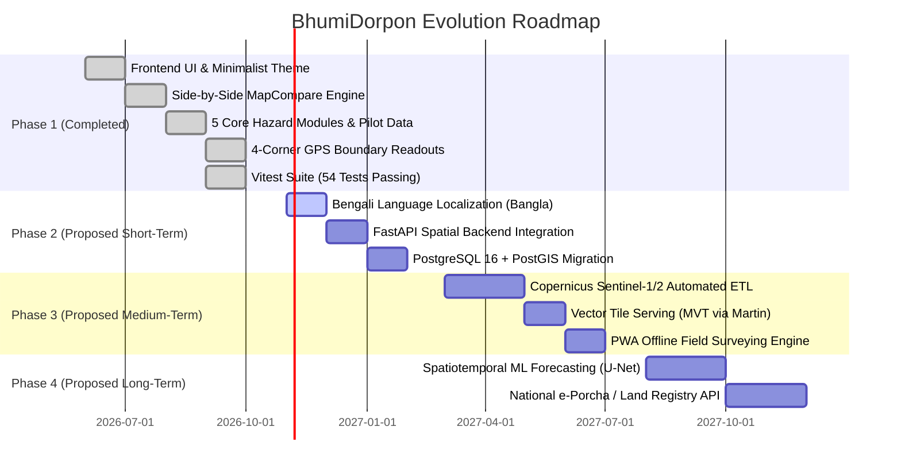

# Project Roadmap — BhumiDorpon
**Bangladesh Cadastral Land-Change Records & Hazard Dashboard**

---

> **Document Status:** Authoritative Development & Evolution Roadmap  
> **Current Project Status:** **Phase 1 Complete (Operational Demonstration Prototype)**  
> **Team:** GeoNeural  
> **Last Updated:** October 2026  
> **Cross-References:** [Main Documentation](file:///d:/SOFTWARE/Project/Antigravity/BhumiDorpon/docs/MAIN-PROJECT-DOCUMENTATION.md) | [PRD](file:///d:/SOFTWARE/Project/Antigravity/BhumiDorpon/docs/prd.md) | [TRD](file:///d:/SOFTWARE/Project/Antigravity/BhumiDorpon/docs/trd.md) | [System Architecture](file:///d:/SOFTWARE/Project/Antigravity/BhumiDorpon/docs/system-architecture.md)

---

## 1. Current Project Maturity Status

BhumiDorpon is currently in a mature **Demonstration Prototype (v1.1)** stage. The entire user-facing web application is fully interactive, responsive, and functional across modern desktop and mobile browsers. It operates with client-side execution backed by deterministic, seeded mock datasets located in `/mocks`.

---

## 2. Completed Work Verified in Current Codebase

The following features have been implemented and verified in the source code:

1. **National Summary Dashboard:** High-level KPI aggregations, multi-year trend charts, hazard breakdown bars, and top-impacted district rankings.
2. **Five Core Hazard Modules:**
   - **River Erosion:** Kazipur pilot with bankline migration, transect retreat metrics, and owner compensation table.
   - **Flood Monitoring:** Sylhet/Jaflong pilot with multi-depth contours (Shallow, Moderate, Deep) and parcel submersion.
   - **Landslides:** Rangamati pilot with synthetic DEM hillshades, contours, spot heights, slope angles, and debris runout buffers.
   - **Char Islands:** Jamuna Char Girish pilot with accretion tips (green), erosion flanks (coral), and state khas land cards.
   - **Coastal Changes:** Bhola pilot with marine shoreline retreat, embankments, and unassigned mudflats.
3. **Synchronized Side-by-Side Map Comparison:**
   - Panning and zooming either map instantly updates the paired map with loop guards.
   - Dual basemaps: Authoritative `Light GIS` vector cartography and genuine `Satellite` (Esri World Imagery).
   - Dedicated direct-click `+` / `−` zoom buttons.
4. **Cadastral Four-Corner GPS Boundary Readouts:**
   - Flood Owner Land Page (`/flood/.../owner/...`) displaying individual plots with **Corner 1 NW, 2 NE, 3 SE, 4 SW coordinates to 6 decimal places**.
   - One-click "Copy 4 Corners", "Copy All Coordinates", and "Download GeoJSON" actions.
5. **Settings Hub:** Dedicated views for About Project and Team Information (GeoNeural).
6. **Automated Quality Assurance:** 54 passing Vitest unit/integration tests and zero TypeScript compiler errors.

---

## 3. Current Gaps and Areas for Improvement

1. **No Live Database:** Data resides in static JSON files in `/mocks` rather than an enterprise spatial database.
2. **Synthetic Boundary Alignment:** Cadastral parcels are fictional polygons and do not align with physical terrain on satellite imagery.
3. **Single Language Interface:** The application is English-only.
4. **No Server Authentication:** Zero user accounts or role-based access control.
5. **No Native Offline Support:** Satellite imagery requires active internet access; no service-worker tile caching exists.

---

## 4. Phase-Based Evolution Roadmap

### Phase 1: Current-State Stabilization and Documentation (Completed)
- **Status:** **COMPLETED**
- **Objectives:** Build full interactive frontend, implement 5 hazard modules, enforce side-by-side synchronized maps, integrate 4-corner GPS coordinates, establish 54 passing unit tests, and compile comprehensive project documentation in `docs/`.

---

### Phase 2: Usability, Localization, and Backend Foundations (Proposed Short-Term)
- **Status:** **PROPOSED**
- **Priority:** High

#### Objectives:
1. **Full Bengali Language Localization (Bangla):**
   - Introduce an internationalization (i18n) framework (e.g., `next-intl`).
   - Provide full language toggle in the header between English and Bengali.
   - Support English and Bengali numerals (e.g., Bengali script "১২৩৪" alongside standard Arabic "1234") across all tables and charts.
2. **FastAPI & PostgreSQL/PostGIS Backend Integration:**
   - Build a production backend using FastAPI (Python 3.11) and PostgreSQL 16 + PostGIS.
   - Migrate mock datasets from `/mocks` into relational spatial tables.
   - Replace client-side simulated data functions in `lib/data.ts` with typed `fetch()` calls to backend endpoints.
3. **Spatial Search Command Palette:**
   - Implement a global search bar (`Cmd + K` / `Ctrl + K`) allowing instant lookup of any Dag No., Khatian deed, or Mouza name nationwide.

---

### Phase 3: Earth Observation Data Ingestion & Field Tooling (Proposed Medium-Term)
- **Status:** **PROPOSED**
- **Priority:** Medium

#### Objectives:
1. **Automated Remote Sensing Ingestion Pipeline:**
   - Integrate with Copernicus Open Access Hub to download weekly Sentinel-2 (optical) and Sentinel-1 (SAR) scenes.
   - Implement automated water extraction indices (MNDWI) to generate verified flood inundation and riverbank vectors.
2. **High-Performance Vector Tile Server:**
   - Deploy a tile server (e.g., Martin / Tegola) to serve millions of cadastral plots as Mapbox Vector Tiles (`.pbf`).
   - Eliminate heavy GeoJSON payloads, enabling smooth 60fps rendering on mobile devices.
3. **Progressive Web App (PWA) Offline Engine:**
   - Introduce service workers and IndexedDB storage to cache local mouza maps for offline field inspection by upazila surveyors.

---

### Phase 4: Operational Machine Learning & Government Integration (Proposed Long-Term)
- **Status:** **PROPOSED**
- **Priority:** Long-Term Opportunity

#### Objectives:
1. **Operational Spatiotemporal Deep Learning Forecasting:**
   - Train ConvLSTM and Spatiotemporal U-Net models on 30 years of historical Landsat and Sentinel river migration sequences.
   - Replace pre-computed forecast mocks with verified, probabilistic 1-year riverbank retreat hazard bands.
2. **Integration with National Land Management Systems:**
   - Establish secure, read-only API interfaces with the Ministry of Land’s e-Mutation and e-Porcha databases under formal government Memoranda of Understanding (MoU).
   - Implement National Single Sign-On (*Porichoy* / *MyGov* SSO) with strict Role-Based Access Control (RBAC).

---

## 5. Risk and Dependency Management

| Roadmap Risk | Severity | Dependency / Factor | Proposed Mitigation |
|---|---|---|---|
| **Delays in Official Cadastral Access** | Critical | Government data-sharing agreements with Ministry of Land. | Continue refining public demonstration prototype using synthetic data; publish open data models. |
| **Monsoon Cloud Cover on Optical Imagery** | High | Sentinel-2 optical occlusion during peak flood events. | Prioritize Sentinel-1 Synthetic Aperture Radar (SAR) data, which penetrates cloud cover and precipitation. |
| **High Server Infrastructure Costs** | Medium | Compute and tile rendering for nationwide high-resolution imagery. | Utilize Cloud-Optimized GeoTIFFs (COG) and client-side vector tile rendering to minimize server load. |

---

## 6. Milestones and Evaluation Criteria

| Milestone | Target Scope | Key Acceptance Criteria | Status |
|---|---|---|---|
| **M1: Interactive Demonstration** | Frontend UI, 5 modules, side-by-side maps, mock data layer, Google Earth integration. | All 5 hazards navigable; synchronized maps; 61 unit tests pass; Google Earth parcel KML export verified. | **Achieved** |
| **M2: Localization & Accessibility** | Bengali UI toggle; WCAG 2.1 AA screen-reader audit. | 100% UI strings localized in Bengali; keyboard navigation certified. | Proposed |
| **M3: Spatial Backend MVP** | FastAPI + PostGIS database; RESTful API endpoints. | Sub-500ms API response times for mouza and plot queries. | Proposed |
| **M4: Automated EO Pipeline** | Automated Sentinel-1/2 flood and erosion vector extraction. | Automated weekly water-mask updates during monsoon season. | Proposed |
| **M5: Pilot Field Trial** | Field testing with local Upazila Land Office surveyors. | Successful boundary reconstruction using 4-corner GPS readouts. | Proposed |

---

<!-- addendum:google-earth-and-hazard-store -->
## 7. Addendum — Google Earth & Spatial Export Roadmap (Future Evolution)

### 7.1 Evolution of Google Earth & 3D Visualization
While the current implementation achieves immediate zero-cost 3D visualization via client-side KML download and Google Earth web camera redirection, the project roadmap identifies three evolutionary phases:
1. **Whole-Owner Multi-Plot KMZ Archive:**
   - Package all cadastral parcels owned by a citizen across a mouza into a single compressed `.kmz` archive.
   - Include color-coded flood inundation depth layers (shallow, moderate, deep) and surveyed corner point Placemarks within a structured KML Folder hierarchy.
2. **Hosted KML Streaming (Dynamic NetworkLinks):**
   - Once a production backend is deployed, provide authenticated permalink endpoints (e.g., `https://api.bhumidorpon.gov.bd/kml/owners/{ownerId}.kml`).
   - Allow Google Earth Desktop and mobile clients to maintain live `<NetworkLink>` connections that automatically refresh when flood waterlines shift.
3. **In-App Photorealistic 3D Tiles (Google Maps Platform):**
   - Integrate Google Maps Platform Photorealistic 3D Tiles / WebGL Maps JavaScript API (or CesiumJS) directly within the BhumiDorpon comparison viewport.
   - Requires commercial Google Cloud API keys and enterprise billing; will eliminate the need to switch external browser tabs.

### 7.2 Evolution of the Five-Hazard Information Store
- **Current State:** Static, deterministic JSON files served via `/public/mocks/` and `mocks/`, ensuring rapid development, reproducibility, and zero backend maintenance.
- **Production Transition:** Migration to PostgreSQL 16 + PostGIS spatial tables with Martin dynamic vector tile serving (`.pbf`) for sub-second retrieval of millions of nationwide parcels.

