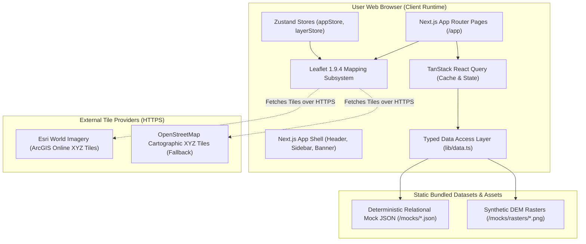
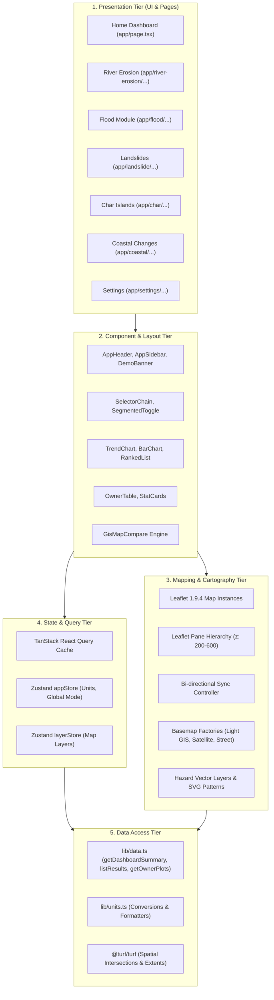
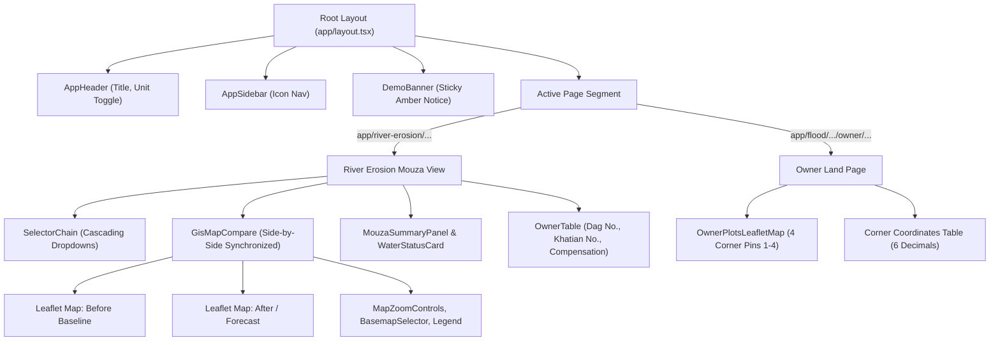
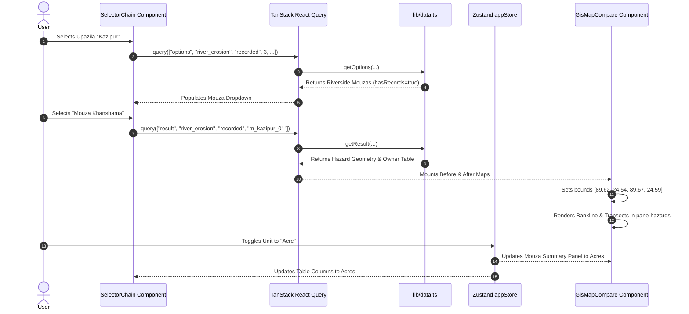

# System Architecture Documentation — BhumiDorpon
**Bangladesh Cadastral Land-Change Records & Hazard Dashboard**

---

> **Document Status:** Authoritative System Architecture Specification  
> **System Architecture Style:** Frontend-Only Client-Side Web Application (Single-Page Prototype)  
> **Target Framework:** Next.js 14.2.15 (App Router) & React 18.3.1  
> **Team:** GeoNeural  
> **Last Updated:** October 2026  
> **Cross-References:** [Main Documentation](file:///d:/SOFTWARE/Project/Antigravity/BhumiDorpon/docs/main-project-documentation.md) | [TRD](file:///d:/SOFTWARE/Project/Antigravity/BhumiDorpon/docs/trd.md) | [Database & Backend Schema](file:///d:/SOFTWARE/Project/Antigravity/BhumiDorpon/docs/database-backend-schema.md) | [API Documentation](file:///d:/SOFTWARE/Project/Antigravity/BhumiDorpon/docs/api-documentation.md)

---

## 1. Architecture Overview

**BhumiDorpon is currently implemented as a frontend-only, client-side web application.** There is no live backend web server, active database server, microservices cluster, or machine-learning inference daemon in the running application. 

All routing, business calculations, unit conversions, multi-depth flood contour filtering, and side-by-side map synchronizations occur directly within the user’s web browser. The application reads from static, relational mock JSON datasets located in the `/mocks` directory through an asynchronous, typed data access layer (`lib/data.ts`) with simulated network latency.

---

## 2. Architectural Style

The application follows a **Modular Jamstack / Client-Side Single-Page Architecture** with server-assisted static bundling:
- **Presentation Layer:** Next.js 14 App Router rendering React 18 client components (`"use client"`).
- **Decoupled Data Layer:** Centralized in `lib/data.ts`, providing a clean boundary between UI components and underlying data storage.
- **Asynchronous Service Simulation:** All data methods return Promises with artificial latency (200–400ms), simulating production HTTP REST APIs and enabling loading skeletons.
- **Declarative Mapping Model:** Imperative Leaflet map APIs are abstracted into reusable, declarative React wrappers (`GisMapCompare`, `FloodMap`, `RiverErosionMap`, `LandslideMap`).

---

## 3. Frontend Structure and Layering

---

## 4. Page and Component Relationships

---

## 5. Routing Layer

The Next.js 14 App Router uses file-system routing under `/app`. Dynamic route segments capture the analysis mode and geographic IDs:

- `[mode]`: Captures `recorded` (historical surveys) or `forecast` (1-year projections).
- `[mouzaId]`: Captures the unique mouza entity identifier (e.g., `m_kazipur_01`).
- `[floodId]`: Captures the specific flood event record (e.g., `flood_sylhet_2024`).
- `[ownerId]`: Captures the individual landowner identifier (e.g., `own_karim_104`).
- `[eventId]` / `[resultId]`: Captures landslide events or char/coastal result clusters.

Selection parameters (District, Upazila, River) are reflected in URL query parameters (`?d=&u=&r=`), ensuring that browser reloads and deep bookmarks preserve state.

---

## 6. Map-Rendering Layer

The cartographic engine in [`components/map/GisMapCompare.tsx`](file:///d:/SOFTWARE/Project/Antigravity/BhumiDorpon/components/map/GisMapCompare.tsx) coordinates two synchronized Leaflet map instances:

### 6.1 Leaflet Pane Hierarchy (Z-Index Isolation)
To prevent vector overlays from rendering beneath raster satellite tiles or labels from being obscured by plot fills, the system initializes custom Leaflet panes:
- `pane-basemap` ($z = 200$): External raster tiles (Esri / OSM) or synthetic Light GIS vector shapes.
- `pane-features` ($z = 300$): Roads, water bodies, and administrative mouza borders.
- `pane-hazards` ($z = 400$): Erosion strips, multi-depth flood contours, landslide scarps, and debris buffers.
- `pane-plots` ($z = 500$): Cadastral plot polygons and selection outlines.
- `pane-labels` ($z = 600$): Mouza name labels, J.L. numbers, corner numbers ($1 - 4$), and UI chrome.

### 6.2 Synchronized Viewport Engine
- **Event Listeners:** Maps subscribe to Leaflet `move` and `zoom` events.
- **Recursion Guard:** A boolean flag (`isSyncingRef.current`) prevents infinite event feedback loops between Map A and Map B.
- **Immediate Zoom:** Zoom buttons directly invoke `map.zoomIn()` and `map.zoomOut()` without intermediary tool-selection states.

---

## 7. Data Layer and Mock Architecture

### 7.1 Data Access Layer (`lib/data.ts`)
The data layer serves as the single source of truth for the frontend:
- **`getDashboardSummary(mode)`**: Asynchronously aggregates national KPI metrics.
- **`getOptions(hazard, mode, step, selectionSoFar)`**: Computes valid cascading options, annotating records with `hasRecords = true`.
- **`listResults(hazard, mode, selection)`**: Retrieves mouza-scale hazard results.
- **`getFlood(floodId)`**: Queries relational flood event geometry with multi-depth contours.
- **`getOwnerPlots(floodId, ownerId)`**: Filters cadastral parcels for a specific owner, calculating 4-corner GPS coordinates.

### 7.2 Spatial Operations (`@turf/turf`)
Client-side spatial calculations utilize Turf.js:
- `turf.bbox(geojson)`: Calculates the exact geographic bounding box to fit the map viewport.
- `turf.intersect(...)`: Evaluates spatial intersection between flood contours and plot polygons to determine submersion depth classes.

---

## 8. State and Event Flow

---

## 9. External Services Integration

The current system connects to external services **strictly for map basemap tile fetching over public HTTPS**:

| Service | Protocol / URL | Credentials | Purpose |
|---|---|---|---|
| **Esri World Imagery** | `HTTPS GET`   `https://server.arcgisonline.com/ArcGIS/rest/services/World_Imagery/MapServer/tile/{z}/{y}/{x}` | None (Public Tile Endpoint) | Provides genuine high-resolution aerial and satellite raster imagery for terrain inspection. |
| **OpenStreetMap** | `HTTPS GET`   `https://tile.openstreetmap.org/{z}/{x}/{y}.png` | None (Public Tile Endpoint) | Fallback street-map cartography. |

No user data, telemetry, private coordinates, or search queries are transmitted to external servers.

---

## 10. Backend Services (Current Status: Not Implemented)

**There is no backend server in the current repository.**
- No Express, FastAPI, Django, or NestJS server is running.
- No Node.js server routes exist under `app/api/` or `pages/api/`.
- All data is statically resolved in the browser runtime.

---

## 11. Deployment Architecture

The application is structured for static deployment or serverless container hosting:
- **Build Output:** Standard Next.js production build (`npm run build`).
- **Hosting Targets:** Vercel, Netlify, Cloudflare Pages, or Docker container (Node.js runtime).
- **Environment Configuration:** Runs out of the box with zero required environment variables.

---

## 12. Error Handling and Resilience

1. **Missing Data Fallback:** If a selector path yields no data, the system renders an informative `EmptyState` component rather than crashing.
2. **External Tile Outage:** If Esri tile servers are unreachable or blocked by firewalls, the map automatically retains the local synthetic `Light GIS` basemap.
3. **Synchronous Boundary Guards:** Leaflet map calls are wrapped in existence checks (`if (!mapRef.current) return;`) and cleaned up on unmount to prevent memory leaks and detached DOM exceptions.

---

## 13. Existing Architecture Limitations

1. **Client Memory Footprint:** Complex GeoJSON polygons (e.g., thousands of vertices in haor floodplains) consume client CPU and memory during rendering.
2. **Static Demonstrations:** The system cannot ingest real-time telemetry from hydrological sensor stations without backend server architecture.
3. **Synthetic Cadastral Alignment:** Because the demonstration geometry is synthetic, parcel boundaries do not align with real-world ground features on satellite imagery.

---

## 14. Key Technical Decisions and Rationale

| Decision | Alternative Considered | Rationale |
|---|---|---|
| **Leaflet 1.9.4** | MapLibre GL / Mapbox GL | Zero API key dependencies; lower memory footprint; superior custom SVG hatch pattern injection and DOM pane control. |
| **TanStack React Query** | Custom `useEffect` fetching | Standardized query caching, loading/error states, and seamless simulated latency integration. |
| **Zustand** | Redux Toolkit / Context API | Minimal boilerplate; instant reactivity without unnecessary parent re-renders. |
| **Client Mock Data** | Local SQLite / Prisma | Eliminates server dependencies; guarantees instant deployment across zero-backend environments. |

---

## 15. Potential Future Architecture Improvements (Proposed)

1. **Production Spatial Backend:** Introduce a **FastAPI** backend with **PostgreSQL 16 + PostGIS**, executing spatial joins (`ST_Intersection`) on the server.
2. **Vector Tiles (Mapbox Vector Tile format):** Pre-render cadastral plots into `.pbf` tiles using Tippecanoe to support hundreds of thousands of nationwide parcels.
3. **Dynamic Cloud-Optimized GeoTIFFs (COG):** Serve multitemporal satellite rasters through a TiTiler microservice.
4. **Service Worker PWA:** Cache cadastral sheets and map tiles locally for field surveying in remote rural areas without cellular coverage.
